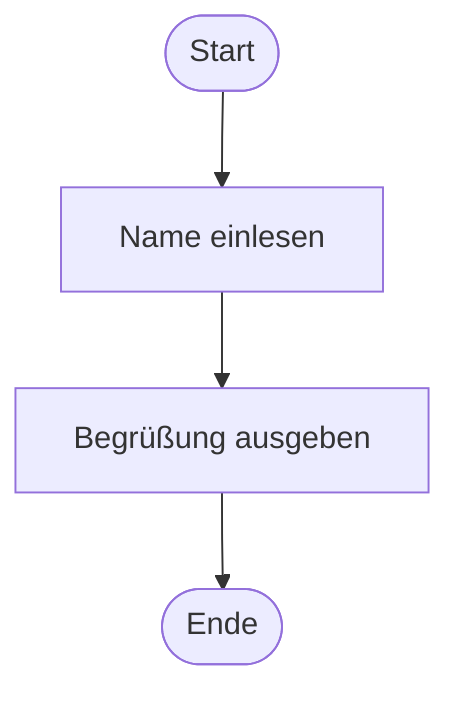
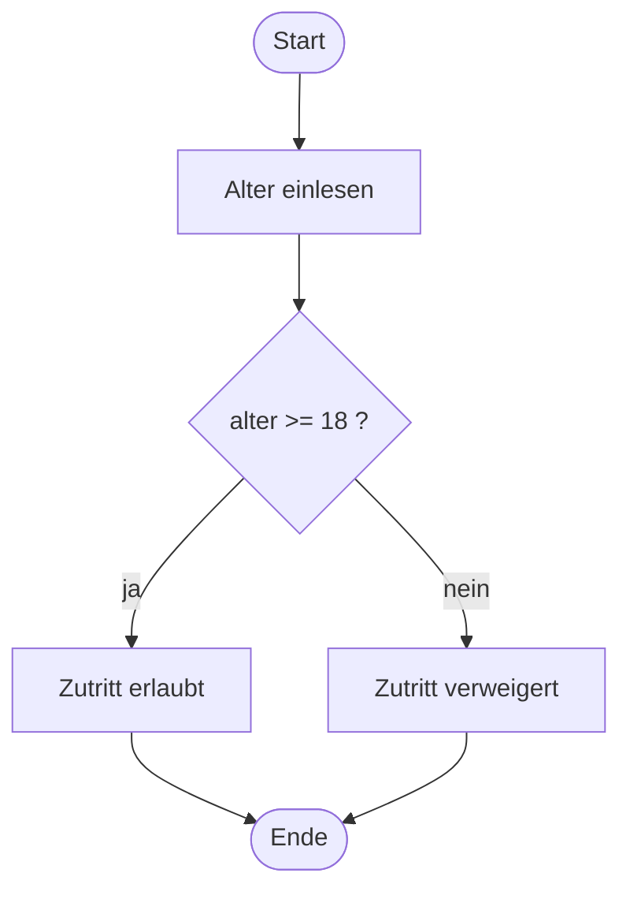

# Bedingungen

## Programme, die Entscheidungen treffen

---
hideInToc: true
---

# Inhalt

<Toc minDepth="1" maxDepth="1" columns="2" />

---

# Warum Bedingungen?

Bisher liefen unsere Programme immer **von oben nach unten**, jede Zeile genau einmal. Das nennt man **Sequenz**.

<div class="grid grid-cols-2 gap-10 mt-6">
<div>

Im echten Leben entscheiden wir ständig:

<v-clicks>

- **Wenn** es regnet, **dann** nehme ich einen Schirm.
- **Wenn** ich volljährig bin, **dann** darf ich wählen, **sonst** nicht.
- **Wenn** das Passwort stimmt, **dann** Login, **sonst** Fehlermeldung.

</v-clicks>

</div>
<div v-click>

Ein Programm braucht dafür eine **Verzweigung**:

- Es wird eine **Frage** gestellt (die *Bedingung*)
- Die Antwort ist immer **ja** oder **nein**
- Je nach Antwort läuft ein **anderer Teil** des Codes

</div>
</div>

<Merke v-click>

Bedingungen machen aus einem starren Ablauf ein Programm, das auf **Eingaben und Situationen reagiert**.

</Merke>

---

# Sequenz und Verzweigung im Flussdiagramm

<div class="grid grid-cols-2 gap-8 mt-2">
<div>

**Sequenz**: Alles läuft nacheinander



</div>
<div>

**Verzweigung**: Eine Bedingung entscheidet



</div>
</div>

<div class="text-sm opacity-80 mt-2">

**Symbole:** Oval = Start/Ende · Rechteck = Anweisung · **Raute = Bedingung** (genau zwei Ausgänge: ja / nein)

</div>

---

# Bedingungen sind `bool`-Ausdrücke

Eine Bedingung ist ein Ausdruck, der **`true` oder `false`** ergibt. Dafür kennen wir schon die **Vergleichsoperatoren**:

<div class="grid grid-cols-2 gap-10 mt-4">
<div>

| Operator | Bedeutung |
| :------: | ------------------- |
| `==` | gleich |
| `!=` | ungleich |
| `<` `>` | kleiner / größer |
| `<=` `>=` | kleiner gleich / größer gleich |

</div>
<div>

**Was kommt heraus?** `int alter = 16;`

<v-clicks>

- `alter >= 18` → `false`
- `alter == 16` → `true`
- `alter != 16` → `false`
- `alter < 20` → `true`

</v-clicks>

</div>
</div>

<Achtung v-click>

`=` ist eine **Zuweisung** („speichere“), `==` ist ein **Vergleich** („ist gleich?“). In einer Bedingung brauchen wir fast immer `==`.

</Achtung>

---

# Die `if`-Anweisung

Mit `if` wird ein Codeblock **nur dann** ausgeführt, wenn die Bedingung `true` ist.

<div class="grid grid-cols-2 gap-10 mt-4">
<div>

**Aufbau**

```csharp
if (Bedingung)
{
    // läuft nur, wenn die Bedingung true ist
}
// hier geht es immer weiter
```

</div>
<div>

**Beispiel**

```csharp
int alter = 21;

if (alter >= 18)
{
    Console.WriteLine("Zutritt erlaubt");
}
Console.WriteLine("Programmende");
```

</div>
</div>

<v-clicks>

- Die Bedingung steht immer in **runden Klammern** `( )`
- Der Block, der bedingt laufen soll, steht in **geschwungenen Klammern** `{ }`
- Ist die Bedingung `false`, wird der ganze Block **übersprungen**

</v-clicks>

---
title: Ablauf einer if-Anweisung
layout: none
clicks: 5
---

<FlussAblauf szenario="if" :schritt="$clicks" />

---

# `if-else`: entweder oder

Oft soll auch im **Nein-Fall** etwas passieren. Dafür gibt es `else` (*sonst*).

<div class="grid grid-cols-2 gap-10 mt-4">
<div>

```csharp
int alter = 15;

if (alter >= 18)
{
    Console.WriteLine("Zutritt erlaubt");
}
else
{
    Console.WriteLine("Zutritt verweigert");
}
Console.WriteLine("Programmende");
```

</div>
<div>

<v-clicks>

- `else` hat **keine eigene Bedingung**, es fängt einfach alle anderen Fälle auf
- Es läuft **immer genau einer** der beiden Blöcke
- `else` gehört immer zum `if` direkt davor

</v-clicks>

<Merke v-click>

**Wenn** … **dann** … **sonst** …<br>
`if` … `{ }` … `else` … `{ }`

</Merke>

</div>
</div>

---
title: Ablauf von if-else
layout: none
clicks: 5
---

<FlussAblauf szenario="ifelse" :schritt="$clicks" />

---

# Typische Fehler

<div class="grid grid-cols-2 gap-8">
<div>

<Achtung title="⚠️ Strichpunkt nach der Bedingung">

```csharp
if (alter >= 18);
{
    Console.WriteLine("Zutritt erlaubt");
}
```

Der `;` beendet das `if` sofort. Der Block darunter läuft **immer**!

</Achtung>

<Achtung title="⚠️ Zuweisung statt Vergleich">

```csharp
if (note = 1) // Fehler!
if (note == 1) // richtig
```

</Achtung>

</div>
<div>

<Achtung title="⚠️ Fehlende geschwungene Klammern">

```csharp
if (alter >= 18)
    Console.WriteLine("Zutritt erlaubt");
    Console.WriteLine("Viel Spaß!");
```

Ohne `{ }` gehört nur die **erste** Zeile zum `if`. „Viel Spaß!“ wird **immer** ausgegeben, auch wenn es eingerückt ist.

</Achtung>

<Merke>

Schreibt die `{ }` **immer**, auch wenn nur eine Zeile drinnen steht.

</Merke>

</div>
</div>

---

# Mehrere Fälle: `else if`

Was, wenn es **mehr als zwei** Möglichkeiten gibt? Zum Beispiel eine Note aus Punkten:

<div class="grid grid-cols-2 gap-10 mt-2">
<div>

```csharp
int punkte = 80;

if (punkte >= 90)
{
    Console.WriteLine("Sehr gut");
}
else if (punkte >= 75)
{
    Console.WriteLine("Gut");
}
else if (punkte >= 50)
{
    Console.WriteLine("Genügend");
}
else
{
    Console.WriteLine("Nicht genügend");
}
```

</div>
<div>

<v-clicks>

- Die Bedingungen werden **von oben nach unten** geprüft
- Die **erste**, die `true` ist, gewinnt
- Danach werden **alle weiteren übersprungen**, auch wenn sie ebenfalls `true` wären
- Das abschließende `else` ist **optional** und fängt den Rest auf

</v-clicks>

<div v-click class="mt-6">

**Frage:** Bei 80 Punkten ist auch `punkte >= 50` wahr. Warum wird trotzdem nur „Gut“ ausgegeben?

</div>

</div>
</div>

---
title: Ablauf von else if
layout: none
clicks: 6
---

<FlussAblauf szenario="elseif" :schritt="$clicks" />

---

# Die Reihenfolge ist entscheidend

Was passiert hier bei **95 Punkten**?

<div class="grid grid-cols-2 gap-10 mt-4">
<div>

```csharp
if (punkte >= 50)
{
    Console.WriteLine("Genügend");
}
else if (punkte >= 75)
{
    Console.WriteLine("Gut");
}
else if (punkte >= 90)
{
    Console.WriteLine("Sehr gut");
}
```

</div>
<div>

<v-clicks>

- `95 >= 50` ist `true` → Ausgabe **„Genügend“** 😱
- Die anderen Bedingungen werden **nie** erreicht
- „Gut“ und „Sehr gut“ kann dieses Programm gar nicht ausgeben

</v-clicks>

<Merke v-click>

Bei Bereichen immer vom **strengsten** Fall zum **lockersten** prüfen, also von oben (`>= 90`) nach unten.

</Merke>

</div>
</div>

---

# Bedingungen verknüpfen

Mit den **logischen Operatoren** können mehrere Bedingungen kombiniert werden:

| Operator | Bedeutung | `true`, wenn … |
| :------: | --------- | -------------- |
| `&&` | UND | **beide** Bedingungen `true` sind |
| `\|\|` | ODER | **mindestens eine** Bedingung `true` ist |
| `!` | NICHT | die Bedingung `false` ist |

<div class="grid grid-cols-2 gap-8 mt-4">
<div>

```csharp
// Jugendliche: 14 bis 17 Jahre
if (alter >= 14 && alter < 18)
{
    Console.WriteLine("Jugendticket");
}
```

</div>
<div>

```csharp
// Wochenende
if (tag == "Samstag" || tag == "Sonntag")
{
    Console.WriteLine("Ausschlafen!");
}
```

</div>
</div>

<Achtung v-click>

`if (14 <= alter < 18)` wie in Mathe funktioniert in C# **nicht**. Jede Seite braucht einen eigenen Vergleich, verbunden mit `&&`.

</Achtung>

---

# Verschachtelte Bedingungen

Ein `if` kann auch **in** einem anderen `if` stehen:

<div class="grid grid-cols-2 gap-10 mt-4">
<div>

```csharp
if (hatTicket)
{
    if (alter >= 18)
    {
        Console.WriteLine("Willkommen!");
    }
    else
    {
        Console.WriteLine("Nur mit Begleitung.");
    }
}
else
{
    Console.WriteLine("Bitte Ticket kaufen.");
}
```

</div>
<div>

<v-clicks>

- Das innere `if` wird nur geprüft, wenn das äußere `true` ist
- Sinnvoll, wenn die zweite Frage **nur im Ja-Fall** interessant ist
- **Saubere Einrückung** ist hier besonders wichtig, damit klar ist, welches `else` zu welchem `if` gehört

</v-clicks>

<Merke v-click>

Wenn beide Bedingungen nur **gemeinsam** zählen, ist `&&` meist übersichtlicher als zwei verschachtelte `if`.

</Merke>

</div>
</div>

---

# Kurzschreibweise: der Bedingungsoperator `? :`

Wenn je nach Bedingung nur **ein Wert** gewählt wird, gibt es eine kompakte Form:

```csharp
string text = alter >= 18 ? "volljährig" : "minderjährig";
```

<div class="mt-4">

So liest man es: **Bedingung** `?` *Wert, wenn true* `:` *Wert, wenn false*

</div>

<div class="grid grid-cols-2 gap-10 mt-4">
<div>

**Ausführlich**

```csharp
string text;
if (alter >= 18)
{
    text = "volljährig";
}
else
{
    text = "minderjährig";
}
```

</div>
<div v-click>

**Wann verwenden?**

- Nur für **einfache** Entscheidungen zwischen zwei Werten
- Nicht verschachteln, sonst wird es unlesbar
- Im Zweifel lieber `if-else`

</div>
</div>

---

# `switch`: Fallunterscheidung

Wird **eine Variable** mit vielen **festen Werten** verglichen, ist `switch` übersichtlicher als eine lange `else if`-Kette.

<div class="grid grid-cols-2 gap-10 mt-2">
<div>

```csharp
int auswahl = 2;

switch (auswahl)
{
    case 1:
        Console.WriteLine("Neues Spiel");
        break;
    case 2:
        Console.WriteLine("Spiel laden");
        break;
    default:
        Console.WriteLine("Ungültig");
        break;
}
```

</div>
<div>

<v-clicks>

- `switch (auswahl)`: Diese Variable wird untersucht
- `case 1:` ist eine **Sprungmarke**: Hier geht es weiter, wenn `auswahl` den Wert `1` hat
- `break;` beendet den `switch`
- `default:` fängt alle Werte auf, für die es kein `case` gibt (wie `else`)

</v-clicks>

</div>
</div>

---
title: Ablauf von switch
layout: none
clicks: 6
---

<FlussAblauf szenario="switch" :schritt="$clicks" />

---

# `switch`: Regeln und Tricks

<div class="grid grid-cols-2 gap-10">
<div>

**Mehrere Werte, gleiche Reaktion**

Leere `case`-Marken dürfen direkt untereinander stehen:

```csharp
switch (tag)
{
    case 6:
    case 7:
        Console.WriteLine("Wochenende");
        break;
    default:
        Console.WriteLine("Werktag");
        break;
}
```

</div>
<div>

**Funktioniert mit**

- ganzen Zahlen (`int`), Zeichen (`char`)
- Texten (`string`): `case "Montag":`

<Achtung title="⚠️ break vergessen">

In C# muss **jedes** `case` mit Anweisungen durch `break` beendet werden. Fehlt es, meldet der Compiler einen **Fehler**. Das Programm „rutscht“ nicht einfach in das nächste `case`.

</Achtung>

<Achtung title="⚠️ Keine Bereiche">

`case >= 90:` geht im klassischen `switch` nicht. Für Bereiche ist `else if` das richtige Werkzeug.

</Achtung>

</div>
</div>

---

# Ausblick: der `switch`-Ausdruck

Seit C# 8 gibt es eine kompakte Form, wenn ein `switch` nur **einen Wert auswählt**:

<div class="grid grid-cols-2 gap-10 mt-4">
<div>

**Klassischer `switch`**

```csharp
string name;
switch (tag)
{
    case 6:
        name = "Samstag";
        break;
    case 7:
        name = "Sonntag";
        break;
    default:
        name = "Werktag";
        break;
}
```

</div>
<div>

**`switch`-Ausdruck**

```csharp
string name = tag switch
{
    6 => "Samstag",
    7 => "Sonntag",
    _ => "Werktag"
};
```

<v-clicks>

- `=>` bedeutet „ergibt“
- `_` steht für „alles andere“ (wie `default`)
- Kein `break` nötig

</v-clicks>

</div>
</div>

---

# `if` oder `switch`?

| Situation | Besser geeignet |
| --------- | --------------- |
| Eine Ja/Nein-Frage | `if` / `if-else` |
| Wertebereiche (`punkte >= 75`) | `else if` |
| Mehrere Bedingungen verknüpft (`&&`, `\|\|`) | `if` |
| **Eine** Variable, viele **feste Werte** (Menü, Wochentag, Befehl) | `switch` |

<Merke>

Alles, was ein `switch` kann, geht auch mit `else if`. Umgekehrt nicht. `switch` ist dann sinnvoll, wenn es den Code **lesbarer** macht.

</Merke>

---
hideInToc: true
---

<PraxisSlide block="1" title="Gerade oder ungerade?" time="10 min">

Schreibt ein Konsolenprogramm, das eine ganze Zahl einliest und ausgibt, ob sie **gerade** oder **ungerade** ist.

```text
Gib eine Zahl ein: 7
7 ist ungerade.
```

1. Lest die Zahl mit `int.Parse(Console.ReadLine())` ein.
2. Prüft mit `if-else`, ob die Zahl gerade ist.
3. **Erweiterung:** Gebt zusätzlich aus, ob die Zahl **positiv**, **negativ** oder **null** ist.

<template #hinweis>

Der Rest-Operator `%` liefert den Rest einer Division: `7 % 2` ergibt `1`, `8 % 2` ergibt `0`.

</template>

</PraxisSlide>

---
hideInToc: true
---

<PraxisSlide block="2" title="Notenrechner" time="15 min">

Schreibt ein Programm, das die erreichten **Punkte (0 – 100)** einliest und die Note ausgibt:

<div class="grid grid-cols-[2fr_3fr] gap-10 items-start">
<div class="notentabelle">

| Punkte | Note |
| ------ | ---- |
| 90 – 100 | Sehr gut |
| 80 – 89 | Gut |
| 65 – 79 | Befriedigend |
| 50 – 64 | Genügend |
| 0 – 49 | Nicht genügend |

</div>
<div>

1. Verwendet eine `else if`-Kette in der richtigen Reihenfolge.
2. Gebt bei Werten unter 0 oder über 100 „Ungültige Eingabe“ aus. Prüft das **zuerst**!

</div>
</div>

<template #hinweis>

Testet eure Grenzen: 100, 90, 89, 50, 49, 0, -5 und 101.

</template>

</PraxisSlide>

<style>
.notentabelle table { font-size: 0.85rem; }
.notentabelle th, .notentabelle td { padding: 0.2rem 0.7rem !important; }
</style>

---
hideInToc: true
---

<PraxisSlide block="3" title="Taschenrechner mit switch" time="20 min">

Schreibt einen Mini-Taschenrechner:

```text
Erste Zahl: 12
Operator (+, -, *, /): *
Zweite Zahl: 3
12 * 3 = 36
```

1. Lest zwei `double`-Zahlen und den Operator als `string` ein.
2. Wählt die Rechnung mit einem `switch` über den Operator aus.
3. Bei einem unbekannten Operator gebt „Unbekannter Operator“ aus (`default`).
4. **Bonus:** Verhindert die Division durch 0 mit einem `if` im `case "/"`.

<template #hinweis>

`case "+":` vergleicht Texte. Achtet auf die Anführungszeichen.

</template>

</PraxisSlide>

---

# Zusammenfassung

<div class="grid grid-cols-2 gap-10">
<div>

- Eine **Bedingung** ist ein Ausdruck, der `true` oder `false` ergibt
- `if` führt einen Block **nur bei `true`** aus
- `else` fängt den **Nein-Fall** auf
- `else if` prüft **mehrere Fälle** von oben nach unten, der erste Treffer gewinnt
- `&&`, `||` und `!` **verknüpfen** Bedingungen

</div>
<div>

- `switch` vergleicht **eine Variable** mit **festen Werten**
- Jedes `case` endet mit `break`
- `default` fängt alle übrigen Werte auf
- Im Flussdiagramm ist eine Bedingung eine **Raute** mit den Ausgängen ja / nein

</div>
</div>

<Merke title="💡 Als Nächstes">

Bedingungen entscheiden, **ob** etwas passiert. Mit **Schleifen** entscheiden sie, **wie oft** etwas passiert.

</Merke>
