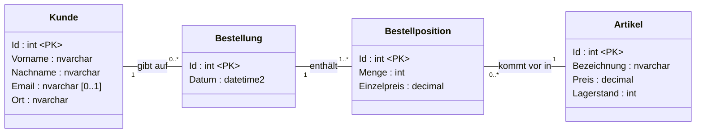
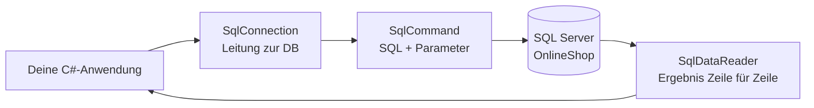
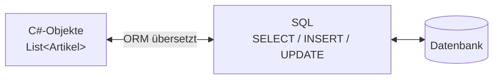
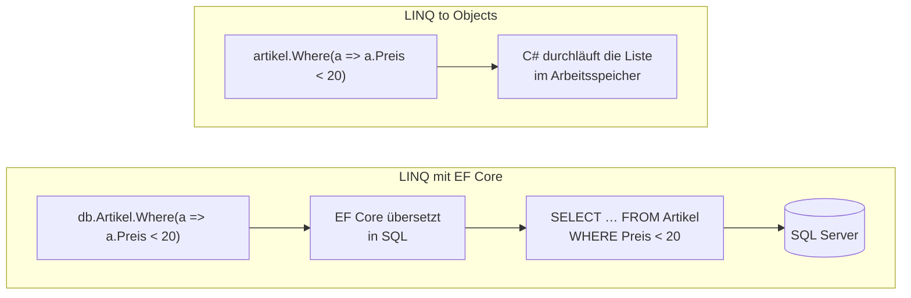
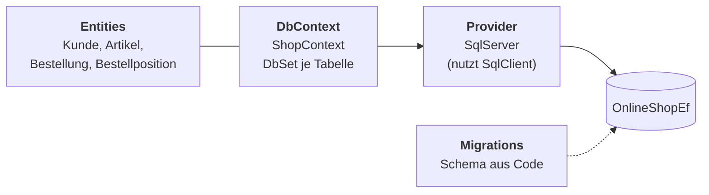
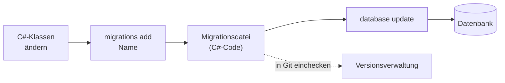
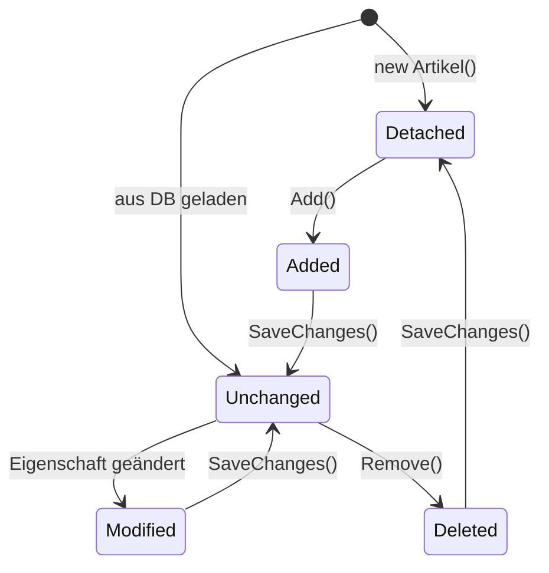

# Datenbanken in C#

---
hideInToc: true
---

# Inhalt

<Toc minDepth="1" maxDepth="1" />

---
hideInToc: true
---

# Worum geht's?

<div class="flow mt-6">
  <div class="flow-left">
    <div class="flow-label">Das könnt ihr schon</div>
    <div class="flow-box known">
      <div class="font-bold">SQL im Management Studio</div>
      <code>SELECT * FROM Artikel</code>
    </div>
    <div class="flow-box known">
      <div class="font-bold">Klassen und Objekte in C#</div>
      <code>List&lt;Artikel&gt;</code>
    </div>
  </div>
  <svg class="flow-arrows" viewBox="0 0 140 300" width="140" height="300">
    <defs>
      <marker id="flow-pfeil" viewBox="0 0 10 10" refX="9" refY="5" markerWidth="8" markerHeight="8" orient="auto-start-reverse">
        <path d="M0,0 L10,5 L0,10 z" fill="#64748b" />
      </marker>
    </defs>
    <path d="M4,80 C70,80 70,150 134,150" fill="none" stroke="#64748b" stroke-width="2.5" marker-end="url(#flow-pfeil)" />
    <path d="M4,240 C70,240 70,150 134,150" fill="none" stroke="#64748b" stroke-width="2.5" marker-end="url(#flow-pfeil)" />
  </svg>
  <div class="flow-right">
    <div class="flow-label">Das fehlt noch</div>
    <div class="flow-box missing">
      <div class="text-6xl font-bold text-orange-500 leading-none">?</div>
      <p class="text-xl !my-2">„Wie kommt die Zeile aus der Tabelle in ein Objekt, und wieder zurück?“</p>
    </div>
  </div>
</div>

<style>
.flow {
  display: grid;
  grid-template-columns: 1fr 140px 1fr;
  align-items: center;
}
.flow-left {
  display: flex;
  flex-direction: column;
  gap: 1.25rem;
}
.flow-label {
  font-size: 0.8rem;
  font-weight: 700;
  text-transform: uppercase;
  letter-spacing: 0.05em;
  opacity: 0.6;
  margin-bottom: -0.5rem;
}
.flow-box {
  border-radius: 10px;
  padding: 0.9rem 1.1rem;
  display: flex;
  flex-direction: column;
  gap: 0.4rem;
}
.flow-box.known {
  height: 110px;
  justify-content: center;
  border: 2px solid #3b82f6;
  background: #eff6ff;
}
.flow-box.missing {
  border: 2px dashed #f97316;
  background: #fff7ed;
  text-align: center;
  align-items: center;
  margin-top: 0.75rem;
}
.flow-right {
  display: flex;
  flex-direction: column;
}
.flow-arrows {
  margin-top: 1.5rem;
}
</style>


<!--
Mit dieser Lücke steigen wir ein. Jede Technik in diesem Foliensatz ist eine Antwort auf genau diese Frage.
-->

---
hideInToc: true
---

# Unser OnlineShop



<!--
- Das Skript `setup.sql` liegt im Projektordner (und im Anhang dieses Foliensatzes).
- Warum hat die Bestellposition einen eigenen Einzelpreis? Weil sich der Artikelpreis später ändern kann. Die Rechnung muss aber den Preis zum Bestellzeitpunkt zeigen. Gute Frage an die Klasse.
-->

---
layout: section
---

# Teil A · Datenzugriff von Hand

## Connection · Command · DataReader

---
hideInToc: true
---

# ADO.NET im Überblick



<v-clicks>

- **Connection:** die Leitung zur Datenbank
- **Command:** der Auftrag, also SQL plus Parameter
- **DataReader:** liest das Ergebnis, eine Zeile nach der anderen

</v-clicks>

<!--
- Analogie Telefonat: Verbindung aufbauen, Frage stellen, Antwort anhören, auflegen.
- ADO.NET ist der Name der Klassenbibliothek. Diese Klassen sind keine Steuerelemente.
-->

---
hideInToc: true
---

# Projekt vorbereiten

```bash{3}
dotnet new console -n OnlineShop
cd OnlineShop
dotnet add package Microsoft.Data.SqlClient
```

```csharp{2}
using System.Data;               // SqlDbType
using Microsoft.Data.SqlClient;  // SqlConnection, SqlCommand, …
```


- In Visual Studio geht es auch über „NuGet-Pakete verwalten“.


---
hideInToc: true
---

# Der Connection-String

<div class="font-mono text-xs p-4 rounded bg-gray-100 whitespace-nowrap leading-7">
<span class="px-1 rounded transition-colors" :class="$clicks >= 1 ? 'bg-red-200' : ''">Server=(localdb)\MSSQLLocalDB</span>;<span class="px-1 rounded transition-colors" :class="$clicks >= 2 ? 'bg-blue-200' : ''">Database=OnlineShop</span>;<span class="px-1 rounded transition-colors" :class="$clicks >= 3 ? 'bg-purple-200' : ''">Integrated Security=true</span>;<span class="px-1 rounded transition-colors" :class="$clicks >= 4 ? 'bg-green-200' : ''">TrustServerCertificate=true</span>
</div>

<table class="text-sm mt-2">
<thead><tr><th>Teil</th><th>Bedeutung</th></tr></thead>
<tbody>
<tr v-click><td class="border-l-4 border-red-400"><code>Server=(localdb)\MSSQLLocalDB</code></td><td>Welcher SQL Server? Hier LocalDB, alternativ <code>.\SQLEXPRESS</code></td></tr>
<tr v-click><td class="border-l-4 border-blue-400"><code>Database=OnlineShop</code></td><td>Welche Datenbank auf diesem Server?</td></tr>
<tr v-click><td class="border-l-4 border-purple-400"><code>Integrated Security=true</code></td><td>Anmeldung mit dem Windows-Benutzer, kein Passwort im Code</td></tr>
<tr v-click><td class="border-l-4 border-green-400"><code>TrustServerCertificate=true</code></td><td>Die Verbindung ist standardmäßig verschlüsselt. Bei lokalen Servern ohne Zertifikat braucht man diese Angabe.</td></tr>
</tbody>
</table>

<Merke>

Connection-Strings gehören in eine Konfigurationsdatei (`appsettings.json`), nicht in den Code. Für den Anfang reicht eine Konstante.

</Merke>

<!--
Ohne `TrustServerCertificate=true` kommt die Fehlermeldung „The certificate chain was issued by an authority that is not trusted“. Das ist der häufigste Fehler beim ersten Start.
-->

---
hideInToc: true
---

# Verbindung öffnen und schließen

<div style="--slidev-code-font-size: 0.6rem;">

```csharp {1|3|4|5-6|all}
const string ConnStr = "Server=(localdb)\\MSSQLLocalDB;Database=OnlineShop;Integrated Security=true;TrustServerCertificate=true";

using var con = new SqlConnection(ConnStr);
con.Open();
Console.WriteLine($"Status: {con.State}");   // Open
// … hier arbeiten …
// Ende des Blocks: using schließt die Verbindung automatisch
```

</div>

<Merke>

Spät öffnen, früh schließen. Das Connection-Pooling sorgt dafür, dass erneutes Öffnen billig ist.

</Merke>

<!--
- `using` ruft am Ende `Dispose()` auf, auch bei einer Exception. Das ist die moderne Kurzform von `try`/`finally`.
- Der Pool hält physische Verbindungen offen und vergibt sie wieder. Eine Verbindung „offen lassen“ bringt daher nichts und blockiert nur den Pool.
-->

---
hideInToc: true
---

# Drei Arten zu fragen

| **Methode** | **Liefert** | **Typisches SQL** | **Beispiel** |
|---|---|---|---|
| `ExecuteScalar()` | **einen** Wert (`object?`) | `SELECT COUNT(*)`, `SUM(…)` | Wie viele Artikel gibt es? |
| `ExecuteNonQuery()` | Anzahl betroffener Zeilen (`int`) | `INSERT`, `UPDATE`, `DELETE` | Neuen Artikel anlegen |
| `ExecuteReader()` | einen `SqlDataReader` (Tabelle) | `SELECT …` mit mehreren Zeilen/Spalten | Alle Artikel anzeigen |

<!--
Wir gehen genau in dieser Reihenfolge vor, vom einfachsten Ergebnis zum komplexesten.
-->

---
hideInToc: true
---

# Schritt 1 · Ein einzelner Wert

```csharp {1-2|4|5|6|all}
using var con = new SqlConnection(ConnStr);
con.Open();

using var cmd = new SqlCommand("SELECT COUNT(*) FROM Artikel", con);
int anzahl = (int)cmd.ExecuteScalar()!;
Console.WriteLine($"Im Shop gibt es {anzahl} Artikel.");
```

<SqlBruecke>

Dasselbe SELECT, das du im Management Studio schreibst. Neu ist nur, dass es als String im C#-Code steht.

</SqlBruecke>

<!--
- `ExecuteScalar` liefert die erste Spalte der ersten Zeile als `object?`, daher der Cast.
- `COUNT(*)` liefert in SQL Server `int`, also passt `(int)`.
-->

---
hideInToc: true
---

# ExecuteScalar und NULL

Lagerwert aller Artikel einer Preisklasse:

```csharp {1-2|3|4|all}
using var cmd = new SqlCommand(
    "SELECT SUM(Preis * Lagerstand) FROM Artikel WHERE Preis > 1000", con);
object? ergebnis = cmd.ExecuteScalar();
decimal lagerwert = ergebnis is DBNull ? 0 : (decimal)ergebnis!;
```

<Achtung>

`SUM` über keine Zeilen ergibt in SQL `NULL`. In C# kommt dann `DBNull.Value` an, nicht `null`. Ein direkter Cast `(decimal)` wirft eine `InvalidCastException`.

</Achtung>

<!--
`DBNull` ist ein eigener Typ für „NULL aus der Datenbank“. Diese Unterscheidung kommt beim DataReader wieder.
-->

---
hideInToc: true
---

# Schritt 2 · Daten ändern

```csharp {1-3|4|all}
using var cmd = new SqlCommand(
    "INSERT INTO Artikel (Bezeichnung, Preis, Lagerstand) " +
    "VALUES ('Laptop-Ständer', 34.90, 20)", con);
int betroffen = cmd.ExecuteNonQuery();
Console.WriteLine($"{betroffen} Zeile(n) eingefügt.");   // 1
```

<div v-click class="mt-10 text-3xl font-bold text-center">
„Und wenn der Benutzer die Werte eingibt?“
</div>

<!--
`ExecuteNonQuery` liefert keine Daten, nur die Anzahl der betroffenen Zeilen. Diese Zahl ist bei UPDATE und DELETE wichtig: 0 bedeutet „nicht gefunden“.
-->

---
hideInToc: true
---

# Der naheliegende Weg - 🛑 DO NOT USE🛑

Eingaben per String-Verkettung einbauen:

<div style="--slidev-code-font-size: 0.75rem;">

```csharp
Console.Write("Bezeichnung: ");
string bez = Console.ReadLine()!;
Console.Write("Preis: ");
decimal preis = decimal.Parse(Console.ReadLine()!);

string sql = "INSERT INTO Artikel (Bezeichnung, Preis, Lagerstand) " +
             "VALUES ('" + bez + "', " + preis + ", 0)";
using var cmd = new SqlCommand(sql, con);
cmd.ExecuteNonQuery();
```

</div>

<v-clicks>

1. Eingabe `12,90`, und auf einem deutschsprachigen Windows entsteht `VALUES ('Maus', 12,90, 0)`. Das sind 4 Werte für 3 Spalten, also ein SQL-Fehler. 💥
2. Eingabe `Kinder's Maus`: Das Apostroph beendet den String, und es entsteht ein Syntaxfehler. 💥
3. Es geht noch schlimmer, siehe nächste Folie. 😱

</v-clicks>

<!--
Diesen Code bewusst live schreiben und mit den Eingaben scheitern lassen. Das Kulturproblem beim Dezimalkomma überrascht fast alle.
-->

---
hideInToc: true
layout: two-cols
layoutClass: gap-8
---

# SQL-Injection 🥷🏿👉💥

Kundensuche per Verkettung:

```csharp
string name = Console.ReadLine()!;
string sql = "SELECT Id, Vorname, Nachname FROM Kunde " +
             "WHERE Nachname = '" + name + "'";
```

<Achtung title="⚠️ Sicherheitslücke">

SQL-Injection gehört seit Jahren zu den häufigsten Sicherheitslücken in Webanwendungen (OWASP Top 10).

</Achtung>

::right::

<div class="mt-16 text-sm">

<v-clicks>

- Eingabe `Berger` ergibt<br>`… WHERE Nachname = 'Berger'`<br>Das funktioniert wie gewünscht. ✅
- Eingabe `x' OR '1'='1` ergibt<br>`… WHERE Nachname = 'x' OR '1'='1'`<br>Damit erscheinen **alle Kunden**. 😬
- Eingabe `x'; DELETE FROM Bestellposition; --` führt **zwei Befehle** aus, und die Bestellpositionen sind gelöscht. 💀

</v-clicks>

</div>

<!--
- Live vorführen, aber nur auf der Testdatenbank.
- Danach mit `setup.sql` neu aufsetzen.
- Optional den xkcd-Comic „Exploits of a Mom“ (Little Bobby Tables) verlinken. Nur verlinken, nicht als Bild einbetten: https://xkcd.com/327/
-->

---
hideInToc: true
---

# Die Lösung: Parameter

````md magic-move
```csharp
string sql = "SELECT Id, Vorname, Nachname FROM Kunde " +
             "WHERE Nachname = '" + name + "'";
using var cmd = new SqlCommand(sql, con);
```
```csharp
string sql = "SELECT Id, Vorname, Nachname FROM Kunde " +
             "WHERE Nachname = @nachname";
using var cmd = new SqlCommand(sql, con);
cmd.Parameters.Add("@nachname", SqlDbType.NVarChar, 50).Value = name;
```
````

<v-clicks>

- Das SQL enthält nur noch einen **Platzhalter** `@nachname`.
- Der Wert wird **getrennt** vom SQL an den Server geschickt. Er wird nie als SQL-Code ausgeführt.
- Typ und Länge entsprechen der Spalte (`NVARCHAR(50)`).

</v-clicks>

<Merke>

Benutzereingaben kommen **nie** per `+` ins SQL, ausnahmslos.

</Merke>

---
hideInToc: true
---

# Parameter im Detail

Der INSERT von vorhin, jetzt richtig:

```csharp {3-5|6|7|8|9}
string bez = "Zahnbürste";
decimal preis = 29.90;
using var cmd = new SqlCommand(
    "INSERT INTO Artikel (Bezeichnung, Preis, Lagerstand) " +
    "VALUES (@bez, @preis, @lager)", con);
cmd.Parameters.Add("@bez", SqlDbType.NVarChar, 100).Value = bez;
cmd.Parameters.Add("@preis", SqlDbType.Decimal).Value = preis;
cmd.Parameters.Add("@lager", SqlDbType.Int).Value = 0;
cmd.ExecuteNonQuery();
```

<div class="grid grid-cols-2 gap-4 mt-4 text-sm">
<div class="p-3 rounded border-t-4 border-green-600">

**`Parameters.Add(name, typ, länge)`**<br>
Typ genau wie in der Tabelle, so empfohlen. ✅

</div>
<div class="p-3 rounded border-t-4 border-orange-500">

**`Parameters.AddWithValue(name, wert)`**<br>
Der Typ wird erraten. Das funktioniert, kann aber zu falschen Typen und langsameren Abfragen führen. In alten Tutorials sehr häufig.

</div>
</div>

<!--
- Dezimalkomma und Apostroph sind mit Parametern automatisch kein Problem mehr. Die Probleme von „Der naheliegende Weg“ noch einmal durchspielen.
- Hintergrund zu AddWithValue: Ein `string` wird z. B. als `nvarchar` mit der Länge des aktuellen Werts gesendet. Das erzeugt viele verschiedene Abfragepläne, und bei `varchar`-Spalten nutzt SQL Server unter Umständen den Index nicht.
-->

---
hideInToc: true
---

# NULL-Werte als Parameter

```csharp
// kunde.Email ist string? – kann null sein
cmd.Parameters.Add("@email", SqlDbType.NVarChar, 100).Value =
    (object?)kunde.Email ?? DBNull.Value;
```

<Achtung>

C#-`null` als Parameterwert bedeutet für SqlClient „Parameter fehlt“ und führt zu einem Fehler. Für SQL-NULL braucht man `DBNull.Value`.

</Achtung>

<!--
Das ist das Gegenstück zu „ExecuteScalar und NULL“. In beide Richtungen gilt: `null` in C# ist nicht dasselbe wie `NULL` in der Datenbank.
-->

---
hideInToc: true
---

# Die neue Id zurückbekommen

```csharp {2-3|6-8|9}
using var cmd = new SqlCommand("""
    INSERT INTO Artikel (Bezeichnung, Preis, Lagerstand)
    OUTPUT INSERTED.Id
    VALUES (@bez, @preis, @lager)
    """, con);
cmd.Parameters.Add("@bez", SqlDbType.NVarChar, 100).Value = artikel.Bezeichnung;
cmd.Parameters.Add("@preis", SqlDbType.Decimal).Value = artikel.Preis;
cmd.Parameters.Add("@lager", SqlDbType.Int).Value = artikel.Lagerstand;
artikel.Id = (int)cmd.ExecuteScalar()!;
```

<SqlBruecke>

`OUTPUT INSERTED.Id` liefert die von `IDENTITY` vergebene Id. Weil das genau ein Wert ist, verwenden wir `ExecuteScalar`.

</SqlBruecke>

<!--
`"""…"""` ist ein Raw-String-Literal (ab C# 11). Damit lässt sich mehrzeiliges SQL gut lesbar schreiben.
-->

---
hideInToc: true
---

# Schritt 3 · Eine ganze Tabelle lesen

```csharp {1-2|4|5|7-9|10|all}
using var cmd = new SqlCommand(
    "SELECT Id, Bezeichnung, Preis, Lagerstand FROM Artikel ORDER BY Bezeichnung", con);

using SqlDataReader reader = cmd.ExecuteReader();
while (reader.Read())
{
    int id = reader.GetInt32(0);
    string bez = reader.GetString(1);
    decimal preis = reader.GetDecimal(2);
    Console.WriteLine($"{id},  {bez}, {preis}");
}
```

<!--
- `Read()` springt zur nächsten Zeile und liefert `false`, wenn keine mehr da ist.
- Vor dem ersten `Read()` steht der Reader **vor** der ersten Zeile.
- Die Zahl in `GetInt32(0)` ist die Spaltenposition im SELECT.
-->

---
hideInToc: true
---

# So arbeitet der DataReader

<table class="text-sm w-auto mx-auto">
<thead><tr><th class="w-10"></th><th>Id</th><th>Bezeichnung</th><th class="text-right">Preis</th></tr></thead>
<tbody>
<tr v-for="(z, i) in [['4','27-Zoll-Monitor','229,00'],['2','Funkmaus','24,90'],['5','HDMI-Kabel 2 m','7,50'],['…','…','…']]" :key="i" class="transition-colors" :class="Math.min($clicks, 3) === i ? 'bg-yellow-100' : ''">
<td class="text-xl text-orange-600">{{ Math.min($clicks, 3) === i ? '➜' : '' }}</td>
<td>{{ z[0] }}</td><td>{{ z[1] }}</td><td>{{ z[2] }}</td>
</tr>
</tbody>
</table>

<div class="mt-6">
<p v-click="4">➡️ <b>Nur vorwärts:</b> Man kann nicht zurückspringen.</p>
<p v-click="5">👀 <b>Nur lesen:</b> Änderungen laufen über eigene Commands.</p>
<p v-click="6">🔌 <b>Die Verbindung bleibt offen, solange gelesen wird:</b> erst lesen, dann schließen.</p>
</div>

<!--
Live mit einem Haltepunkt in der `while`-Schleife zeigen. Nach jedem Schritt im Debugger ist eine neue Zeile da.
-->

---
hideInToc: true
---

# Spalten über den Namen ansprechen

````md magic-move
```csharp
int id = reader.GetInt32(0);
string bez = reader.GetString(1);
decimal preis = reader.GetDecimal(2);
```
```csharp
int iId = reader.GetOrdinal("Id");
int iBez = reader.GetOrdinal("Bezeichnung");
int iPreis = reader.GetOrdinal("Preis");
while (reader.Read())
{
    int id = reader.GetInt32(iId);
    string bez = reader.GetString(iBez);
    decimal preis = reader.GetDecimal(iPreis);
}
```
````

<Achtung>

Wenn jemand im SELECT die Reihenfolge der Spalten ändert, liefern feste Zahlen plötzlich falsche Daten oder eine `InvalidCastException`.

</Achtung>

<!--
`GetOrdinal` einmal vor der Schleife aufrufen, nicht in jeder Zeile. Die Kurzform `(string)reader["Bezeichnung"]` erwähnen: Sie funktioniert auch, kostet aber etwas mehr.
-->

---
hideInToc: true
---

# NULL beim Lesen

Kunden lesen. `Email` darf NULL sein.

```csharp
int iEmail = reader.GetOrdinal("Email");
// …
string? email = reader.IsDBNull(iEmail) ? null : reader.GetString(iEmail);
```

<Achtung>

`GetString` auf einer NULL-Spalte wirft eine `SqlNullValueException`. Vorher immer `IsDBNull` prüfen, wenn die Spalte NULL erlaubt.

</Achtung>

---
hideInToc: true
---

# Mapping: aus Zeilen werden Objekte

<div style="--slidev-code-font-size: 0.68rem; --slidev-code-line-height: 1.35;">

```csharp {1|3-5|7-17|18}
static List<Artikel> AlleArtikel(SqlConnection con)
{
    using var cmd = new SqlCommand(
        "SELECT Id, Bezeichnung, Preis, Lagerstand FROM Artikel ORDER BY Bezeichnung", con);
    using var reader = cmd.ExecuteReader();

    List<Artikel> liste = new List<Artikel>();
    while (reader.Read())
    {
        liste.Add(new Artikel
        {
            Id          = reader.GetInt32(reader.GetOrdinal("Id")),
            Bezeichnung = reader.GetString(reader.GetOrdinal("Bezeichnung")),
            Preis       = reader.GetDecimal(reader.GetOrdinal("Preis")),
            Lagerstand  = reader.GetInt32(reader.GetOrdinal("Lagerstand"))
        });
    }
    return liste;
}
```

</div>

<!--
- Hier schließt sich die Lücke von „Worum geht's?“: Die Tabelle ist jetzt eine `List<Artikel>`.
- Diese Übertragung Spalte für Spalte heißt **Mapping**. Das Wort merken, es kommt beim ORM wieder.
-->

---
hideInToc: true
layout: two-cols
layoutClass: gap-6
---

# JOINs: Ergebnisse, die zu keiner Tabelle passen

<div style="--slidev-code-font-size: 0.68rem;">

```sql
SELECT b.Id, b.Datum,
       k.Vorname + ' ' + k.Nachname AS Kunde,
       SUM(p.Menge * p.Einzelpreis) AS Summe
FROM Bestellung b
JOIN Kunde k           ON k.Id = b.KundeId
JOIN Bestellposition p ON p.BestellungId = b.Id
WHERE k.Id = @kundeId
GROUP BY b.Id, b.Datum, k.Vorname, k.Nachname
ORDER BY b.Datum DESC
```

</div>

::right::

<div class="mt-20" style="--slidev-code-font-size: 0.58rem;">

```csharp
public record BestellUebersicht(
    int BestellungId, DateTime Datum, string Kunde, decimal Summe);

// in der Leseschleife:
liste.Add(new BestellUebersicht(
    reader.GetInt32(0),
    reader.GetDateTime(1),
    reader.GetString(2),
    reader.GetDecimal(3)));
```

</div>

<Merke>

Für Abfrageergebnisse, die keiner Tabelle entsprechen, legt man eine eigene kleine Klasse an, ein **DTO** (Data Transfer Object). `record` ist dafür ideal.

</Merke>

<!--
Die SQL-Abfrage können die Schüler schon. Neu ist nur, wohin das Ergebnis kommt.
-->

---
hideInToc: true
---

# UPDATE und DELETE

```csharp {1-4|5|7-9|all}
using var cmd = new SqlCommand(
    "UPDATE Artikel SET Preis = @preis WHERE Id = @id", con);
cmd.Parameters.Add("@preis", SqlDbType.Decimal).Value = 19.90m;
cmd.Parameters.Add("@id", SqlDbType.Int).Value = 2;
int betroffen = cmd.ExecuteNonQuery();

if (betroffen == 0)
    Console.WriteLine("Artikel nicht gefunden.");
```

<!--
- DELETE funktioniert genauso.
- Frage an die Klasse: Was passiert bei `DELETE FROM Artikel WHERE Id = 1`? Antwort: Es gibt einen Fehler wegen des Fremdschlüssels, weil der Artikel in Bestellpositionen vorkommt. Die Exception ist eine `SqlException` mit der Nummer 547.
-->

---
hideInToc: true
---

# async/await: Warum?

<v-clicks>

- Eine Datenbankabfrage dauert, das Programm **wartet**.
- In WinForms/WPF friert die Oberfläche ein.
- Ein Webserver blockiert pro Anfrage einen Thread, bei vielen Benutzern wird das zum Problem.
- Mit **async/await** gibt das Programm die Kontrolle ab, während die Datenbank arbeitet.

</v-clicks>

<!--
Keine Theorie zu Threads, nur das Prinzip: „Während ich warte, darf etwas anderes passieren.“ Das reicht hier völlig.
-->

---
hideInToc: true
---

# Von sync zu async

<div style="--slidev-code-font-size: 0.64rem; --slidev-code-line-height: 1.35;">

````md magic-move
```csharp
static List<Artikel> AlleArtikel(SqlConnection con)
{
    using var cmd = new SqlCommand(
        "SELECT Id, Bezeichnung, Preis, Lagerstand FROM Artikel ORDER BY Bezeichnung", con);
    using var reader = cmd.ExecuteReader();

    var liste = new List<Artikel>();
    while (reader.Read())
    {
        // Mapping unverändert
    }
    return liste;
}
```
```csharp
static async Task<List<Artikel>> AlleArtikelAsync(SqlConnection con)
{
    await using var cmd = new SqlCommand(
        "SELECT Id, Bezeichnung, Preis, Lagerstand FROM Artikel ORDER BY Bezeichnung", con);
    await using var reader = await cmd.ExecuteReaderAsync();

    var liste = new List<Artikel>();
    while (await reader.ReadAsync())
    {
        // Mapping unverändert
    }
    return liste;
}
```
````

<div v-click class="mt-2">

<p class="text-sm !my-1">Aufruf im Hauptprogramm (<code>Program.cs</code>):</p>

```csharp
await using var con = new SqlConnection(ConnStr);
await con.OpenAsync();

List<Artikel> artikel = await AlleArtikelAsync(con);
foreach (var a in artikel)
    Console.WriteLine($"{a.Bezeichnung}: {a.Preis:C}");
```

</div>

</div>

---
hideInToc: true
---

# Von sync zu async: die Umstellungen

<div class="text-sm">

| sync | async |
|---|---|
| `con.Open()` | `await con.OpenAsync()` |
| `ExecuteScalar()` | `await ExecuteScalarAsync()` |
| `ExecuteNonQuery()` | `await ExecuteNonQueryAsync()` |
| `ExecuteReader()` | `await ExecuteReaderAsync()` |
| `reader.Read()` | `await reader.ReadAsync()` |
| `using var` | `await using var` |
| `List<Artikel>` als Rückgabe | `async Task<List<Artikel>>` |

</div>

<Merke>

Ab jetzt schreiben wir den Datenzugriff asynchron.

</Merke>

---
hideInToc: true
---

# Ordnung: das Repository

Ziel: Kein SQL in `Main` oder in Button-Klicks. Der gesamte Datenzugriff für Artikel steckt in einer Klasse.

<div style="--slidev-code-font-size: 0.64rem; --slidev-code-line-height: 1.35;">

<div class="grid grid-cols-2 gap-4">
<div>

```csharp [ArtikelRepository.cs]
public class ArtikelRepository
{
    private readonly string connStr;

    public ArtikelRepository(string connStr)
    {
        this.connStr = connStr;
    }

    public async Task<List<Artikel>> GetAllAsync() { … }
    public async Task<Artikel?> GetByIdAsync(int id) { … }
    public async Task<int> InsertAsync(Artikel artikel) { … }     
    public async Task<bool> UpdateAsync(Artikel artikel) { … }
    public async Task<bool> DeleteAsync(int id) { … }
}
```

</div>
<div>

```csharp [Program.cs]
// Verwendung – das Programm sieht kein SQL mehr
var repo = new ArtikelRepository(ConnStr);
foreach (Artikel a in await repo.GetAllAsync())
    Console.WriteLine($"{a.Bezeichnung}: {a.Preis:C}");
```

</div>
</div>
<Merke>

**"Repository"** ist ein Entwurfsmuster (*en: Design Pattern*), das den Zugriff auf Datenquellen abstrahiert und eine klare Trennung zwischen Geschäftslogik und Datenzugriffsschicht ermöglicht.

</Merke>

</div>

<!--
- Jede Methode öffnet ihre eigene Verbindung, so wie auf „Verbindung öffnen und schließen“ beschrieben.
- Ausblick: Mit einem Interface `IArtikelRepository` lässt sich die Implementierung später gegen EF Core tauschen. Dazu passt die Konsolen-Demo „DatenzugriffDemo“.
- Übungsaufgabe: `ArtikelRepository` vollständig implementieren.
-->

---
hideInToc: true
---

# Was nervt?

<div class="text-sm">

<v-clicks>

- 😩 Für jede Tabelle dieselben Zeilen: Verbindung, Command, Parameter, Schleife.
- 😩 **Mapping von Hand:** `reader.GetString(reader.GetOrdinal("Bezeichnung"))` für jede Spalte.
- 😩 **SQL steht in Strings.** Ein Tippfehler (`Bezeichung`) fällt erst zur Laufzeit auf.
- 😩 Wird eine Spalte umbenannt, muss man jedes SQL im Projekt suchen.

</v-clicks>

</div>

<div v-click class="mt-6 text-3xl font-bold text-center">
„Geht das nicht besser?“
</div>

<!--
- Zum Zeilenvergleich: Die Methode `AlleArtikel` hat rund 20 Zeilen, davon eine Zeile SQL.
- Den Schmerz bewusst stehen lassen, er ist die Motivation für Teil B.
-->

---
layout: section
---

# Teil B · Object-Relational Mapping

## Die Brücke zwischen Tabellen und Objekten

---
hideInToc: true
---

# Zwei Welten

<table class="text-sm">
<thead><tr><th>Datenbank (relational)</th><th>C# (objektorientiert)</th></tr></thead>
<tbody>
<tr v-click><td>Tabelle <code>Artikel</code></td><td>Klasse <code>Artikel</code></td></tr>
<tr v-click><td>Zeile</td><td>Objekt</td></tr>
<tr v-click><td>Spalte</td><td>Eigenschaft</td></tr>
<tr v-click><td>Fremdschlüssel <code>KundeId</code></td><td>Referenz <code>bestellung.Kunde</code></td></tr>
<tr v-click><td>1:n über JOIN</td><td>Liste <code>kunde.Bestellungen</code></td></tr>
<tr v-click><td><code>NVARCHAR(50)</code>, <code>DECIMAL(10,2)</code>, <code>NULL</code></td><td><code>string</code>, <code>decimal</code>, <code>null</code></td></tr>
<tr v-click><td>Identität über Primärschlüssel</td><td>Identität über Referenz im Speicher</td></tr>
</tbody>
</table>

<!--
Diese Unterschiede nennt man den **Object-Relational Impedance Mismatch**. Den Begriff nur nennen, nicht abprüfen. In Teil A haben wir diese Lücke von Hand überbrückt.
-->

---
hideInToc: true
---

# Was ist ein ORM?

<div class="text-xl p-4 rounded bg-gray-100">
Ein <b>Object-Relational Mapper</b> ist eine Bibliothek, die Objekte automatisch in Tabellenzeilen übersetzt und umgekehrt.
</div>



<p class="text-center text-lg">„Du arbeitest mit Objekten, das ORM erzeugt das SQL.“</p>

<!--
Wichtig: Ein ORM ersetzt die Datenbank nicht, und es ersetzt auch das SQL-Wissen nicht. Es schreibt das SQL für uns, aber es bleibt SQL.
-->

---
hideInToc: true
---

# Was ein ORM übernimmt

<table class="text-sm">
<thead><tr><th>Problem aus Teil A</th><th>Das macht das ORM</th></tr></thead>
<tbody>
<tr v-click><td>Mapping von Hand</td><td><b>Mapping:</b> Spalten werden automatisch zu Eigenschaften</td></tr>
<tr v-click><td>SQL in Strings</td><td><b>Abfragen in C#</b> (LINQ), vom Compiler geprüft</td></tr>
<tr v-click><td>Selbst merken, was sich geändert hat</td><td><b>Change Tracking:</b> erkennt geänderte Objekte und erzeugt INSERT/UPDATE/DELETE</td></tr>
<tr v-click><td>Beziehungen zusammenbauen</td><td><b>Navigation:</b> <code>kunde.Bestellungen</code></td></tr>
<tr v-click><td>Tabellen per Skript anlegen</td><td><b>Migrations:</b> Datenbankschema aus dem C#-Code</td></tr>
</tbody>
</table>

---
hideInToc: true
---

# Vergleich ohne und mit ORM

Dieselbe Abfrage, „alle Artikel unter 20 €“:

<div style="--slidev-code-font-size: 0.64rem; --slidev-code-line-height: 1.35;">

````md magic-move
```csharp
// ohne ORM
await using var cmd = new SqlCommand(
    "SELECT Id, Bezeichnung, Preis, Lagerstand FROM Artikel WHERE Preis < @max", con);
cmd.Parameters.Add("@max", SqlDbType.Decimal).Value = 20m;
await using var reader = await cmd.ExecuteReaderAsync();

List<Artikel> liste = new List<Artikel>();
while (await reader.ReadAsync())
{
    liste.Add(new Artikel
    {
        Id          = reader.GetInt32(reader.GetOrdinal("Id")),
        Bezeichnung = reader.GetString(reader.GetOrdinal("Bezeichnung")),
        Preis       = reader.GetDecimal(reader.GetOrdinal("Preis")),
        Lagerstand  = reader.GetInt32(reader.GetOrdinal("Lagerstand"))
    });
}
```
```csharp
// mit ORM
List<Artikel> liste = await db.Artikel.Where(a => a.Preis < 20).ToListAsync();
```
````

</div>

---
hideInToc: true
---

# Entity Framework Core

<div class="efcore grid grid-cols-[2fr_3fr] gap-8">
<div>

- **Full ORM von Microsoft**, Open Source (MIT-Lizenz)
- Standard für neue .NET-Projekte
- Aktuelle Version: **EF Core 10** (LTS, passend zu .NET 10)
- Nachfolger von *Entity Framework 6*, daher das „Core“ im Namen
- Spricht über einen **Provider** mit der jeweiligen Datenbank: SQL Server, SQLite, PostgreSQL …
- Wird als **NuGet-Paket** ins Projekt eingebunden

</div>
<div>

| NuGet-Paket | Wozu |
|---|---|
| `Microsoft.EntityFrameworkCore` | Kern: DbContext, LINQ, Change Tracking |
| `Microsoft.EntityFrameworkCore.SqlServer` | Provider für SQL Server, bringt den Kern mit |
| `Microsoft.EntityFrameworkCore.Sqlite` | Provider für SQLite |
| `Npgsql.EntityFrameworkCore.PostgreSQL` | Provider für PostgreSQL |
| `Microsoft.EntityFrameworkCore.Design` | Werkzeuge für Migrationen |

<p class="text-xs opacity-70 !mt-2">Die Installation im Projekt kommt in Teil D.</p>

</div>
</div>

<style>
.efcore li { font-size: 0.85rem; line-height: 1.5; }
.efcore table { font-size: 0.72rem; }
.efcore td, .efcore th { padding: 0.3rem 0.5rem; }
.efcore code { font-size: 0.68rem; }
</style>

<Merke>

Auch EF Core verwendet intern einen DataReader. Teil A war also keine Zeitverschwendung, sondern die Grundlage für alles Weitere.

</Merke>

<!--
- Im Unterricht verwenden wir nur den SQL-Server-Provider. Die anderen Provider zeigen: Der C#-Code bleibt gleich, nur das Paket und `UseSqlServer` ändern sich.
- Der SQL-Server-Provider verwendet intern `Microsoft.Data.SqlClient` aus Teil A.
-->

---
hideInToc: true
---

# Das Prinzip gibt es überall

<div class="grid grid-cols-4 gap-4 mt-6 text-center">
<div class="p-4 rounded border-t-4 border-orange-500 bg-gray-50"><b>Java</b><br>Hibernate / JPA</div>
<div class="p-4 rounded border-t-4 border-blue-500 bg-gray-50"><b>Python</b><br>SQLAlchemy, Django ORM</div>
<div class="p-4 rounded border-t-4 border-yellow-500 bg-gray-50"><b>JavaScript/TypeScript</b><br>Prisma, TypeORM</div>
<div class="p-4 rounded border-t-4 border-purple-500 bg-gray-50"><b>PHP</b><br>Eloquent (Laravel), Doctrine</div>
</div>

<Merke>

Wer die Konzepte von EF Core versteht, findet sich auch in diesen Frameworks schnell zurecht. Das ist relevant für Diplomarbeiten in anderen Sprachen.

</Merke>

---
hideInToc: true
---

# Vorteile von ORMs

<div class="text-sm">

<v-clicks>

- ✅ **Weniger Code:** kein Mapping, kein wiederholter Verbindungs-Code
- ✅ **Typsicherheit:** Der Compiler prüft Abfragen und Eigenschaftsnamen. Tippfehler fallen sofort auf.
- ✅ **Refactoring:** Eine Eigenschaft umbenennen ändert alle Abfragen mit.
- ✅ **Change Tracking:** `SaveChanges()` speichert alle Änderungen in einer Transaktion.
- ✅ **Beziehungen** als Objekte: `bestellung.Kunde.Ort`
- ✅ **Migrations:** Code und Datenbankschema bleiben synchron, versioniert in Git.
- ✅ **Sicherheit:** Parameter werden automatisch verwendet, SQL-Injection ist im Normalfall ausgeschlossen.
- ✅ **Datenbankunabhängigkeit:** Der Provider lässt sich tauschen (SQL Server, PostgreSQL, SQLite …).

</v-clicks>

</div>

---
hideInToc: true
---

# Nachteile und Risiken

<div class="text-sm">

<v-clicks>

- ⚠️ **Blackbox:** Man sieht das SQL nicht, ohne es bewusst einzuschalten.
- ⚠️ **Performance-Fallen:** Das N+1-Problem, zu viele geladene Daten, ineffizientes SQL. Kommt in Teil D.
- ⚠️ **Overhead:** etwas langsamer als handgeschriebenes SQL mit DataReader
- ⚠️ **Lernkurve:** viele neue Konzepte (Tracking, Loading-Strategien, Migrations)
- ⚠️ **Grenzen:** komplexe Berichte, Massenänderungen oder datenbankspezifische Features sind in SQL oft einfacher.
- ⚠️ **„Leaky Abstraction“:** Wenn es klemmt, muss man trotzdem SQL und die Datenbank verstehen.

</v-clicks>

</div>

<v-click>

<Merke>

Ein ORM ersetzt SQL-Wissen nicht, es setzt es voraus.

</Merke>

</v-click>

<!--
Darum haben wir mit Teil A begonnen. Wer nie gesehen hat, was ein ORM erzeugt, kann seine Probleme nicht lösen.
-->

---
layout: section
---

# Teil C · LINQ

## Abfragen direkt in C#

---
hideInToc: true
---

# Was ist LINQ?

- **LINQ = Language Integrated Query**, also Abfragen als Teil der Sprache C#.
- Funktioniert auf **allem, was man durchlaufen kann:** Listen, Arrays, und über EF Core auch auf Datenbanken.
- Wir lernen es zuerst auf einer `List<Artikel>` im Speicher, ganz ohne Datenbank.

<p class="text-sm opacity-70 mt-4 mb-1">Testdaten für alle Folien in Teil C:</p>

<div style="--slidev-code-font-size: 0.66rem;">

```csharp
List<Artikel> artikel =
[
    new() { Id = 1, Bezeichnung = "USB-Stick 64 GB",      Preis = 12.90m,  Lagerstand = 50 },
    new() { Id = 2, Bezeichnung = "Funkmaus",             Preis = 24.90m,  Lagerstand = 30 },
    new() { Id = 3, Bezeichnung = "Mechanische Tastatur", Preis = 89.00m,  Lagerstand = 12 },
    new() { Id = 4, Bezeichnung = "27-Zoll-Monitor",      Preis = 229.00m, Lagerstand = 5 },
    new() { Id = 5, Bezeichnung = "HDMI-Kabel 2 m",       Preis = 7.50m,   Lagerstand = 100 },
    new() { Id = 6, Bezeichnung = "Webcam Full HD",       Preis = 49.90m,  Lagerstand = 0 },
];
```

</div>

---
hideInToc: true
layout: two-cols
layoutClass: gap-8
---

# Ohne und mit LINQ

**So kennt ihr es**

```csharp
var guenstige = new List<Artikel>();
foreach (var a in artikel)
{
    if (a.Preis < 20)
        guenstige.Add(a);
}
guenstige.Sort((x, y) =>
    x.Bezeichnung.CompareTo(y.Bezeichnung));
```

::right::

<div class="mt-19">

**Mit LINQ**

```csharp
var guenstige = artikel
    .Where(a => a.Preis < 20)
    .OrderBy(a => a.Bezeichnung)
    .ToList();
```

<SqlBruecke>

`SELECT * FROM Artikel WHERE Preis < 20 ORDER BY Bezeichnung`

</SqlBruecke>

</div>

<!--
LINQ beschreibt, **was** man will, nicht **wie** es Schritt für Schritt gemacht wird. Genau wie SQL.
-->

---
hideInToc: true
---

# Lambda-Ausdrücke

Ein **Lambda** ist eine kleine, namenlose Funktion:

<div class="text-center font-mono text-4xl my-6">
<span class="px-2 rounded transition-colors" :class="$clicks >= 1 ? 'bg-red-200' : ''">a</span>
<span class="px-2 rounded transition-colors" :class="$clicks >= 2 ? 'bg-blue-200' : ''">=&gt;</span>
<span class="px-2 rounded transition-colors" :class="$clicks >= 3 ? 'bg-green-200' : ''">a.Preis &lt; 20</span>
</div>

<div class="grid grid-cols-3 gap-4 text-sm text-center">
<div v-click class="p-2 rounded border-t-4 border-red-400"><code>a</code> ist der Parameter (ein Artikel)</div>
<div v-click class="p-2 rounded border-t-4 border-blue-400"><code>=&gt;</code> heißt „wird zu“</div>
<div v-click class="p-2 rounded border-t-4 border-green-400"><code>a.Preis &lt; 20</code> ist das Ergebnis (<code>bool</code>)</div>
</div>

Vergleich mit einer normalen Methode:

```csharp
// als Methode
static bool IstGuenstig(Artikel a) { return a.Preis < 20; }

// als Lambda
Func<Artikel, bool> istGuenstig = a => a.Preis < 20;
```

`Where` ruft das Lambda für jeden Artikel auf und behält jene, bei denen `true` herauskommt.

<!--
Für LINQ reicht dieses Verständnis völlig. `Func<…>` nur kurz zeigen, nicht vertiefen.
-->

---
hideInToc: true
---

# Die wichtigsten Operatoren

<div class="text-xs">

| LINQ | SQL | Beispiel |
|---|---|---|
| `Where(a => …)` | `WHERE` | `.Where(a => a.Lagerstand > 0)` |
| `Select(a => …)` | Spaltenliste im `SELECT` | `.Select(a => a.Bezeichnung)` |
| `OrderBy` / `OrderByDescending` / `ThenBy` | `ORDER BY` | `.OrderBy(a => a.Preis)` |
| `Count` / `Sum` / `Average` / `Min` / `Max` | Aggregatfunktionen | `.Sum(a => a.Preis * a.Lagerstand)` |
| `First` / `FirstOrDefault` | `TOP 1` | `.FirstOrDefault(a => a.Id == 3)` |
| `Any` | `EXISTS` | `.Any(a => a.Lagerstand == 0)` |
| `GroupBy` | `GROUP BY` | `.GroupBy(a => a.Preis > 50)` |
| `Take` / `Skip` | `TOP` / `OFFSET … FETCH` | `.Skip(10).Take(10)` |
| `ToList` | Ausführen und Ergebnis holen | `.ToList()` |

</div>

---
hideInToc: true
---

# Beispiele im Shop

<div style="--slidev-code-font-size: 0.72rem;" class="text-sm">

**Wie viel ist das Lager wert?**

<div v-click>

```csharp
decimal lagerwert = artikel.Sum(a => a.Preis * a.Lagerstand);
```

</div>

**Gibt es Artikel, die ausverkauft sind?**

<div v-click>

```csharp
bool ausverkauft = artikel.Any(a => a.Lagerstand == 0);
```

</div>

**Der teuerste Artikel**

<div v-click>

```csharp
Artikel teuerster = artikel.OrderByDescending(a => a.Preis).First();
```

</div>

**Nur die Bezeichnungen der lagernden Artikel, alphabetisch**

<div v-click>

```csharp
List<string> namen = artikel
    .Where(a => a.Lagerstand > 0)
    .OrderBy(a => a.Bezeichnung)
    .Select(a => a.Bezeichnung)
    .ToList();
```

</div>

</div>

<!--
Live mit den Testdaten ausprobieren, vorher Ergebnisse vorhersagen lassen (Predict → Run).
-->

---
hideInToc: true
---

# First, FirstOrDefault, Single

| Methode | 0 Treffer | 1 Treffer | mehrere Treffer |
|---|---|---|---|
| `First` | Exception | das Element | das erste |
| `FirstOrDefault` | `null` | das Element | das erste |
| `Single` | Exception | das Element | Exception |
| `SingleOrDefault` | `null` | das Element | Exception |

<Merke>

Suche nach Id (es kann höchstens einen geben): `SingleOrDefault` oder `FirstOrDefault`, und danach auf `null` prüfen.

</Merke>

---
hideInToc: true
---

# Projektion: nur was man braucht

```csharp
// anonymer Typ – nur innerhalb der Methode verwendbar
var preisliste = artikel
    .Select(a => new { a.Bezeichnung, Brutto = a.Preis * 1.2m })
    .ToList();

// DTO – auch als Rückgabewert verwendbar
public record PreisZeile(string Bezeichnung, decimal Brutto);

List<PreisZeile> liste = artikel
    .Select(a => new PreisZeile(a.Bezeichnung, a.Preis * 1.2m))
    .ToList();
```

<!--
Ein DTO kennen wir schon von „JOINs: Ergebnisse, die zu keiner Tabelle passen“. Bei EF Core wird `Select` später wichtig, weil dann nur diese Spalten aus der Datenbank geholt werden.
-->

---
hideInToc: true
---

# GroupBy

Wie viele Stück wurden von jedem Artikel verkauft?

<div class="grid grid-cols-2 gap-6" style="--slidev-code-font-size: 0.58rem; --slidev-code-line-height: 1.35;">
<div>

```csharp
public class Bestellposition
{
    public Artikel Artikel { get; set; } = null!;
    public int Menge { get; set; }
}

// Testdaten wie in setup.sql
List<Bestellposition> positionen =
[
    new() { Artikel = artikel[0], Menge = 2 },
    new() { Artikel = artikel[4], Menge = 1 },
    new() { Artikel = artikel[3], Menge = 1 },
    new() { Artikel = artikel[1], Menge = 1 },
    new() { Artikel = artikel[2], Menge = 1 },
    new() { Artikel = artikel[0], Menge = 5 },
    new() { Artikel = artikel[4], Menge = 3 },
];
```

</div>
<div>

```csharp {all|2|3|4|6-7}
var verkauft = positionen
    .GroupBy(p => p.Artikel.Bezeichnung)
    .Select(g => new { Artikel = g.Key, Stueck = g.Sum(p => p.Menge) })
    .OrderByDescending(x => x.Stueck);

foreach (var v in verkauft)
    Console.WriteLine($"{v.Artikel}: {v.Stueck} Stück");
```

<div v-click>

```text
USB-Stick 64 GB: 7 Stück
HDMI-Kabel 2 m: 4 Stück
27-Zoll-Monitor: 1 Stück
Funkmaus: 1 Stück
Mechanische Tastatur: 1 Stück
```

</div>
</div>
</div>

<SqlBruecke>

`SELECT a.Bezeichnung, SUM(p.Menge) FROM Bestellposition p JOIN Artikel a ON a.Id = p.ArtikelId GROUP BY a.Bezeichnung`. `g.Key` ist der Gruppierungswert, hier die Bezeichnung.

</SqlBruecke>

<!--
- Ergebnis vorher vorhersagen lassen (Predict → Run).
- Die Webcam fehlt im Ergebnis: Sie wurde nie bestellt, also gibt es keine Gruppe für sie. Das ist wie bei `GROUP BY` mit `INNER JOIN`.
- Die Bestellposition verweist hier direkt auf das Artikel-Objekt. Genau so sieht das später bei EF Core aus (Navigationseigenschaft).
-->

---
hideInToc: true
---

# Verzögerte Ausführung

<div style="--slidev-code-font-size: 0.75rem;">

```csharp {1|2|3}
var abfrage = artikel.Where(a => a.Preis < 20);        // noch NICHTS passiert
artikel.Add(new Artikel { Bezeichnung = "Mauspad", Preis = 4.90m });
Console.WriteLine(abfrage.Count());                     // 3 – das Mauspad ist dabei!
```

</div>

<Merke>

Eine LINQ-Abfrage ist zuerst nur eine **Beschreibung**. Ausgeführt wird sie erst, wenn man das Ergebnis braucht: `ToList()`, `Count()`, `First()`, `foreach` …

</Merke>

<!--
- Vorhersagen lassen. Die meisten tippen auf 2, richtig ist 3 (USB-Stick, HDMI-Kabel, Mauspad).
- Das wird bei EF Core entscheidend: Bis zum `ToList()` kann man die Abfrage noch erweitern, und erst dann geht **ein** SQL an die Datenbank.
-->

---
hideInToc: true
---

# LINQ auf Listen vs. LINQ auf der Datenbank



<Merke>

Gleicher Code, ganz anderer Ablauf. Bei EF Core wird das Lambda **nicht ausgeführt**, sondern in SQL **übersetzt**.

</Merke>

<!--
Darum kann nicht jeder C#-Ausdruck in EF Core verwendet werden: Eine eigene Methode `IstGuenstig(a)` kennt SQL Server nicht. Das ist die Überleitung zu Teil D.
-->

---
layout: section
---

# Teil D · Entity Framework Core

## Der OnlineShop mit einem ORM

---
hideInToc: true
---

# Die Bausteine



<div class="text-xs">

| Begriff | Bedeutung | aus Teil A bekannt als |
|---|---|---|
| Entity | Klasse, die einer Tabelle entspricht | `Artikel`-Klasse |
| DbContext | Sitzung mit der Datenbank, verwaltet Entities | Connection + Repository |
| DbSet&lt;T&gt; | Zugriff auf eine Tabelle | `FROM Artikel` |
| Provider | übersetzt für eine bestimmte Datenbank | `Microsoft.Data.SqlClient` |
| Migration | versionierte Schemaänderung | `setup.sql` |

</div>

<!--
Der Provider für SQL Server verwendet intern genau den `Microsoft.Data.SqlClient` aus Teil A.
-->

---
hideInToc: true
layout: two-cols
layoutClass: gap-8
---

# Code First oder Database First?

### Code First <span class="text-sm font-normal opacity-70">(machen wir)</span>

- Zuerst die C#-Klassen schreiben
- EF Core erzeugt per Migration die Datenbank
- Schemaänderungen laufen über neue Migrationen

::right::

<div class="mt-19">

### Database First

- Die Datenbank existiert schon
- EF Core erzeugt die Klassen daraus („Scaffolding“):

<div class="wrap-code" style="--slidev-code-font-size: 0.66rem;">

```bash
dotnet ef dbcontext scaffold "<ConnectionString>" Microsoft.EntityFrameworkCore.SqlServer -o Models
```

</div>

</div>

<style>
.wrap-code :deep(pre),
.wrap-code :deep(code),
.wrap-code :deep(.line) { white-space: pre-wrap !important; word-break: break-all; }
</style>

<!--
- Für neue Projekte und Diplomarbeiten ist Code First üblich.
- Database First ist praktisch, wenn man an eine bestehende Firmendatenbank andocken muss. Das kommt in der Betriebsinformatik oft vor.
- Wir legen eine **neue** Datenbank `OnlineShopEf` an, damit die Datenbank aus Teil A unberührt bleibt.
-->

---
hideInToc: true
---

# Projekt vorbereiten

```bash
dotnet new console -n OnlineShopEf
cd OnlineShopEf
dotnet add package Microsoft.EntityFrameworkCore.SqlServer
dotnet add package Microsoft.EntityFrameworkCore.Design
dotnet tool install --global dotnet-ef
```

| Paket | Wozu |
|---|---|
| `…EntityFrameworkCore.SqlServer` | EF Core samt Provider für SQL Server |
| `…EntityFrameworkCore.Design` | wird für Migrationen gebraucht |
| `dotnet-ef` | Kommandozeilenwerkzeug für Migrationen |

<!--
- Die Versionen von EF Core, `.Design` und `dotnet-ef` sollten zusammenpassen (alle 10.x).
- In Visual Studio gibt es alternativ die Paket-Manager-Konsole mit `Add-Migration` und `Update-Database`.
-->

---
hideInToc: true
---

# Die Entities

<div style="--slidev-code-font-size: 0.72rem; --slidev-code-line-height: 1.35;">

````md magic-move
```csharp
public class Kunde
{
    public int Id { get; set; }
    public string Vorname { get; set; } = "";
    public string Nachname { get; set; } = "";
    public string? Email { get; set; }
    public string Ort { get; set; } = "";
}

public class Bestellung
{
    public int Id { get; set; }
    public DateTime Datum { get; set; } = DateTime.Now;
    public int KundeId { get; set; }
}
```
```csharp
public class Kunde
{
    public int Id { get; set; }
    public string Vorname { get; set; } = "";
    public string Nachname { get; set; } = "";
    public string? Email { get; set; }
    public string Ort { get; set; } = "";
    public List<Bestellung> Bestellungen { get; set; } = [];
}

public class Bestellung
{
    public int Id { get; set; }
    public DateTime Datum { get; set; } = DateTime.Now;
    public int KundeId { get; set; }
    public Kunde Kunde { get; set; } = null!;
    public List<Bestellposition> Positionen { get; set; } = [];
}
```
````

</div>

<p v-click class="text-sm mt-2">Neu: <b>Navigationseigenschaften</b> wie <code>Kunde</code>, <code>Bestellungen</code> und <code>Positionen</code></p>

<!--
- `KundeId` ist der Fremdschlüssel wie in der Tabelle, `Kunde` ist das Objekt dazu.
- `= null!` bedeutet: „Wird von EF Core befüllt, wenn man es lädt.“ Das beruhigt den Nullable-Compiler.
-->

---
hideInToc: true
---

# Die Entities (Fortsetzung)

<div style="--slidev-code-font-size: 0.7rem; --slidev-code-line-height: 1.35;">

```csharp
using Microsoft.EntityFrameworkCore;   // für [Precision]

public class Artikel
{
    public int Id { get; set; }
    public string Bezeichnung { get; set; } = "";
    [Precision(10, 2)] public decimal Preis { get; set; }
    public int Lagerstand { get; set; }
}

public class Bestellposition
{
    public int Id { get; set; }
    public int BestellungId { get; set; }
    public Bestellung Bestellung { get; set; } = null!;
    public int ArtikelId { get; set; }
    public Artikel Artikel { get; set; } = null!;
    public int Menge { get; set; }
    [Precision(10, 2)] public decimal Einzelpreis { get; set; }
}
```

</div>

<Achtung>

Ohne `[Precision]` legt EF Core `decimal(18,2)` an und gibt eine Warnung aus. Bei Geldbeträgen die Genauigkeit immer bewusst festlegen.

</Achtung>

<!--
Das ER-Diagramm von „Unser OnlineShop“ einblenden. Jede Linie im Diagramm ist jetzt eine Navigationseigenschaft.
-->

---
hideInToc: true
---

# Konventionen: was EF Core von selbst erkennt

<div class="text-sm">

| Im Code | erkennt EF Core als |
|---|---|
| Eigenschaft `Id` (oder `ArtikelId` in Klasse `Artikel`) | Primärschlüssel, bei `int` mit `IDENTITY` |
| `KundeId` + `Kunde Kunde` | Fremdschlüssel zur Tabelle Kunde |
| `List<Bestellung> Bestellungen` | 1:n-Beziehung |
| `string` (nicht nullable) | `nvarchar(max) NOT NULL` |
| `string?` | `nvarchar(max) NULL` |
| `DbSet<Kunde> Kunden` | Tabellenname `Kunden` |

</div>

<Merke>

Wo die Konventionen nicht passen, konfiguriert man selbst: mit **Attributen** (`[Precision]`, `[MaxLength]`, `[Required]`) oder mit der **Fluent API** in `OnModelCreating`.

</Merke>

<!--
Der Tabellenname ergibt sich aus dem Namen der DbSet-Eigenschaft. Darum heißt die Tabelle in der EF-Datenbank `Kunden`, nicht `Kunde` wie in Teil A. Mit `.ToTable("Kunde")` ließe sich das ändern.
-->

---
hideInToc: true
---

# Der DbContext

<div style="--slidev-code-font-size: 0.68rem;">

```csharp {3|5-8|10-14|all}
using Microsoft.EntityFrameworkCore;

public class ShopContext : DbContext
{
    public DbSet<Kunde> Kunden => Set<Kunde>();
    public DbSet<Artikel> Artikel => Set<Artikel>();
    public DbSet<Bestellung> Bestellungen => Set<Bestellung>();
    public DbSet<Bestellposition> Bestellpositionen => Set<Bestellposition>();

    protected override void OnConfiguring(DbContextOptionsBuilder options)
    {
        options.UseSqlServer(
            "Server=(localdb)\\MSSQLLocalDB;Database=OnlineShopEf;Integrated Security=true;TrustServerCertificate=true");
    }
}
```

</div>

<!--
- Der Context ist die „Sitzung“ mit der Datenbank. Wie bei einer Connection gilt: kurz verwenden, dann wegwerfen (`await using`).
- In ASP.NET Core wird der Context nicht selbst erzeugt, sondern per Dependency Injection bereitgestellt. Das ist ein Ausblick auf „EF Core in der Diplomarbeit“.
-->

---
hideInToc: true
---

# Fluent API (Alternative zu Attributen)

<div style="--slidev-code-font-size: 0.75rem;">

```csharp
protected override void OnModelCreating(ModelBuilder modelBuilder)
{
    modelBuilder.Entity<Artikel>(e =>
    {
        e.Property(a => a.Bezeichnung).HasMaxLength(100);
        e.Property(a => a.Preis).HasPrecision(10, 2);
    });

    modelBuilder.Entity<Kunde>(e =>
    {
        e.Property(k => k.Vorname).HasMaxLength(50);
        e.Property(k => k.Nachname).HasMaxLength(50);
        e.HasIndex(k => k.Email).IsUnique();
    });
}
```

</div>

<!--
Attribute sind kürzer, die Fluent API kann mehr (z. B. Indizes, zusammengesetzte Schlüssel). Beides ist korrekt, im Projekt sollte man sich auf einen Stil einigen.
-->

---
hideInToc: true
---

# Migrations: Datenbank aus Code

```bash
dotnet ef migrations add Initial     # erzeugt Migrations/…_Initial.cs
dotnet ef database update            # führt sie auf der Datenbank aus
```



<!--
- EF Core legt zusätzlich die Tabelle `__EFMigrationsHistory` an. Darin steht, welche Migrationen schon ausgeführt wurden.
- In SSMS zeigen.
-->

---
hideInToc: true
---

# Was steht in einer Migration?

Ausschnitt aus der erzeugten Datei:

<div style="--slidev-code-font-size: 0.66rem; --slidev-code-line-height: 1.35;">

```csharp
migrationBuilder.CreateTable(
    name: "Artikel",
    columns: table => new
    {
        Id = table.Column<int>(type: "int", nullable: false)
            .Annotation("SqlServer:Identity", "1, 1"),
        Bezeichnung = table.Column<string>(type: "nvarchar(max)", nullable: false),
        Preis = table.Column<decimal>(type: "decimal(10,2)", precision: 10, scale: 2, nullable: false),
        Lagerstand = table.Column<int>(type: "int", nullable: false)
    },
    constraints: table =>
    {
        table.PrimaryKey("PK_Artikel", x => x.Id);
    });
```

</div>

<SqlBruecke>

Das ist ein `CREATE TABLE` in C#-Form. Mit `dotnet ef migrations script` sieht man das SQL dazu.

</SqlBruecke>

<!--
Auf `nvarchar(max)` hinweisen. Das ist zu großzügig und die Überleitung zur nächsten Folie.
(Ausschnitt mit EF Core 10.0.12 erzeugt und abgeglichen.)
-->

---
hideInToc: true
---

# Das Modell ändern

<div style="--slidev-code-font-size: 0.7rem;">

1. In `Artikel` ergänzen: `[MaxLength(100)] public string Bezeichnung { get; set; } = "";`
2. Migration erzeugen und ausführen:
   ```bash
   dotnet ef migrations add BezeichnungLaenge
   dotnet ef database update
   ```
3. Die neue Migration enthält nur die Änderung:
   ```csharp
   migrationBuilder.AlterColumn<string>(
       name: "Bezeichnung", table: "Artikel",
       type: "nvarchar(100)", maxLength: 100, nullable: false,
       oldClrType: typeof(string), oldType: "nvarchar(max)");
   ```

</div>

<Merke>

Niemals die Datenbank von Hand ändern, wenn man mit Migrationen arbeitet. Sonst passen Code und Datenbank nicht mehr zusammen.

</Merke>

<!--
`[MaxLength]` steht im Namespace `System.ComponentModel.DataAnnotations`.
-->

---
hideInToc: true
---

# SQL sichtbar machen

```csharp
options.UseSqlServer(connStr)
       .LogTo(Console.WriteLine, LogLevel.Information);   // using Microsoft.Extensions.Logging;
```

oder für eine einzelne Abfrage:

```csharp
var abfrage = db.Artikel.Where(a => a.Preis < 20);
Console.WriteLine(abfrage.ToQueryString());
```

<Merke>

Ab jetzt ist das Logging im Unterricht **immer eingeschaltet**. Zu jeder LINQ-Abfrage schauen wir uns das SQL an.

</Merke>

<!--
Das ist die wichtigste Gewohnheit gegen die Blackbox (siehe „Nachteile und Risiken“ in Teil B).
-->

---
hideInToc: true
layout: two-cols
layoutClass: gap-8
---

# CRUD: Create

**EF Core**

<div style="--slidev-code-font-size: 0.62rem;">

```csharp
await using var db = new ShopContext();

var stick = new Artikel
{
    Bezeichnung = "USB-Stick 64 GB",
    Preis = 12.90m,
    Lagerstand = 50
};
db.Artikel.Add(stick);
await db.SaveChangesAsync();

Console.WriteLine($"Neue Id: {stick.Id}");
```

</div>

::right::

<div class="mt-19" style="--slidev-code-font-size: 0.62rem;">

**Erzeugtes SQL** <span class="text-sm opacity-70">(aus dem Log, vereinfacht)</span>

```sql
INSERT INTO [Artikel] ([Bezeichnung], [Lagerstand], [Preis])
OUTPUT INSERTED.[Id]
VALUES (@p0, @p1, @p2);
```

</div>

<!--
- Das SQL sieht fast genauso aus wie das auf „Die neue Id zurückbekommen“, inklusive `OUTPUT INSERTED.Id` und Parametern.
- `Add` allein schreibt noch nichts. Erst `SaveChangesAsync` geht zur Datenbank.
-->

---
hideInToc: true
---

# CRUD: Read

```csharp {1-4|6|8-9|all}
List<Artikel> guenstige = await db.Artikel
    .Where(a => a.Preis < 20)
    .OrderBy(a => a.Bezeichnung)
    .ToListAsync();

Artikel? artikel = await db.Artikel.FindAsync(3);          // nach Primärschlüssel

Kunde? anna = await db.Kunden
    .FirstOrDefaultAsync(k => k.Email == "anna.berger@example.at");
```

<SqlBruecke title="🔁 Kennst du aus Teil C">

Exakt dieselben LINQ-Methoden. Neu ist nur `Async` am Ende, weil die Datenbank gefragt wird.

</SqlBruecke>

<!--
`FindAsync` schaut zuerst, ob das Objekt schon im Context geladen ist. Nur wenn nicht, fragt es die Datenbank.
-->

---
hideInToc: true
layout: two-cols
layoutClass: gap-8
---

# CRUD: Update und Delete

**Update**

<div style="--slidev-code-font-size: 0.6rem;">

```csharp
var maus = await db.Artikel.FindAsync(2);
if (maus is not null)
{
    maus.Preis = 19.90m;          // nur das Objekt ändern
    await db.SaveChangesAsync();  // EF erkennt die Änderung
}
```

```sql
UPDATE [Artikel] SET [Preis] = @p0
WHERE [Id] = @p1;
```

</div>

::right::

<div class="mt-19" style="--slidev-code-font-size: 0.6rem;">

**Delete**

```csharp
var webcam = await db.Artikel.FindAsync(6);
if (webcam is not null)
{
    db.Artikel.Remove(webcam);
    await db.SaveChangesAsync();
}
```

</div>

<!--
- Beim Update kein SQL, kein Parameter, kein „welche Spalte?“. EF Core schreibt nur die geänderte Spalte. Wie macht es das? Das zeigt die nächste Folie.
- Delete eines Artikels mit Bestellpositionen scheitert wie in Teil A am Fremdschlüssel. Es kommt eine `DbUpdateException`, darin steckt die `SqlException`.
-->

---
hideInToc: true
---

# Change Tracking

<div class="grid grid-cols-[3fr_2fr] gap-6 items-start">
<div>



</div>
<div style="--slidev-code-font-size: 0.66rem;">

```csharp
var a = await db.Artikel.FindAsync(1);
Console.WriteLine(db.Entry(a!).State);   // Unchanged
a!.Preis += 1;
Console.WriteLine(db.Entry(a).State);    // Modified
```

<Merke>

Der Context merkt sich beim Laden eine Kopie der Werte (Snapshot). `SaveChanges()` vergleicht und schreibt nur die Unterschiede, und zwar alle in **einer Transaktion**.

</Merke>

</div>
</div>

<!--
`db.ChangeTracker.DebugView.LongView` zeigt alle verfolgten Objekte samt Zustand. Das eignet sich gut zum Live-Vorführen.
-->

---
hideInToc: true
---

# Nur lesen? AsNoTracking

```csharp
var preisliste = await db.Artikel
    .AsNoTracking()               // keine Snapshots, schneller, weniger Speicher
    .OrderBy(a => a.Bezeichnung)
    .ToListAsync();
```

<Merke>

Für reine Anzeigen (Listen, Berichte) `AsNoTracking()` verwenden. Änderungen an diesen Objekten speichert `SaveChanges()` **nicht**.

</Merke>

---
hideInToc: true
---

# Die Bestellung mit EF Core

<div style="--slidev-code-font-size: 0.6rem; --slidev-code-line-height: 1.3;">

```csharp {all|3-7|9-19|21-23}
public record Position(int ArtikelId, int Menge);

static async Task<int> BestellungAufgebenAsync(ShopContext db, int kundeId, List<Position> positionen)
{
    var kunde = await db.Kunden.FindAsync(kundeId)
                ?? throw new InvalidOperationException("Kunde nicht gefunden.");
    var bestellung = new Bestellung { Kunde = kunde };

    foreach (var (artikelId, menge) in positionen)
    {
        var artikel = await db.Artikel.FindAsync(artikelId)
                      ?? throw new InvalidOperationException($"Artikel {artikelId} nicht gefunden.");
        if (artikel.Lagerstand < menge)
            throw new InvalidOperationException($"{artikel.Bezeichnung} ist nicht lagernd.");

        artikel.Lagerstand -= menge;
        bestellung.Positionen.Add(new Bestellposition
            { Artikel = artikel, Menge = menge, Einzelpreis = artikel.Preis });
    }

    db.Bestellungen.Add(bestellung);
    await db.SaveChangesAsync();      // alles in EINER Transaktion
    return bestellung.Id;
}
```

</div>

<!--
- Vergleich mit „Transaktion in C#“ aus Teil A: keine `BeginTransaction`, kein `Commit`/`Rollback`, keine Ids von Hand. Wird vor `SaveChanges` eine Exception geworfen, kommt **nichts** in die Datenbank.
- Im Log zeigen: ein INSERT für die Bestellung, INSERTs für die Positionen, UPDATEs für die Artikel. EF Core setzt `BestellungId` automatisch.
- Für Fortgeschrittene: Bestellen zwei Benutzer gleichzeitig, kann der Lagerstand trotzdem falsch werden. Dagegen helfen Concurrency Tokens (`[Timestamp]`). Nur erwähnen.
-->

---
hideInToc: true
---

# Beziehungen laden: Include

```csharp {1-2|3|4|5|6|all}
var anna = await db.Kunden
    .Include(k => k.Bestellungen)
        .ThenInclude(b => b.Positionen)
            .ThenInclude(p => p.Artikel)
    .AsNoTracking()
    .FirstAsync(k => k.Id == 1);

foreach (var b in anna.Bestellungen)
    Console.WriteLine($"{b.Datum:d}: {b.Positionen.Count} Positionen");
```

<Achtung>

Ohne `Include` ist `anna.Bestellungen` einfach **leer**, ohne Fehlermeldung. EF Core lädt Beziehungen nicht automatisch.

</Achtung>

<!--
Im Log zeigen: Aus `Include` werden JOINs. Genau die JOINs, die die Schüler in SQL selbst schreiben würden.
-->

---
hideInToc: true
---

# Das N+1-Problem

<div style="--slidev-code-font-size: 0.68rem;">

**So nicht** ❌

```csharp
var bestellungen = await db.Bestellungen.ToListAsync();   // 1 Abfrage
foreach (var b in bestellungen)
{
    await db.Entry(b).Collection(x => x.Positionen).LoadAsync();  // + 1 Abfrage PRO Bestellung
    Console.WriteLine($"{b.Id}: {b.Positionen.Sum(p => p.Menge * p.Einzelpreis):C}");
}
```

**So** ✅

```csharp
var bestellungen = await db.Bestellungen
    .Include(b => b.Positionen)                             // 1 Abfrage mit JOIN
    .ToListAsync();
```

</div>

<div v-click class="mt-4 p-3 rounded bg-red-50 border-l-4 border-red-500 text-lg font-bold text-center">
4 Bestellungen ergeben 5 Abfragen. 10.000 Bestellungen ergeben 10.001 Abfragen.
</div>

<!--
Im Log die Abfragen zählen lassen. Das ist der häufigste Performance-Fehler mit ORMs, und ohne Logging bemerkt man ihn nicht. Dieselbe Falle gibt es bei Lazy Loading. In EF Core ist Lazy Loading standardmäßig aus, und das ist gut so.
-->

---
hideInToc: true
---

# Projektion: genau die Daten, die man braucht

Die Bestellübersicht aus Teil A, jetzt mit EF Core:

<div style="--slidev-code-font-size: 0.68rem;">

```csharp
public record BestellUebersicht(int BestellungId, DateTime Datum, string Kunde, decimal Summe);

var uebersicht = await db.Bestellungen
    .Where(b => b.KundeId == 1)
    .OrderByDescending(b => b.Datum)
    .Select(b => new BestellUebersicht(
        b.Id,
        b.Datum,
        b.Kunde.Vorname + " " + b.Kunde.Nachname,
        b.Positionen.Sum(p => p.Menge * p.Einzelpreis)))
    .ToListAsync();
```

</div>

<Merke>

Mit `Select` holt EF Core nur die benötigten Spalten. Ein `Include` ist dabei nicht nötig, weil Navigationen im `Select` automatisch zu JOINs bzw. Unterabfragen werden.

</Merke>

<!--
Das erzeugte SQL neben das handgeschriebene von „JOINs: Ergebnisse, die zu keiner Tabelle passen“ legen. EF Core verwendet für die Summe eventuell eine Unterabfrage statt `GROUP BY`. Das Ergebnis ist gleich.
-->

---
hideInToc: true
---

# Auswertungen mit GroupBy

Umsatz pro Ort, eine typische Frage aus der Betriebsinformatik:

```csharp
var umsatzProOrt = await db.Bestellpositionen
    .GroupBy(p => p.Bestellung.Kunde.Ort)
    .Select(g => new
    {
        Ort = g.Key,
        Umsatz = g.Sum(p => p.Menge * p.Einzelpreis)
    })
    .OrderByDescending(x => x.Umsatz)
    .ToListAsync();
```

<SqlBruecke>

`SELECT k.Ort, SUM(p.Menge * p.Einzelpreis) … JOIN … GROUP BY k.Ort ORDER BY 2 DESC`

</SqlBruecke>

<!--
Das SQL im Log zeigen. EF Core erzeugt die JOINs über die Navigationen selbst.
-->

---
hideInToc: true
---

# Vorsicht: Wo wird gerechnet?

<div class="grid grid-cols-[auto_1fr] gap-x-4 gap-y-1 items-center" style="--slidev-code-font-size: 0.72rem;">

<div class="font-bold">Falsch ❌</div>

```csharp
var teure = (await db.Artikel.ToListAsync())   // ALLE Artikel laden
    .Where(a => a.Preis > 100)                 // dann im Speicher filtern
    .ToList();
```

<div class="font-bold">Richtig ✅</div>

```csharp
var teure = await db.Artikel
    .Where(a => a.Preis > 100)                 // WHERE in SQL
    .ToListAsync();
```

</div>

<Merke>

Alles vor `ToListAsync()` wird zu SQL, alles danach läuft in C#. Darum `ToListAsync()` so spät wie möglich aufrufen. Das ist die verzögerte Ausführung aus Teil C.

</Merke>

<!--
Methoden, die EF Core nicht übersetzen kann (z. B. eine eigene `IstGuenstig(a)`), führen zu einer Exception „could not be translated“. Das ist gewollt, denn sonst würde heimlich alles geladen.
-->

---
hideInToc: true
---

# Wenn LINQ nicht reicht: SQL in EF Core

<div style="--slidev-code-font-size: 0.72rem;">

```csharp
// eigenes SQL, Ergebnis als Entities – {ort} wird automatisch ein Parameter
string ort = "Wolfsberg";
var kunden = await db.Kunden
    .FromSql($"SELECT * FROM Kunden WHERE Ort = {ort}")
    .ToListAsync();

// Massenänderung ohne Laden: ein einziges UPDATE
await db.Artikel
    .Where(a => a.Lagerstand == 0)
    .ExecuteUpdateAsync(s => s.SetProperty(a => a.Preis, a => a.Preis * 0.9m));
```

</div>

<Achtung>

`FromSqlRaw("… WHERE Ort = '" + ort + "'")` ist wieder SQL-Injection wie in Teil A. `FromSql` mit `$"…"` ist sicher, weil EF Core die Platzhalter in Parameter umwandelt.

</Achtung>

<!--
- `ExecuteUpdateAsync` und `ExecuteDeleteAsync` umgehen das Change Tracking. Sie sind schnell, aber geladene Objekte im Context erfahren nichts davon.
- (Beispiel mit EF Core 10.0.12 kompiliert.)
-->


---
hideInToc: true
---

# Ausblick: EF Core in der Diplomarbeit

In **ASP.NET Core** (Web-API, Blazor) wird der Context registriert und automatisch übergeben:

<div style="--slidev-code-font-size: 0.7rem;">

```csharp
// Program.cs
builder.Services.AddDbContext<ShopContext>(o =>
    o.UseSqlServer(builder.Configuration.GetConnectionString("Shop")));

// in einem Controller oder Service
public class ArtikelService
{
    private readonly ShopContext db;

    public ArtikelService(ShopContext db)
    {
        this.db = db;
    }

    public Task<List<Artikel>> AlleAsync() => db.Artikel.AsNoTracking().ToListAsync();
}
```

</div>

- Connection-String in `appsettings.json`, Passwörter in **User Secrets**
- Andere Datenbank? Provider tauschen: `UseNpgsql` (PostgreSQL), `UseSqlite` …

<!--
- Für `AddDbContext` braucht `ShopContext` einen Konstruktor mit `DbContextOptions<ShopContext>`, statt `OnConfiguring` zu verwenden. Nur erwähnen.
- Das ist das Muster, das in fast jeder .NET-Diplomarbeit vorkommt.
-->

---
hideInToc: true
---

# Vergleich: Teil A und Teil D

Dieselbe Aufgabe im OnlineShop:

<div class="text-sm">

| Aufgabe | Command + DataReader | EF Core |
|---|---|---|
| Alle Artikel lesen | ca. 20 Zeilen | 1 Zeile |
| Artikel anlegen, Id zurück | ca. 10 Zeilen | 3 Zeilen |
| Preis ändern | SQL + 2 Parameter | Eigenschaft setzen + `SaveChanges` |
| Bestellung mit Transaktion | ca. 45 Zeilen | ca. 20 Zeilen, Transaktion automatisch |
| SQL-Kontrolle | vollständig | über Logging, `FromSql` bei Bedarf |
| Geschwindigkeit | am schnellsten | etwas Overhead |

</div>

<!--
Keine Technik ist „besser“, sie haben unterschiedliche Stärken. Das ist die Brücke zu „Wann was?“ in Teil B.
-->

---
hideInToc: true
---

# Zusammenfassung

<div class="grid grid-cols-3 gap-6 mt-6 text-sm">
<div class="p-4 rounded border-t-4 border-blue-500 bg-gray-50">

### ADO.NET

- Connection, Command, DataReader
- Scalar, NonQuery, Reader
- Immer Parameter
- Transaktion bei mehreren Schritten

</div>
<div class="p-4 rounded border-t-4 border-purple-500 bg-gray-50">

### ORM

- übersetzt zwischen Objekten und Tabellen
- ersetzt SQL-Wissen nicht

</div>
<div class="p-4 rounded border-t-4 border-green-500 bg-gray-50">

### EF Core

- Entities, DbContext, Migrations
- LINQ wird zu SQL
- `SaveChanges` mit Change Tracking
- SQL immer im Blick (Logging)

</div>
</div>

---
hideInToc: true
---

# Quellen und Weiterlesen

- Microsoft Learn: ADO.NET mit SqlClient – <https://learn.microsoft.com/sql/connect/ado-net/>
- Microsoft Learn: EF Core Überblick – <https://learn.microsoft.com/ef/core/>
- Microsoft Learn: LINQ – <https://learn.microsoft.com/dotnet/csharp/linq/>
- OWASP: SQL Injection – <https://owasp.org/www-community/attacks/SQL_Injection>

---
layout: section
---

# Anhang

## setup.sql · Datenbank OnlineShop

---
hideInToc: true
layout: two-cols
layoutClass: gap-6
---

# setup.sql (1/2): Tabellen

<div style="--slidev-code-font-size: 0.58rem; --slidev-code-line-height: 1.3;">

```sql
CREATE DATABASE OnlineShop;
GO
USE OnlineShop;
GO
CREATE TABLE Kunde (
    Id        INT IDENTITY PRIMARY KEY,
    Vorname   NVARCHAR(50)  NOT NULL,
    Nachname  NVARCHAR(50)  NOT NULL,
    Email     NVARCHAR(100) NULL,
    Ort       NVARCHAR(50)  NOT NULL
);
CREATE TABLE Artikel (
    Id          INT IDENTITY PRIMARY KEY,
    Bezeichnung NVARCHAR(100) NOT NULL,
    Preis       DECIMAL(10,2) NOT NULL,
    Lagerstand  INT NOT NULL DEFAULT 0
);
```

</div>

::right::

<div class="mt-19" style="--slidev-code-font-size: 0.58rem; --slidev-code-line-height: 1.3;">

```sql
CREATE TABLE Bestellung (
    Id       INT IDENTITY PRIMARY KEY,
    KundeId  INT NOT NULL REFERENCES Kunde(Id),
    Datum    DATETIME2 NOT NULL DEFAULT SYSDATETIME()
);
CREATE TABLE Bestellposition (
    Id            INT IDENTITY PRIMARY KEY,
    BestellungId  INT NOT NULL REFERENCES Bestellung(Id),
    ArtikelId     INT NOT NULL REFERENCES Artikel(Id),
    Menge         INT NOT NULL CHECK (Menge > 0),
    Einzelpreis   DECIMAL(10,2) NOT NULL
);
```

<p class="text-sm mt-4">📥 <a href="onlineshop/setup.sql" download>setup.sql herunterladen</a></p>

</div>

---
hideInToc: true
---

# setup.sql (2/2): Testdaten

<div style="--slidev-code-font-size: 0.6rem; --slidev-code-line-height: 1.3;">

```sql
INSERT INTO Kunde (Vorname, Nachname, Email, Ort) VALUES
 ('Anna','Berger','anna.berger@example.at','Wolfsberg'),
 ('Lukas','Pichler',NULL,'Wolfsberg'),
 ('Sophie','Wallner','s.wallner@example.at','St. Andrä'),
 ('Tobias','Krenn','tobias.krenn@example.at','Klagenfurt'),
 ('Lena','Fuchs','lena.fuchs@example.at','Villach');

INSERT INTO Artikel (Bezeichnung, Preis, Lagerstand) VALUES
 ('USB-Stick 64 GB', 12.90, 50),
 ('Funkmaus', 24.90, 30),
 ('Mechanische Tastatur', 89.00, 12),
 ('27-Zoll-Monitor', 229.00, 5),
 ('HDMI-Kabel 2 m', 7.50, 100),
 ('Webcam Full HD', 49.90, 0);

INSERT INTO Bestellung (KundeId, Datum) VALUES
 (1,'2026-09-14'), (1,'2026-10-02'), (3,'2026-10-05'), (4,'2026-10-06');

INSERT INTO Bestellposition (BestellungId, ArtikelId, Menge, Einzelpreis) VALUES
 (1,1,2,12.90), (1,5,1,7.50),
 (2,4,1,229.00), (2,2,1,24.90),
 (3,3,1,89.00),
 (4,1,5,12.90), (4,5,3,7.50);
```

</div>
