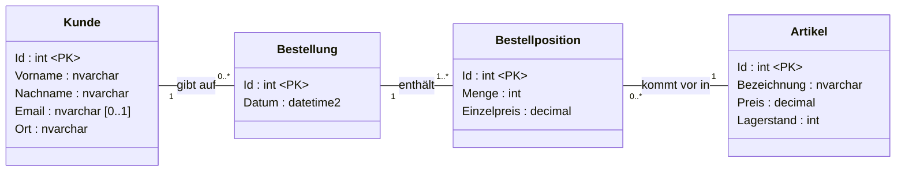
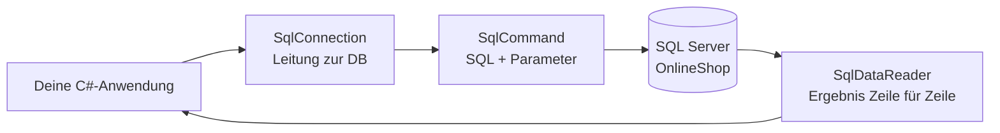

# Datenbanken in C#

## *Datenzugriff mit ADO.NET*

---
hideInToc: true
---

# Inhalt

<Toc minDepth="1" maxDepth="1" />

---
hideInToc: true
---

# Worum geht's?

<div class="flow mt-6">
  <div class="flow-left">
    <div class="flow-label">Das könnt ihr schon</div>
    <div class="flow-box known">
      <div class="font-bold">SQL im Management Studio</div>
      <code>SELECT * FROM Artikel</code>
    </div>
    <div class="flow-box known">
      <div class="font-bold">Klassen und Objekte in C#</div>
      <code>List&lt;Artikel&gt;</code>
    </div>
  </div>
  <svg class="flow-arrows" viewBox="0 0 140 300" width="140" height="300">
    <defs>
      <marker id="flow-pfeil" viewBox="0 0 10 10" refX="9" refY="5" markerWidth="8" markerHeight="8" orient="auto-start-reverse">
        <path d="M0,0 L10,5 L0,10 z" fill="#64748b" />
      </marker>
    </defs>
    <path d="M4,80 C70,80 70,150 134,150" fill="none" stroke="#64748b" stroke-width="2.5" marker-end="url(#flow-pfeil)" />
    <path d="M4,240 C70,240 70,150 134,150" fill="none" stroke="#64748b" stroke-width="2.5" marker-end="url(#flow-pfeil)" />
  </svg>
  <div class="flow-right">
    <div class="flow-label">Das fehlt noch</div>
    <div class="flow-box missing">
      <div class="text-6xl font-bold text-orange-500 leading-none">?</div>
      <p class="text-xl !my-2">„Wie kommt die Zeile aus der Tabelle in ein Objekt, und wieder zurück?“</p>
    </div>
  </div>
</div>

<style>
.flow {
  display: grid;
  grid-template-columns: 1fr 140px 1fr;
  align-items: center;
}
.flow-left {
  display: flex;
  flex-direction: column;
  gap: 1.25rem;
}
.flow-label {
  font-size: 0.8rem;
  font-weight: 700;
  text-transform: uppercase;
  letter-spacing: 0.05em;
  opacity: 0.6;
  margin-bottom: -0.5rem;
}
.flow-box {
  border-radius: 10px;
  padding: 0.9rem 1.1rem;
  display: flex;
  flex-direction: column;
  gap: 0.4rem;
}
.flow-box.known {
  height: 110px;
  justify-content: center;
  border: 2px solid #3b82f6;
  background: #eff6ff;
}
.flow-box.missing {
  border: 2px dashed #f97316;
  background: #fff7ed;
  text-align: center;
  align-items: center;
  margin-top: 0.75rem;
}
.flow-right {
  display: flex;
  flex-direction: column;
}
.flow-arrows {
  margin-top: 1.5rem;
}
</style>


<!--
Mit dieser Lücke steigen wir ein. Jede Technik in diesem Foliensatz ist eine Antwort auf genau diese Frage.
-->

---
hideInToc: true
---

# Unser OnlineShop



<!--
- Das Skript `setup.sql` liegt im Projektordner (und im Anhang dieses Foliensatzes).
- Warum hat die Bestellposition einen eigenen Einzelpreis? Weil sich der Artikelpreis später ändern kann. Die Rechnung muss aber den Preis zum Bestellzeitpunkt zeigen. Gute Frage an die Klasse.
-->

---
hideInToc: true
---

# Die Klassen dazu

Für die Tabellen `Kunde` und `Artikel` gibt es je eine Klasse in C#:

<div class="grid grid-cols-2 gap-6" style="--slidev-code-font-size: 0.7rem;">
<div>

```csharp
public class Kunde
{
    public int Id { get; set; }
    public string Vorname { get; set; } = "";
    public string Nachname { get; set; } = "";
    public string? Email { get; set; }
    public string Ort { get; set; } = "";
}
```

</div>
<div>

```csharp
public class Artikel
{
    public int Id { get; set; }
    public string Bezeichnung { get; set; } = "";
    public decimal Preis { get; set; }
    public int Lagerstand { get; set; }
}
```

</div>
</div>

<SqlBruecke>

Jede Spalte wird zu einer Eigenschaft. `Email` darf in der Tabelle `NULL` sein, darum ist sie in C# `string?`.

</SqlBruecke>

<!--
`string?` und `= ""` kennen die Schüler aus dem Foliensatz C#-Techniken.
-->

---
layout: section
---

# Verbindung herstellen

## Connection · Connection-String · using

---
hideInToc: true
---

# ADO.NET im Überblick



<v-clicks>

- **Connection:** die Leitung zur Datenbank
- **Command:** der Auftrag, also SQL plus Parameter
- **DataReader:** liest das Ergebnis, eine Zeile nach der anderen

</v-clicks>

<!--
- Analogie Telefonat: Verbindung aufbauen, Frage stellen, Antwort anhören, auflegen.
- ADO.NET ist der Name der Klassenbibliothek. Diese Klassen sind keine Steuerelemente.
-->

---
hideInToc: true
---

# Projekt vorbereiten

```bash{3}
dotnet new console -n OnlineShop
cd OnlineShop
dotnet add package Microsoft.Data.SqlClient
```

```csharp{2}
using System.Data;               // SqlDbType
using Microsoft.Data.SqlClient;  // SqlConnection, SqlCommand, …
```


- In Visual Studio geht es auch über „NuGet-Pakete verwalten“.


---
hideInToc: true
---

# Der Connection-String

<div class="font-mono text-xs p-4 rounded bg-gray-100 whitespace-nowrap leading-7">
<span class="px-1 rounded transition-colors" :class="$clicks >= 1 ? 'bg-red-200' : ''">Server=(localdb)\MSSQLLocalDB</span>;<span class="px-1 rounded transition-colors" :class="$clicks >= 2 ? 'bg-blue-200' : ''">Database=OnlineShop</span>;<span class="px-1 rounded transition-colors" :class="$clicks >= 3 ? 'bg-purple-200' : ''">Integrated Security=true</span>;<span class="px-1 rounded transition-colors" :class="$clicks >= 4 ? 'bg-green-200' : ''">TrustServerCertificate=true</span>
</div>

<table class="text-sm mt-2">
<thead><tr><th>Teil</th><th>Bedeutung</th></tr></thead>
<tbody>
<tr v-click><td class="border-l-4 border-red-400"><code>Server=(localdb)\MSSQLLocalDB</code></td><td>Welcher SQL Server? Hier LocalDB, alternativ <code>.\SQLEXPRESS</code></td></tr>
<tr v-click><td class="border-l-4 border-blue-400"><code>Database=OnlineShop</code></td><td>Welche Datenbank auf diesem Server?</td></tr>
<tr v-click><td class="border-l-4 border-purple-400"><code>Integrated Security=true</code></td><td>Anmeldung mit dem Windows-Benutzer, kein Passwort im Code</td></tr>
<tr v-click><td class="border-l-4 border-green-400"><code>TrustServerCertificate=true</code></td><td>Die Verbindung ist standardmäßig verschlüsselt. Bei lokalen Servern ohne Zertifikat braucht man diese Angabe.</td></tr>
</tbody>
</table>

<Merke>

Connection-Strings gehören in eine Konfigurationsdatei (`appsettings.json`), nicht in den Code. Für den Anfang reicht eine Konstante.

</Merke>

<!--
Ohne `TrustServerCertificate=true` kommt die Fehlermeldung „The certificate chain was issued by an authority that is not trusted“. Das ist der häufigste Fehler beim ersten Start.
-->

---
hideInToc: true
---

# Verbindung öffnen und schließen

<div style="--slidev-code-font-size: 0.6rem;">

```csharp {1|3|4|5-6|all}
const string ConnStr = "Server=(localdb)\\MSSQLLocalDB;Database=OnlineShop;Integrated Security=true;TrustServerCertificate=true";

using var con = new SqlConnection(ConnStr);
con.Open();
Console.WriteLine($"Status: {con.State}");   // Open
// … hier arbeiten …
// Ende des Blocks: using schließt die Verbindung automatisch
```

</div>

<Merke>

Spät öffnen, früh schließen. Das Connection-Pooling sorgt dafür, dass erneutes Öffnen billig ist.

</Merke>

<!--
- `using` ruft am Ende `Dispose()` auf, auch bei einer Exception. Das ist die moderne Kurzform von `try`/`finally`.
- Der Pool hält physische Verbindungen offen und vergibt sie wieder. Eine Verbindung „offen lassen“ bringt daher nichts und blockiert nur den Pool.
-->

---
hideInToc: true
---

# Drei Arten zu fragen

| **Methode** | **Liefert** | **Typisches SQL** | **Beispiel** |
|---|---|---|---|
| `ExecuteScalar()` | **einen** Wert (`object?`) | `SELECT COUNT(*)`, `SUM(…)` | Wie viele Artikel gibt es? |
| `ExecuteNonQuery()` | Anzahl betroffener Zeilen (`int`) | `INSERT`, `UPDATE`, `DELETE` | Neuen Artikel anlegen |
| `ExecuteReader()` | einen `SqlDataReader` (Tabelle) | `SELECT …` mit mehreren Zeilen/Spalten | Alle Artikel anzeigen |

<!--
Wir gehen genau in dieser Reihenfolge vor, vom einfachsten Ergebnis zum komplexesten.
-->

---
layout: section
---

# Ein einzelner Wert

## ExecuteScalar

---
hideInToc: true
---

# Schritt 1 · Ein einzelner Wert

```csharp {1-2|4|5|6|all}
using var con = new SqlConnection(ConnStr);
con.Open();

using var cmd = new SqlCommand("SELECT COUNT(*) FROM Artikel", con);
int anzahl = (int)cmd.ExecuteScalar()!;
Console.WriteLine($"Im Shop gibt es {anzahl} Artikel.");
```

<SqlBruecke>

Dasselbe SELECT, das du im Management Studio schreibst. Neu ist nur, dass es als String im C#-Code steht.

</SqlBruecke>

<!--
- `ExecuteScalar` liefert die erste Spalte der ersten Zeile als `object?`, daher der Cast.
- `COUNT(*)` liefert in SQL Server `int`, also passt `(int)`.
-->

---
hideInToc: true
---

# ExecuteScalar und NULL

Lagerwert aller Artikel einer Preisklasse:

```csharp {1-2|3|4|all}
using var cmd = new SqlCommand(
    "SELECT SUM(Preis * Lagerstand) FROM Artikel WHERE Preis > 1000", con);
object? ergebnis = cmd.ExecuteScalar();
decimal lagerwert = ergebnis is DBNull ? 0 : (decimal)ergebnis!;
```

<Achtung>

`SUM` über keine Zeilen ergibt in SQL `NULL`. In C# kommt dann `DBNull.Value` an, nicht `null`. Ein direkter Cast `(decimal)` wirft eine `InvalidCastException`.

</Achtung>

<!--
`DBNull` ist ein eigener Typ für „NULL aus der Datenbank“. Diese Unterscheidung kommt beim DataReader wieder.
-->

---
layout: section
---

# Daten ändern

## ExecuteNonQuery · Parameter · INSERT, UPDATE, DELETE

---
hideInToc: true
---

# Schritt 2 · Daten ändern

```csharp {1-3|4|all}
using var cmd = new SqlCommand(
    "INSERT INTO Artikel (Bezeichnung, Preis, Lagerstand) " +
    "VALUES ('Laptop-Ständer', 34.90, 20)", con);
int betroffen = cmd.ExecuteNonQuery();
Console.WriteLine($"{betroffen} Zeile(n) eingefügt.");   // 1
```

<div v-click class="mt-10 text-3xl font-bold text-center">
„Und wenn der Benutzer die Werte eingibt?“
</div>

<!--
`ExecuteNonQuery` liefert keine Daten, nur die Anzahl der betroffenen Zeilen. Diese Zahl ist bei UPDATE und DELETE wichtig: 0 bedeutet „nicht gefunden“.
-->

---
hideInToc: true
---

# Der naheliegende Weg - 🛑 DO NOT USE🛑

Eingaben per String-Verkettung einbauen:

<div style="--slidev-code-font-size: 0.75rem;">

```csharp
Console.Write("Bezeichnung: ");
string bez = Console.ReadLine()!;
Console.Write("Preis: ");
decimal preis = decimal.Parse(Console.ReadLine()!);

string sql = "INSERT INTO Artikel (Bezeichnung, Preis, Lagerstand) " +
             "VALUES ('" + bez + "', " + preis + ", 0)";
using var cmd = new SqlCommand(sql, con);
cmd.ExecuteNonQuery();
```

</div>

<v-clicks>

1. Eingabe `12,90`, und auf einem deutschsprachigen Windows entsteht `VALUES ('Maus', 12,90, 0)`. Das sind 4 Werte für 3 Spalten, also ein SQL-Fehler. 💥
2. Eingabe `Kinder's Maus`: Das Apostroph beendet den String, und es entsteht ein Syntaxfehler. 💥
3. Es geht noch schlimmer, siehe nächste Folie. 😱

</v-clicks>

<!--
Diesen Code bewusst live schreiben und mit den Eingaben scheitern lassen. Das Kulturproblem beim Dezimalkomma überrascht fast alle.
-->

---
hideInToc: true
layout: two-cols
layoutClass: gap-8
---

# SQL-Injection 🥷🏿👉💥

Kundensuche per Verkettung:

```csharp
string name = Console.ReadLine()!;
string sql = "SELECT Id, Vorname, Nachname FROM Kunde " +
             "WHERE Nachname = '" + name + "'";
```

<Achtung title="⚠️ Sicherheitslücke">

SQL-Injection gehört seit Jahren zu den häufigsten Sicherheitslücken in Webanwendungen (OWASP Top 10).

</Achtung>

::right::

<div class="mt-16 text-sm">

<v-clicks>

- Eingabe `Berger` ergibt<br>`… WHERE Nachname = 'Berger'`<br>Das funktioniert wie gewünscht. ✅
- Eingabe `x' OR '1'='1` ergibt<br>`… WHERE Nachname = 'x' OR '1'='1'`<br>Damit erscheinen **alle Kunden**. 😬
- Eingabe `x'; DELETE FROM Bestellposition; --` führt **zwei Befehle** aus, und die Bestellpositionen sind gelöscht. 💀

</v-clicks>

</div>

<!--
- Live vorführen, aber nur auf der Testdatenbank.
- Danach mit `setup.sql` neu aufsetzen.
- Optional den xkcd-Comic „Exploits of a Mom“ (Little Bobby Tables) verlinken. Nur verlinken, nicht als Bild einbetten: https://xkcd.com/327/
-->

---
hideInToc: true
---

# Die Lösung: Parameter

````md magic-move
```csharp
string sql = "SELECT Id, Vorname, Nachname FROM Kunde " +
             "WHERE Nachname = '" + name + "'";
using var cmd = new SqlCommand(sql, con);
```
```csharp
string sql = "SELECT Id, Vorname, Nachname FROM Kunde " +
             "WHERE Nachname = @nachname";
using var cmd = new SqlCommand(sql, con);
cmd.Parameters.Add("@nachname", SqlDbType.NVarChar, 50).Value = name;
```
````

<v-clicks>

- Das SQL enthält nur noch einen **Platzhalter** `@nachname`.
- Der Wert wird **getrennt** vom SQL an den Server geschickt. Er wird nie als SQL-Code ausgeführt.
- Typ und Länge entsprechen der Spalte (`NVARCHAR(50)`).

</v-clicks>

<Merke>

Benutzereingaben kommen **nie** per `+` ins SQL, ausnahmslos.

</Merke>

---
hideInToc: true
---

# Parameter im Detail

Der INSERT von vorhin, jetzt richtig:

```csharp {3-5|6|7|8|9}
string bez = "Zahnbürste";
decimal preis = 29.90m;
using var cmd = new SqlCommand(
    "INSERT INTO Artikel (Bezeichnung, Preis, Lagerstand) " +
    "VALUES (@bez, @preis, @lager)", con);
cmd.Parameters.Add("@bez", SqlDbType.NVarChar, 100).Value = bez;
cmd.Parameters.Add("@preis", SqlDbType.Decimal).Value = preis;
cmd.Parameters.Add("@lager", SqlDbType.Int).Value = 0;
cmd.ExecuteNonQuery();
```

<div class="grid grid-cols-2 gap-4 mt-4 text-sm">
<div class="p-3 rounded border-t-4 border-green-600">

**`Parameters.Add(name, typ, länge)`**<br>
Typ genau wie in der Tabelle, so empfohlen. ✅

</div>
<div class="p-3 rounded border-t-4 border-orange-500">

**`Parameters.AddWithValue(name, wert)`**<br>
Der Typ wird erraten. Das funktioniert, kann aber zu falschen Typen und langsameren Abfragen führen. In alten Tutorials sehr häufig.

</div>
</div>

<!--
- Dezimalkomma und Apostroph sind mit Parametern automatisch kein Problem mehr. Die Probleme von „Der naheliegende Weg“ noch einmal durchspielen.
- Hintergrund zu AddWithValue: Ein `string` wird z. B. als `nvarchar` mit der Länge des aktuellen Werts gesendet. Das erzeugt viele verschiedene Abfragepläne, und bei `varchar`-Spalten nutzt SQL Server unter Umständen den Index nicht.
-->

---
hideInToc: true
---

# NULL-Werte als Parameter

```csharp
// kunde.Email ist string? – kann null sein
cmd.Parameters.Add("@email", SqlDbType.NVarChar, 100).Value =
    (object?)kunde.Email ?? DBNull.Value;
```

<Achtung>

C#-`null` als Parameterwert bedeutet für SqlClient „Parameter fehlt“ und führt zu einem Fehler. Für SQL-NULL braucht man `DBNull.Value`.

</Achtung>

<!--
Das ist das Gegenstück zu „ExecuteScalar und NULL“. In beide Richtungen gilt: `null` in C# ist nicht dasselbe wie `NULL` in der Datenbank.
-->

---
hideInToc: true
---

# Die neue Id zurückbekommen

```csharp {2-3|6-8|9}
using var cmd = new SqlCommand("""
    INSERT INTO Artikel (Bezeichnung, Preis, Lagerstand)
    OUTPUT INSERTED.Id
    VALUES (@bez, @preis, @lager)
    """, con);
cmd.Parameters.Add("@bez", SqlDbType.NVarChar, 100).Value = artikel.Bezeichnung;
cmd.Parameters.Add("@preis", SqlDbType.Decimal).Value = artikel.Preis;
cmd.Parameters.Add("@lager", SqlDbType.Int).Value = artikel.Lagerstand;
artikel.Id = (int)cmd.ExecuteScalar()!;
```

<SqlBruecke>

`OUTPUT INSERTED.Id` liefert die von `IDENTITY` vergebene Id. Weil das genau ein Wert ist, verwenden wir `ExecuteScalar`.

</SqlBruecke>

<!--
`"""…"""` ist ein Raw-String-Literal (ab C# 11). Damit lässt sich mehrzeiliges SQL gut lesbar schreiben.
-->

---
hideInToc: true
---

# UPDATE und DELETE

```csharp {1-4|5|7-9|all}
using var cmd = new SqlCommand(
    "UPDATE Artikel SET Preis = @preis WHERE Id = @id", con);
cmd.Parameters.Add("@preis", SqlDbType.Decimal).Value = 19.90m;
cmd.Parameters.Add("@id", SqlDbType.Int).Value = 2;
int betroffen = cmd.ExecuteNonQuery();

if (betroffen == 0)
    Console.WriteLine("Artikel nicht gefunden.");
```

<!--
- DELETE funktioniert genauso.
- Frage an die Klasse: Was passiert bei `DELETE FROM Artikel WHERE Id = 1`? Antwort: Es gibt einen Fehler wegen des Fremdschlüssels, weil der Artikel in Bestellpositionen vorkommt. Die Exception ist eine `SqlException` mit der Nummer 547.
-->

---
layout: section
---

# Daten lesen

## ExecuteReader · Mapping · DTO

---
hideInToc: true
---

# Schritt 3 · Eine ganze Tabelle lesen

```csharp {1-2|4|5|7-9|10|all}
using var cmd = new SqlCommand(
    "SELECT Id, Bezeichnung, Preis, Lagerstand FROM Artikel ORDER BY Bezeichnung", con);

using SqlDataReader reader = cmd.ExecuteReader();
while (reader.Read())
{
    int id = reader.GetInt32(0);
    string bez = reader.GetString(1);
    decimal preis = reader.GetDecimal(2);
    Console.WriteLine($"{id},  {bez}, {preis}");
}
```

<!--
- `Read()` springt zur nächsten Zeile und liefert `false`, wenn keine mehr da ist.
- Vor dem ersten `Read()` steht der Reader **vor** der ersten Zeile.
- Die Zahl in `GetInt32(0)` ist die Spaltenposition im SELECT.
-->

---
hideInToc: true
---

# So arbeitet der DataReader

<table class="text-sm w-auto mx-auto">
<thead><tr><th class="w-10"></th><th>Id</th><th>Bezeichnung</th><th class="text-right">Preis</th></tr></thead>
<tbody>
<tr v-for="(z, i) in [['4','27-Zoll-Monitor','229,00'],['2','Funkmaus','24,90'],['5','HDMI-Kabel 2 m','7,50'],['…','…','…']]" :key="i" class="transition-colors" :class="Math.min($clicks, 3) === i ? 'bg-yellow-100' : ''">
<td class="text-xl text-orange-600">{{ Math.min($clicks, 3) === i ? '➜' : '' }}</td>
<td>{{ z[0] }}</td><td>{{ z[1] }}</td><td>{{ z[2] }}</td>
</tr>
</tbody>
</table>

<div class="mt-6">
<p v-click="4">➡️ <b>Nur vorwärts:</b> Man kann nicht zurückspringen.</p>
<p v-click="5">👀 <b>Nur lesen:</b> Änderungen laufen über eigene Commands.</p>
<p v-click="6">🔌 <b>Die Verbindung bleibt offen, solange gelesen wird:</b> erst lesen, dann schließen.</p>
</div>

<!--
Live mit einem Haltepunkt in der `while`-Schleife zeigen. Nach jedem Schritt im Debugger ist eine neue Zeile da.
-->

---
hideInToc: true
---

# Spalten über den Namen ansprechen

````md magic-move
```csharp
int id = reader.GetInt32(0);
string bez = reader.GetString(1);
decimal preis = reader.GetDecimal(2);
```
```csharp
int iId = reader.GetOrdinal("Id");
int iBez = reader.GetOrdinal("Bezeichnung");
int iPreis = reader.GetOrdinal("Preis");
while (reader.Read())
{
    int id = reader.GetInt32(iId);
    string bez = reader.GetString(iBez);
    decimal preis = reader.GetDecimal(iPreis);
}
```
````

<Achtung>

Wenn jemand im SELECT die Reihenfolge der Spalten ändert, liefern feste Zahlen plötzlich falsche Daten oder eine `InvalidCastException`.

</Achtung>

<!--
`GetOrdinal` einmal vor der Schleife aufrufen, nicht in jeder Zeile. Die Kurzform `(string)reader["Bezeichnung"]` erwähnen: Sie funktioniert auch, kostet aber etwas mehr.
-->

---
hideInToc: true
---

# NULL beim Lesen

Kunden lesen. `Email` darf NULL sein.

```csharp
int iEmail = reader.GetOrdinal("Email");
// …
string? email = reader.IsDBNull(iEmail) ? null : reader.GetString(iEmail);
```

<Achtung>

`GetString` auf einer NULL-Spalte wirft eine `SqlNullValueException`. Vorher immer `IsDBNull` prüfen, wenn die Spalte NULL erlaubt.

</Achtung>

---
hideInToc: true
---

# Mapping: aus Zeilen werden Objekte

<div style="--slidev-code-font-size: 0.68rem; --slidev-code-line-height: 1.35;">

```csharp {1|3-5|7-17|18}
static List<Artikel> AlleArtikel(SqlConnection con)
{
    using var cmd = new SqlCommand(
        "SELECT Id, Bezeichnung, Preis, Lagerstand FROM Artikel ORDER BY Bezeichnung", con);
    using var reader = cmd.ExecuteReader();

    List<Artikel> liste = new List<Artikel>();
    while (reader.Read())
    {
        liste.Add(new Artikel
        {
            Id          = reader.GetInt32(reader.GetOrdinal("Id")),
            Bezeichnung = reader.GetString(reader.GetOrdinal("Bezeichnung")),
            Preis       = reader.GetDecimal(reader.GetOrdinal("Preis")),
            Lagerstand  = reader.GetInt32(reader.GetOrdinal("Lagerstand"))
        });
    }
    return liste;
}
```

</div>

<!--
- Hier schließt sich die Lücke von „Worum geht's?“: Die Tabelle ist jetzt eine `List<Artikel>`.
- Diese Übertragung Spalte für Spalte heißt **Mapping**. Das Wort merken, es kommt beim ORM wieder.
-->

---
hideInToc: true
layout: two-cols
layoutClass: gap-6
---

# JOINs: Ergebnisse, die zu keiner Tabelle passen

<div style="--slidev-code-font-size: 0.68rem;">

```sql
SELECT b.Id, b.Datum,
       k.Vorname + ' ' + k.Nachname AS Kunde,
       SUM(p.Menge * p.Einzelpreis) AS Summe
FROM Bestellung b
JOIN Kunde k           ON k.Id = b.KundeId
JOIN Bestellposition p ON p.BestellungId = b.Id
WHERE k.Id = @kundeId
GROUP BY b.Id, b.Datum, k.Vorname, k.Nachname
ORDER BY b.Datum DESC
```

</div>

::right::

<div class="mt-20" style="--slidev-code-font-size: 0.58rem; --slidev-code-line-height: 1.3;">

```csharp
public class BestellUebersicht
{
    public int BestellungId { get; set; }
    public DateTime Datum { get; set; }
    public string Kunde { get; set; } = "";
    public decimal Summe { get; set; }
}

// in der Leseschleife:
liste.Add(new BestellUebersicht
{
    BestellungId = reader.GetInt32(0),
    Datum        = reader.GetDateTime(1),
    Kunde        = reader.GetString(2),
    Summe        = reader.GetDecimal(3)
});
```

</div>

<Merke>

Für Abfrageergebnisse, die keiner Tabelle entsprechen, legt man eine eigene kleine Klasse an, ein **DTO** (Data Transfer Object). Sie hat nur Eigenschaften, keine Methoden.

</Merke>

<!--
Die SQL-Abfrage können die Schüler schon. Neu ist nur, wohin das Ergebnis kommt.
-->

---
layout: section
---

# Asynchron und aufgeräumt

## async/await · Repository

---
hideInToc: true
---

# async/await: Warum?

<v-clicks>

- Eine Datenbankabfrage dauert, das Programm **wartet**.
- In WinForms/WPF friert die Oberfläche ein.
- Ein Webserver blockiert pro Anfrage einen Thread, bei vielen Benutzern wird das zum Problem.
- Mit **async/await** gibt das Programm die Kontrolle ab, während die Datenbank arbeitet.

</v-clicks>

<!--
Keine Theorie zu Threads, nur das Prinzip: „Während ich warte, darf etwas anderes passieren.“ Das reicht hier völlig.
-->

---
hideInToc: true
---

# Von sync zu async

<div style="--slidev-code-font-size: 0.64rem; --slidev-code-line-height: 1.35;">

````md magic-move
```csharp
static List<Artikel> AlleArtikel(SqlConnection con)
{
    using var cmd = new SqlCommand(
        "SELECT Id, Bezeichnung, Preis, Lagerstand FROM Artikel ORDER BY Bezeichnung", con);
    using var reader = cmd.ExecuteReader();

    var liste = new List<Artikel>();
    while (reader.Read())
    {
        // Mapping unverändert
    }
    return liste;
}
```
```csharp
static async Task<List<Artikel>> AlleArtikelAsync(SqlConnection con)
{
    await using var cmd = new SqlCommand(
        "SELECT Id, Bezeichnung, Preis, Lagerstand FROM Artikel ORDER BY Bezeichnung", con);
    await using var reader = await cmd.ExecuteReaderAsync();

    var liste = new List<Artikel>();
    while (await reader.ReadAsync())
    {
        // Mapping unverändert
    }
    return liste;
}
```
````

<div v-click class="mt-2">

<p class="text-sm !my-1">Aufruf im Hauptprogramm (<code>Program.cs</code>):</p>

```csharp
await using var con = new SqlConnection(ConnStr);
await con.OpenAsync();

List<Artikel> artikel = await AlleArtikelAsync(con);
foreach (var a in artikel)
    Console.WriteLine($"{a.Bezeichnung}: {a.Preis:C}");
```

</div>

</div>

---
hideInToc: true
---

# Von sync zu async: die Umstellungen

<div class="text-sm">

| sync | async |
|---|---|
| `con.Open()` | `await con.OpenAsync()` |
| `ExecuteScalar()` | `await ExecuteScalarAsync()` |
| `ExecuteNonQuery()` | `await ExecuteNonQueryAsync()` |
| `ExecuteReader()` | `await ExecuteReaderAsync()` |
| `reader.Read()` | `await reader.ReadAsync()` |
| `using var` | `await using var` |
| `List<Artikel>` als Rückgabe | `async Task<List<Artikel>>` |

</div>

<Merke>

Ab jetzt schreiben wir den Datenzugriff asynchron.

</Merke>

---
hideInToc: true
---

# Ordnung: das Repository

Ziel: Kein SQL in `Main` oder in Button-Klicks. Der gesamte Datenzugriff für Artikel steckt in einer Klasse.

<div style="--slidev-code-font-size: 0.64rem; --slidev-code-line-height: 1.35;">

<div class="grid grid-cols-2 gap-4">
<div>

```csharp [ArtikelRepository.cs]
public class ArtikelRepository
{
    private readonly string connStr;

    public ArtikelRepository(string connStr)
    {
        this.connStr = connStr;
    }

    public async Task<List<Artikel>> GetAllAsync() { … }
    public async Task<Artikel?> GetByIdAsync(int id) { … }
    public async Task<int> InsertAsync(Artikel artikel) { … }     
    public async Task<bool> UpdateAsync(Artikel artikel) { … }
    public async Task<bool> DeleteAsync(int id) { … }
}
```

</div>
<div>

```csharp [Program.cs]
// Verwendung – das Programm sieht kein SQL mehr
var repo = new ArtikelRepository(ConnStr);
foreach (Artikel a in await repo.GetAllAsync())
    Console.WriteLine($"{a.Bezeichnung}: {a.Preis:C}");
```

</div>
</div>
<Merke>

**"Repository"** ist ein Entwurfsmuster (*en: Design Pattern*), das den Zugriff auf Datenquellen abstrahiert und eine klare Trennung zwischen Geschäftslogik und Datenzugriffsschicht ermöglicht.

</Merke>

</div>

<!--
- Jede Methode öffnet ihre eigene Verbindung, so wie auf „Verbindung öffnen und schließen“ beschrieben.
- Ausblick: Mit einem Interface `IArtikelRepository` lässt sich die Implementierung später gegen EF Core tauschen. Dazu passt die Konsolen-Demo „DatenzugriffDemo“.
- Übungsaufgabe: `ArtikelRepository` vollständig implementieren.
-->

---
hideInToc: true
---

# Was nervt?

<div class="text-sm">

<v-clicks>

- 😩 Für jede Tabelle dieselben Zeilen: Verbindung, Command, Parameter, Schleife.
- 😩 **Mapping von Hand:** `reader.GetString(reader.GetOrdinal("Bezeichnung"))` für jede Spalte.
- 😩 **SQL steht in Strings.** Ein Tippfehler (`Bezeichung`) fällt erst zur Laufzeit auf.
- 😩 Wird eine Spalte umbenannt, muss man jedes SQL im Projekt suchen.

</v-clicks>

</div>

<div v-click class="mt-6 text-3xl font-bold text-center">
„Geht das nicht besser?“
</div>

<!--
- Zum Zeilenvergleich: Die Methode `AlleArtikel` hat rund 20 Zeilen, davon eine Zeile SQL.
- Den Schmerz bewusst stehen lassen, er ist die Motivation für den Foliensatz „ORM & Entity Framework Core“.
-->


---
layout: section
---

# Anhang

## setup.sql · Datenbank OnlineShop

---
hideInToc: true
layout: two-cols
layoutClass: gap-6
---

# setup.sql (1/2): Tabellen

<div style="--slidev-code-font-size: 0.58rem; --slidev-code-line-height: 1.3;">

```sql
CREATE DATABASE OnlineShop;
GO
USE OnlineShop;
GO
CREATE TABLE Kunde (
    Id        INT IDENTITY PRIMARY KEY,
    Vorname   NVARCHAR(50)  NOT NULL,
    Nachname  NVARCHAR(50)  NOT NULL,
    Email     NVARCHAR(100) NULL,
    Ort       NVARCHAR(50)  NOT NULL
);
CREATE TABLE Artikel (
    Id          INT IDENTITY PRIMARY KEY,
    Bezeichnung NVARCHAR(100) NOT NULL,
    Preis       DECIMAL(10,2) NOT NULL,
    Lagerstand  INT NOT NULL DEFAULT 0
);
```

</div>

::right::

<div class="mt-19" style="--slidev-code-font-size: 0.58rem; --slidev-code-line-height: 1.3;">

```sql
CREATE TABLE Bestellung (
    Id       INT IDENTITY PRIMARY KEY,
    KundeId  INT NOT NULL REFERENCES Kunde(Id),
    Datum    DATETIME2 NOT NULL DEFAULT SYSDATETIME()
);
CREATE TABLE Bestellposition (
    Id            INT IDENTITY PRIMARY KEY,
    BestellungId  INT NOT NULL REFERENCES Bestellung(Id),
    ArtikelId     INT NOT NULL REFERENCES Artikel(Id),
    Menge         INT NOT NULL CHECK (Menge > 0),
    Einzelpreis   DECIMAL(10,2) NOT NULL
);
```

<p class="text-sm mt-4">📥 <a href="onlineshop/setup.sql" download>setup.sql herunterladen</a></p>

</div>

---
hideInToc: true
---

# setup.sql (2/2): Testdaten

<div style="--slidev-code-font-size: 0.6rem; --slidev-code-line-height: 1.3;">

```sql
INSERT INTO Kunde (Vorname, Nachname, Email, Ort) VALUES
 ('Anna','Berger','anna.berger@example.at','Wolfsberg'),
 ('Lukas','Pichler',NULL,'Wolfsberg'),
 ('Sophie','Wallner','s.wallner@example.at','St. Andrä'),
 ('Tobias','Krenn','tobias.krenn@example.at','Klagenfurt'),
 ('Lena','Fuchs','lena.fuchs@example.at','Villach');

INSERT INTO Artikel (Bezeichnung, Preis, Lagerstand) VALUES
 ('USB-Stick 64 GB', 12.90, 50),
 ('Funkmaus', 24.90, 30),
 ('Mechanische Tastatur', 89.00, 12),
 ('27-Zoll-Monitor', 229.00, 5),
 ('HDMI-Kabel 2 m', 7.50, 100),
 ('Webcam Full HD', 49.90, 0);

INSERT INTO Bestellung (KundeId, Datum) VALUES
 (1,'2026-09-14'), (1,'2026-10-02'), (3,'2026-10-05'), (4,'2026-10-06');

INSERT INTO Bestellposition (BestellungId, ArtikelId, Menge, Einzelpreis) VALUES
 (1,1,2,12.90), (1,5,1,7.50),
 (2,4,1,229.00), (2,2,1,24.90),
 (3,3,1,89.00),
 (4,1,5,12.90), (4,5,3,7.50);
```

</div>
