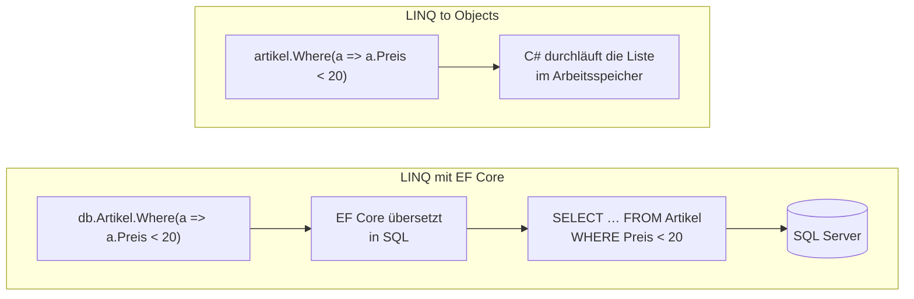

# LINQ

## *Abfragen direkt in C#*

---
hideInToc: true
---

# Inhalt

<Toc minDepth="1" maxDepth="1" />

---
layout: section
---

# Grundlagen

## Was ist LINQ? · Lambda-Ausdrücke

---
hideInToc: true
---

# Was ist LINQ?

- **LINQ = Language Integrated Query**, also Abfragen als Teil der Sprache C#.
- Funktioniert auf **allem, was man durchlaufen kann:** Listen, Arrays, und über EF Core auch auf Datenbanken.
- Wir lernen es zuerst auf einer `List<Artikel>` im Speicher, ganz ohne Datenbank.

<SqlBruecke>

LINQ fühlt sich an wie SQL: `Where`, `OrderBy`, `GroupBy`, `Sum` … Nur steht die Abfrage direkt im C#-Code.

</SqlBruecke>

---
hideInToc: true
---

# Unsere Testdaten

Für alle Folien in diesem Foliensatz:

<div style="--slidev-code-font-size: 0.68rem; --slidev-code-line-height: 1.35;">
<div class="w-1/2">

```csharp
public class Artikel
{
    public int Id { get; set; }
    public string Bezeichnung { get; set; } = "";
    public decimal Preis { get; set; }
    public int Lagerstand { get; set; }
}
```

</div>
<div>

```csharp
List<Artikel> artikel = new List<Artikel>();
artikel.Add(new Artikel { Id = 1, Bezeichnung = "USB-Stick 64 GB",      Preis = 12.90m,  Lagerstand = 50 });
artikel.Add(new Artikel { Id = 2, Bezeichnung = "Funkmaus",             Preis = 24.90m,  Lagerstand = 30 });
artikel.Add(new Artikel { Id = 3, Bezeichnung = "Mechanische Tastatur", Preis = 89.00m,  Lagerstand = 12 });
artikel.Add(new Artikel { Id = 4, Bezeichnung = "27-Zoll-Monitor",      Preis = 229.00m, Lagerstand = 5 });
artikel.Add(new Artikel { Id = 5, Bezeichnung = "HDMI-Kabel 2 m",       Preis = 7.50m,   Lagerstand = 100 });
artikel.Add(new Artikel { Id = 6, Bezeichnung = "Webcam Full HD",       Preis = 49.90m,  Lagerstand = 0 });
```

</div>
</div>

<!--
Dieselben sechs Artikel wie in `setup.sql`. So lassen sich die Ergebnisse später mit der Datenbank vergleichen.
-->

---
hideInToc: true
layout: two-cols
layoutClass: gap-8
---

# Ohne und mit LINQ

**So kennt ihr es**

```csharp
var guenstige = new List<Artikel>();
foreach (var a in artikel)
{
    if (a.Preis < 20)
        guenstige.Add(a);
}
guenstige.Sort((x, y) =>
    x.Bezeichnung.CompareTo(y.Bezeichnung));
```

::right::

<div class="mt-19">

**Mit LINQ**

```csharp
var guenstige = artikel
    .Where(a => a.Preis < 20)
    .OrderBy(a => a.Bezeichnung)
    .ToList();
```

<SqlBruecke>

`SELECT * FROM Artikel WHERE Preis < 20 ORDER BY Bezeichnung`

</SqlBruecke>

</div>

<!--
LINQ beschreibt, **was** man will, nicht **wie** es Schritt für Schritt gemacht wird. Genau wie SQL.
-->

---
hideInToc: true
---

# Lambda-Ausdrücke

Ein **Lambda** ist eine kleine, namenlose Funktion:

<div class="text-center font-mono text-4xl my-6">
<span class="px-2 rounded transition-colors" :class="$clicks >= 1 ? 'bg-red-200' : ''">a</span>
<span class="px-2 rounded transition-colors" :class="$clicks >= 2 ? 'bg-blue-200' : ''">=&gt;</span>
<span class="px-2 rounded transition-colors" :class="$clicks >= 3 ? 'bg-green-200' : ''">a.Preis &lt; 20</span>
</div>

<div class="grid grid-cols-3 gap-4 text-sm text-center">
<div v-click class="p-2 rounded border-t-4 border-red-400"><code>a</code> ist der Parameter (ein Artikel)</div>
<div v-click class="p-2 rounded border-t-4 border-blue-400"><code>=&gt;</code> heißt „wird zu“</div>
<div v-click class="p-2 rounded border-t-4 border-green-400"><code>a.Preis &lt; 20</code> ist das Ergebnis (<code>bool</code>)</div>
</div>

Vergleich mit einer normalen Methode:

```csharp
// als Methode
static bool IstGuenstig(Artikel a) { return a.Preis < 20; }

// als Lambda
Func<Artikel, bool> istGuenstig = a => a.Preis < 20;
```

`Where` ruft das Lambda für jeden Artikel auf und behält jene, bei denen `true` herauskommt.

<!--
Für LINQ reicht dieses Verständnis völlig. `Func<…>` nur kurz zeigen, nicht vertiefen.
-->

---
layout: section
---

# Die wichtigsten Operatoren

## Filtern · Sortieren · Projizieren · Gruppieren

---
hideInToc: true
---

# Die wichtigsten Operatoren

<div class="text-xs">

| LINQ | SQL | Beispiel |
|---|---|---|
| `Where(a => …)` | `WHERE` | `.Where(a => a.Lagerstand > 0)` |
| `Select(a => …)` | Spaltenliste im `SELECT` | `.Select(a => a.Bezeichnung)` |
| `OrderBy` / `OrderByDescending` / `ThenBy` | `ORDER BY` | `.OrderBy(a => a.Preis)` |
| `Count` / `Sum` / `Average` / `Min` / `Max` | Aggregatfunktionen | `.Sum(a => a.Preis * a.Lagerstand)` |
| `First` / `FirstOrDefault` | `TOP 1` | `.FirstOrDefault(a => a.Id == 3)` |
| `Any` | `EXISTS` | `.Any(a => a.Lagerstand == 0)` |
| `GroupBy` | `GROUP BY` | `.GroupBy(a => a.Preis > 50)` |
| `Take` / `Skip` | `TOP` / `OFFSET … FETCH` | `.Skip(10).Take(10)` |
| `ToList` | Ausführen und Ergebnis holen | `.ToList()` |

</div>

---
hideInToc: true
---

# Beispiele im Shop

<div style="--slidev-code-font-size: 0.72rem;" class="text-sm">

**Wie viel ist das Lager wert?**

<div v-click>

```csharp
decimal lagerwert = artikel.Sum(a => a.Preis * a.Lagerstand);
```

</div>

**Gibt es Artikel, die ausverkauft sind?**

<div v-click>

```csharp
bool ausverkauft = artikel.Any(a => a.Lagerstand == 0);
```

</div>

**Der teuerste Artikel**

<div v-click>

```csharp
Artikel teuerster = artikel.OrderByDescending(a => a.Preis).First();
```

</div>

**Nur die Bezeichnungen der lagernden Artikel, alphabetisch**

<div v-click>

```csharp
List<string> namen = artikel
    .Where(a => a.Lagerstand > 0)
    .OrderBy(a => a.Bezeichnung)
    .Select(a => a.Bezeichnung)
    .ToList();
```

</div>

</div>

<!--
Live mit den Testdaten ausprobieren, vorher Ergebnisse vorhersagen lassen (Predict → Run).
-->

---
hideInToc: true
---

# First, FirstOrDefault, Single

| Methode | 0 Treffer | 1 Treffer | mehrere Treffer |
|---|---|---|---|
| `First` | Exception | das Element | das erste |
| `FirstOrDefault` | `null` | das Element | das erste |
| `Single` | Exception | das Element | Exception |
| `SingleOrDefault` | `null` | das Element | Exception |

<Merke>

Suche nach Id (es kann höchstens einen geben): `SingleOrDefault` oder `FirstOrDefault`, und danach auf `null` prüfen.

</Merke>

---
hideInToc: true
---

# Projektion: nur was man braucht

<div class="grid grid-cols-2 gap-6" style="--slidev-code-font-size: 0.62rem; --slidev-code-line-height: 1.35;">
<div>

**Anonymer Typ** – nur innerhalb der Methode verwendbar

```csharp
var preisliste = artikel
    .Select(a => new { a.Bezeichnung, Brutto = a.Preis * 1.2m })
    .ToList();
```

<p class="text-sm">Die Klasse hat keinen Namen, darum geht hier <b>nur</b> <code>var</code>.</p>

</div>
<div>

**DTO-Klasse** – auch als Rückgabewert verwendbar

```csharp
public class PreisZeile
{
    public string Bezeichnung { get; set; } = "";
    public decimal Brutto { get; set; }
}

List<PreisZeile> liste = artikel
    .Select(a => new PreisZeile
    {
        Bezeichnung = a.Bezeichnung,
        Brutto = a.Preis * 1.2m
    })
    .ToList();
```

</div>
</div>

<!--
- Ein DTO kennen wir schon aus dem Foliensatz „Datenbanken in C#“ (Folie „JOINs: Ergebnisse, die zu keiner Tabelle passen“).
- Bei EF Core wird `Select` später wichtig, weil dann nur diese Spalten aus der Datenbank geholt werden.
-->

---
hideInToc: true
---

# GroupBy

Wie viele Stück wurden von jedem Artikel verkauft?

<div class="grid grid-cols-2 gap-6" style="--slidev-code-font-size: 0.58rem; --slidev-code-line-height: 1.35;">
<div>

```csharp
public class Bestellposition
{
    public Artikel Artikel { get; set; } = null!;
    public int Menge { get; set; }
}

// Testdaten wie in setup.sql
List<Bestellposition> positionen = new List<Bestellposition>();
positionen.Add(new Bestellposition { Artikel = artikel[0], Menge = 2 });
positionen.Add(new Bestellposition { Artikel = artikel[4], Menge = 1 });
positionen.Add(new Bestellposition { Artikel = artikel[3], Menge = 1 });
positionen.Add(new Bestellposition { Artikel = artikel[1], Menge = 1 });
positionen.Add(new Bestellposition { Artikel = artikel[2], Menge = 1 });
positionen.Add(new Bestellposition { Artikel = artikel[0], Menge = 5 });
positionen.Add(new Bestellposition { Artikel = artikel[4], Menge = 3 });
```

</div>
<div>

```csharp {all|2|3|4|6-7}
var verkauft = positionen
    .GroupBy(p => p.Artikel.Bezeichnung)
    .Select(g => new { Artikel = g.Key, Stueck = g.Sum(p => p.Menge) })
    .OrderByDescending(x => x.Stueck);

foreach (var v in verkauft)
    Console.WriteLine($"{v.Artikel}: {v.Stueck} Stück");
```

<div v-click>

```text
USB-Stick 64 GB: 7 Stück
HDMI-Kabel 2 m: 4 Stück
27-Zoll-Monitor: 1 Stück
Funkmaus: 1 Stück
Mechanische Tastatur: 1 Stück
```

</div>
</div>
</div>

<SqlBruecke>

`SELECT a.Bezeichnung, SUM(p.Menge) FROM Bestellposition p JOIN Artikel a ON a.Id = p.ArtikelId GROUP BY a.Bezeichnung`. `g.Key` ist der Gruppierungswert, hier die Bezeichnung.

</SqlBruecke>

<!--
- Ergebnis vorher vorhersagen lassen (Predict → Run).
- Die Webcam fehlt im Ergebnis: Sie wurde nie bestellt, also gibt es keine Gruppe für sie. Das ist wie bei `GROUP BY` mit `INNER JOIN`.
- Die Bestellposition verweist hier direkt auf das Artikel-Objekt. Genau so sieht das später bei EF Core aus (Navigationseigenschaft).
-->

---
layout: section
---

# Wie LINQ ausgeführt wird

## Verzögerte Ausführung · Listen vs. Datenbank

---
hideInToc: true
---

# Verzögerte Ausführung

<div style="--slidev-code-font-size: 0.75rem;">

```csharp {1|2|3}
var abfrage = artikel.Where(a => a.Preis < 20);        // noch NICHTS passiert
artikel.Add(new Artikel { Bezeichnung = "Mauspad", Preis = 4.90m });
Console.WriteLine(abfrage.Count());                     // 3 – das Mauspad ist dabei!
```

</div>

<Merke>

Eine LINQ-Abfrage ist zuerst nur eine **Beschreibung**. Ausgeführt wird sie erst, wenn man das Ergebnis braucht: `ToList()`, `Count()`, `First()`, `foreach` …

</Merke>

<!--
- Vorhersagen lassen. Die meisten tippen auf 2, richtig ist 3 (USB-Stick, HDMI-Kabel, Mauspad).
- Das wird bei EF Core entscheidend: Bis zum `ToList()` kann man die Abfrage noch erweitern, und erst dann geht **ein** SQL an die Datenbank.
-->

---
hideInToc: true
---

# LINQ auf Listen vs. LINQ auf der Datenbank



<Merke>

Gleicher Code, ganz anderer Ablauf. Bei EF Core wird das Lambda **nicht ausgeführt**, sondern in SQL **übersetzt**.

</Merke>

<!--
Darum kann nicht jeder C#-Ausdruck in EF Core verwendet werden: Eine eigene Methode `IstGuenstig(a)` kennt SQL Server nicht. Das ist die Überleitung zum Foliensatz „ORM & Entity Framework Core“.
-->

---
hideInToc: true
---

# Zusammenfassung

<div class="grid grid-cols-3 gap-6 mt-6 text-sm">
<div class="p-4 rounded border-t-4 border-blue-500 bg-gray-50">

### Grundlagen

- LINQ = Abfragen als Teil von C#
- Lambda: `a => a.Preis < 20`
- beschreibt **was**, nicht **wie**

</div>
<div class="p-4 rounded border-t-4 border-purple-500 bg-gray-50">

### Operatoren

- `Where`, `OrderBy`, `Select`
- `Sum`, `Count`, `Any`
- `First…`, `Single…`
- `GroupBy` mit `g.Key`

</div>
<div class="p-4 rounded border-t-4 border-green-500 bg-gray-50">

### Ausführung

- erst bei `ToList()`, `Count()`, `foreach` …
- Listen: C# rechnet im Speicher
- EF Core: wird zu SQL übersetzt

</div>
</div>

