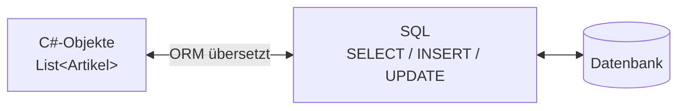
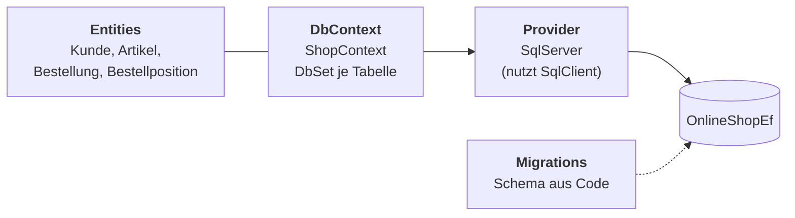
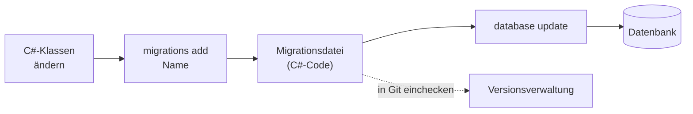
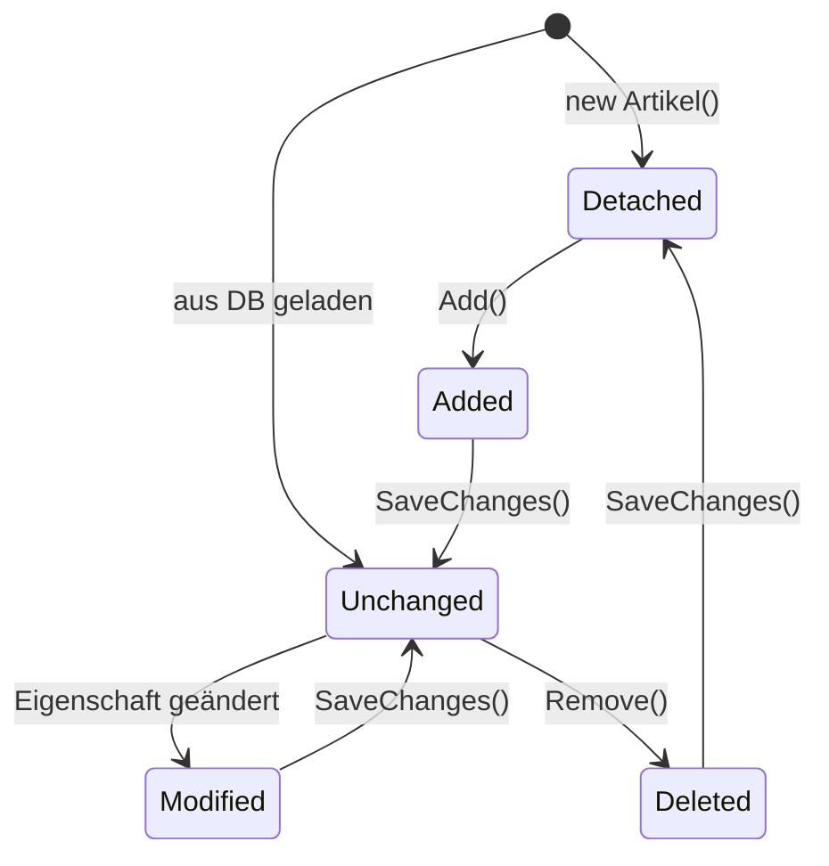

# ORM & EF Core

## *Der OnlineShop mit einem ORM*

---
hideInToc: true
---

# Inhalt

<Toc minDepth="1" maxDepth="1" />

---
layout: section
---

# Object-Relational Mapping

## Die Brücke zwischen Tabellen und Objekten

---
hideInToc: true
---

# Zwei Welten

<table class="text-sm">
<thead><tr><th>Datenbank (relational)</th><th>C# (objektorientiert)</th></tr></thead>
<tbody>
<tr v-click><td>Tabelle <code>Artikel</code></td><td>Klasse <code>Artikel</code></td></tr>
<tr v-click><td>Zeile</td><td>Objekt</td></tr>
<tr v-click><td>Spalte</td><td>Eigenschaft</td></tr>
<tr v-click><td>Fremdschlüssel <code>KundeId</code></td><td>Referenz <code>bestellung.Kunde</code></td></tr>
<tr v-click><td>1:n über JOIN</td><td>Liste <code>kunde.Bestellungen</code></td></tr>
<tr v-click><td><code>NVARCHAR(50)</code>, <code>DECIMAL(10,2)</code>, <code>NULL</code></td><td><code>string</code>, <code>decimal</code>, <code>null</code></td></tr>
<tr v-click><td>Identität über Primärschlüssel</td><td>Identität über Referenz im Speicher</td></tr>
</tbody>
</table>

<!--
Diese Unterschiede nennt man den **Object-Relational Impedance Mismatch**. Den Begriff nur nennen, nicht abprüfen. Im Foliensatz „Datenbanken in C#“ haben wir diese Lücke von Hand überbrückt.
-->

---
hideInToc: true
---

# Was ist ein ORM?

<div class="text-xl p-4 rounded bg-gray-100">
Ein <b>Object-Relational Mapper</b> ist eine Bibliothek, die Objekte automatisch in Tabellenzeilen übersetzt und umgekehrt.
</div>



<p class="text-center text-lg">„Du arbeitest mit Objekten, das ORM erzeugt das SQL.“</p>

<!--
Wichtig: Ein ORM ersetzt die Datenbank nicht, und es ersetzt auch das SQL-Wissen nicht. Es schreibt das SQL für uns, aber es bleibt SQL.
-->

---
hideInToc: true
---

# Was ein ORM übernimmt

<table class="text-sm">
<thead><tr><th>Problem mit ADO.NET</th><th>Das macht das ORM</th></tr></thead>
<tbody>
<tr v-click><td>Mapping von Hand</td><td><b>Mapping:</b> Spalten werden automatisch zu Eigenschaften</td></tr>
<tr v-click><td>SQL in Strings</td><td><b>Abfragen in C#</b> (LINQ), vom Compiler geprüft</td></tr>
<tr v-click><td>Selbst merken, was sich geändert hat</td><td><b>Change Tracking:</b> erkennt geänderte Objekte und erzeugt INSERT/UPDATE/DELETE</td></tr>
<tr v-click><td>Beziehungen zusammenbauen</td><td><b>Navigation:</b> <code>kunde.Bestellungen</code></td></tr>
<tr v-click><td>Tabellen per Skript anlegen</td><td><b>Migrations:</b> Datenbankschema aus dem C#-Code</td></tr>
</tbody>
</table>

---
hideInToc: true
---

# Vergleich ohne und mit ORM

Dieselbe Abfrage, „alle Artikel unter 20 €“:

<div style="--slidev-code-font-size: 0.64rem; --slidev-code-line-height: 1.35;">

````md magic-move
```csharp
// ohne ORM
await using var cmd = new SqlCommand(
    "SELECT Id, Bezeichnung, Preis, Lagerstand FROM Artikel WHERE Preis < @max", con);
cmd.Parameters.Add("@max", SqlDbType.Decimal).Value = 20m;
await using var reader = await cmd.ExecuteReaderAsync();

List<Artikel> liste = new List<Artikel>();
while (await reader.ReadAsync())
{
    liste.Add(new Artikel
    {
        Id          = reader.GetInt32(reader.GetOrdinal("Id")),
        Bezeichnung = reader.GetString(reader.GetOrdinal("Bezeichnung")),
        Preis       = reader.GetDecimal(reader.GetOrdinal("Preis")),
        Lagerstand  = reader.GetInt32(reader.GetOrdinal("Lagerstand"))
    });
}
```
```csharp
// mit ORM
List<Artikel> liste = await db.Artikel.Where(a => a.Preis < 20).ToListAsync();
```
````

</div>

---
hideInToc: true
---

# Entity Framework Core

<div class="efcore grid grid-cols-[2fr_3fr] gap-8">
<div>

- **Full ORM von Microsoft**, Open Source (MIT-Lizenz)
- Standard für neue .NET-Projekte
- Aktuelle Version: **EF Core 10** (LTS, passend zu .NET 10)
- Nachfolger von *Entity Framework 6*, daher das „Core“ im Namen
- Spricht über einen **Provider** mit der jeweiligen Datenbank: SQL Server, SQLite, PostgreSQL …
- Wird als **NuGet-Paket** ins Projekt eingebunden

</div>
<div>

| NuGet-Paket | Wozu |
|---|---|
| `Microsoft.EntityFrameworkCore` | Kern: DbContext, LINQ, Change Tracking |
| `Microsoft.EntityFrameworkCore.SqlServer` | Provider für SQL Server, bringt den Kern mit |
| `Microsoft.EntityFrameworkCore.Sqlite` | Provider für SQLite |
| `Npgsql.EntityFrameworkCore.PostgreSQL` | Provider für PostgreSQL |
| `Microsoft.EntityFrameworkCore.Design` | Werkzeuge für Migrationen |

<p class="text-xs opacity-70 !mt-2">Die Installation kommt gleich bei „Projekt vorbereiten“.</p>

</div>
</div>

<style>
.efcore li { font-size: 0.85rem; line-height: 1.5; }
.efcore table { font-size: 0.72rem; }
.efcore td, .efcore th { padding: 0.3rem 0.5rem; }
.efcore code { font-size: 0.68rem; }
</style>

<Merke>

Auch EF Core verwendet intern einen DataReader. ADO.NET war also keine Zeitverschwendung, sondern die Grundlage für alles Weitere.

</Merke>

<!--
- Im Unterricht verwenden wir nur den SQL-Server-Provider. Die anderen Provider zeigen: Der C#-Code bleibt gleich, nur das Paket und `UseSqlServer` ändern sich.
- Der SQL-Server-Provider verwendet intern `Microsoft.Data.SqlClient` aus ADO.NET.
-->

---
hideInToc: true
---

# Das Prinzip gibt es überall

<div class="grid grid-cols-4 gap-4 mt-6 text-center">
<div class="p-4 rounded border-t-4 border-orange-500 bg-gray-50"><b>Java</b><br>Hibernate / JPA</div>
<div class="p-4 rounded border-t-4 border-blue-500 bg-gray-50"><b>Python</b><br>SQLAlchemy, Django ORM</div>
<div class="p-4 rounded border-t-4 border-yellow-500 bg-gray-50"><b>JavaScript/TypeScript</b><br>Prisma, TypeORM</div>
<div class="p-4 rounded border-t-4 border-purple-500 bg-gray-50"><b>PHP</b><br>Eloquent (Laravel), Doctrine</div>
</div>

<Merke>

Wer die Konzepte von EF Core versteht, findet sich auch in diesen Frameworks schnell zurecht. Das ist relevant für Diplomarbeiten in anderen Sprachen.

</Merke>

---
hideInToc: true
---

# Vorteile von ORMs

<div class="text-sm">

<v-clicks>

- ✅ **Weniger Code:** kein Mapping, kein wiederholter Verbindungs-Code
- ✅ **Typsicherheit:** Der Compiler prüft Abfragen und Eigenschaftsnamen. Tippfehler fallen sofort auf.
- ✅ **Refactoring:** Eine Eigenschaft umbenennen ändert alle Abfragen mit.
- ✅ **Change Tracking:** `SaveChanges()` speichert alle Änderungen in einer Transaktion.
- ✅ **Beziehungen** als Objekte: `bestellung.Kunde.Ort`
- ✅ **Migrations:** Code und Datenbankschema bleiben synchron, versioniert in Git.
- ✅ **Sicherheit:** Parameter werden automatisch verwendet, SQL-Injection ist im Normalfall ausgeschlossen.
- ✅ **Datenbankunabhängigkeit:** Der Provider lässt sich tauschen (SQL Server, PostgreSQL, SQLite …).

</v-clicks>

</div>

---
hideInToc: true
---

# Nachteile und Risiken

<div class="text-sm">

<v-clicks>

- ⚠️ **Blackbox:** Man sieht das SQL nicht, ohne es bewusst einzuschalten.
- ⚠️ **Performance-Fallen:** Das N+1-Problem, zu viele geladene Daten, ineffizientes SQL. Kommt später in diesem Foliensatz.
- ⚠️ **Overhead:** etwas langsamer als handgeschriebenes SQL mit DataReader
- ⚠️ **Lernkurve:** viele neue Konzepte (Tracking, Loading-Strategien, Migrations)
- ⚠️ **Grenzen:** komplexe Berichte, Massenänderungen oder datenbankspezifische Features sind in SQL oft einfacher.
- ⚠️ **„Leaky Abstraction“:** Wenn es klemmt, muss man trotzdem SQL und die Datenbank verstehen.

</v-clicks>

</div>

<v-click>

<Merke>

Ein ORM ersetzt SQL-Wissen nicht, es setzt es voraus.

</Merke>

</v-click>

<!--
Darum haben wir mit ADO.NET begonnen. Wer nie gesehen hat, was ein ORM erzeugt, kann seine Probleme nicht lösen.
-->

---
layout: section
---

# Entity Framework Core einrichten

## Der OnlineShop mit einem ORM

---
hideInToc: true
---

# Die Bausteine



<div class="text-xs">

| Begriff | Bedeutung | aus ADO.NET bekannt als |
|---|---|---|
| Entity | Klasse, die einer Tabelle entspricht | `Artikel`-Klasse |
| DbContext | Sitzung mit der Datenbank, verwaltet Entities | Connection + Repository |
| DbSet&lt;T&gt; | Zugriff auf eine Tabelle | `FROM Artikel` |
| Provider | übersetzt für eine bestimmte Datenbank | `Microsoft.Data.SqlClient` |
| Migration | versionierte Schemaänderung | `setup.sql` |

</div>

<!--
Der Provider für SQL Server verwendet intern genau den `Microsoft.Data.SqlClient` aus ADO.NET.
-->

---
hideInToc: true
layout: two-cols
layoutClass: gap-8
---

# Code First oder Database First?

### Code First <span class="text-sm font-normal opacity-70">(machen wir)</span>

- Zuerst die C#-Klassen schreiben
- EF Core erzeugt per Migration die Datenbank
- Schemaänderungen laufen über neue Migrationen

::right::

<div class="mt-19">

### Database First

- Die Datenbank existiert schon
- EF Core erzeugt die Klassen daraus („Scaffolding“):

<div class="wrap-code" style="--slidev-code-font-size: 0.66rem;">

```bash
dotnet ef dbcontext scaffold "<ConnectionString>" Microsoft.EntityFrameworkCore.SqlServer -o Models
```

</div>

</div>

<style>
.wrap-code :deep(pre),
.wrap-code :deep(code),
.wrap-code :deep(.line) { white-space: pre-wrap !important; word-break: break-all; }
</style>

<!--
- Für neue Projekte und Diplomarbeiten ist Code First üblich.
- Database First ist praktisch, wenn man an eine bestehende Firmendatenbank andocken muss. Das kommt in der Betriebsinformatik oft vor.
- Wir legen eine **neue** Datenbank `OnlineShopEf` an, damit die Datenbank aus „Datenbanken in C#“ unberührt bleibt.
-->

---
hideInToc: true
---

# Projekt vorbereiten

```bash
dotnet new console -n OnlineShopEf
cd OnlineShopEf
dotnet add package Microsoft.EntityFrameworkCore.SqlServer
dotnet add package Microsoft.EntityFrameworkCore.Design
dotnet tool install --global dotnet-ef
```

| Paket | Wozu |
|---|---|
| `…EntityFrameworkCore.SqlServer` | EF Core samt Provider für SQL Server |
| `…EntityFrameworkCore.Design` | wird für Migrationen gebraucht |
| `dotnet-ef` | Kommandozeilenwerkzeug für Migrationen |

<!--
- Die Versionen von EF Core, `.Design` und `dotnet-ef` sollten zusammenpassen (alle 10.x).
- In Visual Studio gibt es alternativ die Paket-Manager-Konsole mit `Add-Migration` und `Update-Database`.
-->

---
hideInToc: true
---

# Die Entities

<div style="--slidev-code-font-size: 0.72rem; --slidev-code-line-height: 1.35;">

````md magic-move
```csharp
public class Kunde
{
    public int Id { get; set; }
    public string Vorname { get; set; } = "";
    public string Nachname { get; set; } = "";
    public string? Email { get; set; }
    public string Ort { get; set; } = "";
}

public class Bestellung
{
    public int Id { get; set; }
    public DateTime Datum { get; set; } = DateTime.Now;
    public int KundeId { get; set; }
}
```
```csharp
public class Kunde
{
    public int Id { get; set; }
    public string Vorname { get; set; } = "";
    public string Nachname { get; set; } = "";
    public string? Email { get; set; }
    public string Ort { get; set; } = "";
    public List<Bestellung> Bestellungen { get; set; } = new List<Bestellung>();
}

public class Bestellung
{
    public int Id { get; set; }
    public DateTime Datum { get; set; } = DateTime.Now;
    public int KundeId { get; set; }
    public Kunde Kunde { get; set; } = null!;
    public List<Bestellposition> Positionen { get; set; } = new List<Bestellposition>();
}
```
````

</div>

<p v-click class="text-sm mt-2">Neu: <b>Navigationseigenschaften</b> wie <code>Kunde</code>, <code>Bestellungen</code> und <code>Positionen</code></p>

<!--
- `KundeId` ist der Fremdschlüssel wie in der Tabelle, `Kunde` ist das Objekt dazu.
- `= null!` bedeutet: „Wird von EF Core befüllt, wenn man es lädt.“ Das beruhigt den Nullable-Compiler.
-->

---
hideInToc: true
---

# Die Entities (Fortsetzung)

<div style="--slidev-code-font-size: 0.7rem; --slidev-code-line-height: 1.35;">

```csharp
using Microsoft.EntityFrameworkCore;   // für [Precision]

public class Artikel
{
    public int Id { get; set; }
    public string Bezeichnung { get; set; } = "";
    [Precision(10, 2)] public decimal Preis { get; set; }
    public int Lagerstand { get; set; }
}

public class Bestellposition
{
    public int Id { get; set; }
    public int BestellungId { get; set; }
    public Bestellung Bestellung { get; set; } = null!;
    public int ArtikelId { get; set; }
    public Artikel Artikel { get; set; } = null!;
    public int Menge { get; set; }
    [Precision(10, 2)] public decimal Einzelpreis { get; set; }
}
```

</div>

<Achtung>

Ohne `[Precision]` legt EF Core `decimal(18,2)` an und gibt eine Warnung aus. Bei Geldbeträgen die Genauigkeit immer bewusst festlegen.

</Achtung>

<!--
Das ER-Diagramm von „Unser OnlineShop“ einblenden. Jede Linie im Diagramm ist jetzt eine Navigationseigenschaft.
-->

---
hideInToc: true
---

# Konventionen: was EF Core von selbst erkennt

<div class="text-sm">

| Im Code | erkennt EF Core als |
|---|---|
| Eigenschaft `Id` (oder `ArtikelId` in Klasse `Artikel`) | Primärschlüssel, bei `int` mit `IDENTITY` |
| `KundeId` + `Kunde Kunde` | Fremdschlüssel zur Tabelle Kunde |
| `List<Bestellung> Bestellungen` | 1:n-Beziehung |
| `string` (nicht nullable) | `nvarchar(max) NOT NULL` |
| `string?` | `nvarchar(max) NULL` |
| `DbSet<Kunde> Kunden` | Tabellenname `Kunden` |

</div>

<Merke>

Wo die Konventionen nicht passen, konfiguriert man selbst: mit **Attributen** (`[Precision]`, `[MaxLength]`, `[Required]`) oder mit der **Fluent API** in `OnModelCreating`.

</Merke>

<!--
Der Tabellenname ergibt sich aus dem Namen der DbSet-Eigenschaft. Darum heißt die Tabelle in der EF-Datenbank `Kunden`, nicht `Kunde` wie in `setup.sql`. Mit `.ToTable("Kunde")` ließe sich das ändern.
-->

---
hideInToc: true
---

# Der DbContext

<div style="--slidev-code-font-size: 0.68rem;">

```csharp {3|5-8|10-14|all}
using Microsoft.EntityFrameworkCore;

public class ShopContext : DbContext
{
    public DbSet<Kunde> Kunden { get; set; } = null!;
    public DbSet<Artikel> Artikel { get; set; } = null!;
    public DbSet<Bestellung> Bestellungen { get; set; } = null!;
    public DbSet<Bestellposition> Bestellpositionen { get; set; } = null!;

    protected override void OnConfiguring(DbContextOptionsBuilder options)
    {
        options.UseSqlServer(
            "Server=(localdb)\\MSSQLLocalDB;Database=OnlineShopEf;Integrated Security=true;TrustServerCertificate=true");
    }
}
```

</div>

<!--
- Der Context ist die „Sitzung“ mit der Datenbank. Wie bei einer Connection gilt: kurz verwenden, dann wegwerfen (`await using`).
- In ASP.NET Core wird der Context nicht selbst erzeugt, sondern per Dependency Injection bereitgestellt. Das ist ein Ausblick auf „EF Core in der Diplomarbeit“.
-->

---
hideInToc: true
---

# Fluent API (Alternative zu Attributen)

<div style="--slidev-code-font-size: 0.75rem;">

```csharp
protected override void OnModelCreating(ModelBuilder modelBuilder)
{
    modelBuilder.Entity<Artikel>(e =>
    {
        e.Property(a => a.Bezeichnung).HasMaxLength(100);
        e.Property(a => a.Preis).HasPrecision(10, 2);
    });

    modelBuilder.Entity<Kunde>(e =>
    {
        e.Property(k => k.Vorname).HasMaxLength(50);
        e.Property(k => k.Nachname).HasMaxLength(50);
        e.HasIndex(k => k.Email).IsUnique();
    });
}
```

</div>

<!--
Attribute sind kürzer, die Fluent API kann mehr (z. B. Indizes, zusammengesetzte Schlüssel). Beides ist korrekt, im Projekt sollte man sich auf einen Stil einigen.
-->

---
layout: section
---

# Migrations

## Datenbankschema aus dem C#-Code

---
hideInToc: true
---

# Migrations: Datenbank aus Code

```bash
dotnet ef migrations add Initial     # erzeugt Migrations/…_Initial.cs
dotnet ef database update            # führt sie auf der Datenbank aus
```



<!--
- EF Core legt zusätzlich die Tabelle `__EFMigrationsHistory` an. Darin steht, welche Migrationen schon ausgeführt wurden.
- In SSMS zeigen.
-->

---
hideInToc: true
---

# Was steht in einer Migration?

Ausschnitt aus der erzeugten Datei:

<div style="--slidev-code-font-size: 0.66rem; --slidev-code-line-height: 1.35;">

```csharp
migrationBuilder.CreateTable(
    name: "Artikel",
    columns: table => new
    {
        Id = table.Column<int>(type: "int", nullable: false)
            .Annotation("SqlServer:Identity", "1, 1"),
        Bezeichnung = table.Column<string>(type: "nvarchar(max)", nullable: false),
        Preis = table.Column<decimal>(type: "decimal(10,2)", precision: 10, scale: 2, nullable: false),
        Lagerstand = table.Column<int>(type: "int", nullable: false)
    },
    constraints: table =>
    {
        table.PrimaryKey("PK_Artikel", x => x.Id);
    });
```

</div>

<SqlBruecke>

Das ist ein `CREATE TABLE` in C#-Form. Mit `dotnet ef migrations script` sieht man das SQL dazu.

</SqlBruecke>

<!--
Auf `nvarchar(max)` hinweisen. Das ist zu großzügig und die Überleitung zur nächsten Folie.
(Ausschnitt mit EF Core 10.0.12 erzeugt und abgeglichen.)
-->

---
hideInToc: true
---

# Das Modell ändern

<div style="--slidev-code-font-size: 0.7rem;">

1. In `Artikel` ergänzen: `[MaxLength(100)] public string Bezeichnung { get; set; } = "";`
2. Migration erzeugen und ausführen:
   ```bash
   dotnet ef migrations add BezeichnungLaenge
   dotnet ef database update
   ```
3. Die neue Migration enthält nur die Änderung:
   ```csharp
   migrationBuilder.AlterColumn<string>(
       name: "Bezeichnung", table: "Artikel",
       type: "nvarchar(100)", maxLength: 100, nullable: false,
       oldClrType: typeof(string), oldType: "nvarchar(max)");
   ```

</div>

<Merke>

Niemals die Datenbank von Hand ändern, wenn man mit Migrationen arbeitet. Sonst passen Code und Datenbank nicht mehr zusammen.

</Merke>

<!--
`[MaxLength]` steht im Namespace `System.ComponentModel.DataAnnotations`.
-->

---
layout: section
---

# Daten lesen und schreiben

## Logging · CRUD · Change Tracking

---
hideInToc: true
---

# SQL sichtbar machen

```csharp
options.UseSqlServer(connStr)
       .LogTo(Console.WriteLine, LogLevel.Information);   // using Microsoft.Extensions.Logging;
```

oder für eine einzelne Abfrage:

```csharp
var abfrage = db.Artikel.Where(a => a.Preis < 20);
Console.WriteLine(abfrage.ToQueryString());
```

<Merke>

Ab jetzt ist das Logging im Unterricht **immer eingeschaltet**. Zu jeder LINQ-Abfrage schauen wir uns das SQL an.

</Merke>

<!--
Das ist die wichtigste Gewohnheit gegen die Blackbox (siehe „Nachteile und Risiken“).
-->

---
hideInToc: true
layout: two-cols
layoutClass: gap-8
---

# CRUD: Create

**EF Core**

<div style="--slidev-code-font-size: 0.62rem;">

```csharp
await using var db = new ShopContext();

var stick = new Artikel
{
    Bezeichnung = "USB-Stick 64 GB",
    Preis = 12.90m,
    Lagerstand = 50
};
db.Artikel.Add(stick);
await db.SaveChangesAsync();

Console.WriteLine($"Neue Id: {stick.Id}");
```

</div>

::right::

<div class="mt-19" style="--slidev-code-font-size: 0.62rem;">

**Erzeugtes SQL** <span class="text-sm opacity-70">(aus dem Log, vereinfacht)</span>

```sql
INSERT INTO [Artikel] ([Bezeichnung], [Lagerstand], [Preis])
OUTPUT INSERTED.[Id]
VALUES (@p0, @p1, @p2);
```

</div>

<!--
- Das SQL sieht fast genauso aus wie das auf „Die neue Id zurückbekommen“, inklusive `OUTPUT INSERTED.Id` und Parametern.
- `Add` allein schreibt noch nichts. Erst `SaveChangesAsync` geht zur Datenbank.
-->

---
hideInToc: true
---

<PraxisSlide block="1" title="Testdaten mit EF Core einfügen" time="30 min">

Die neue Datenbank `OnlineShopEf` ist nach der Migration **leer**. Füllt sie mit den Testdaten aus `setup.sql`, aber **ohne SQL**, nur mit EF Core.

- **5 Kunden**, **6 Artikel** und **4 Bestellungen** mit ihren Positionen (Werte siehe `setup.sql`)
- Kunden und Artikel in **derselben Reihenfolge** wie im Skript anlegen, dann stimmen die Ids
- Bestellungen über die **Navigationseigenschaften** aufbauen: `Kunde = anna` und `bestellung.Positionen.Add(…)`. Keine Ids von Hand!
- Ganz am Ende **ein einziges** `await db.SaveChangesAsync();`
- Danach in SSMS kontrollieren: Stimmen die Tabellen mit `setup.sql` überein?

<template #hinweis>

Prüft am Anfang mit `await db.Artikel.AnyAsync()`, ob schon Daten da sind. Sonst habt ihr nach dem zweiten Programmstart alles doppelt.

</template>

</PraxisSlide>

<!--
- Die folgenden Folien verwenden genau diese Daten (z. B. `FindAsync(2)` = Funkmaus, Kunde 1 = Anna). Darum muss die Aufgabe vor „CRUD: Read“ erledigt sein.
- Die Musterlösung wurde gegen LocalDB getestet: Die Ids entsprechen exakt `setup.sql`.
- Bewusst ohne den Begriff „Seeding“. Er kann später nachgereicht werden.
-->

---
hideInToc: true
---

# Lösung (1/3): Kunden

<div style="--slidev-code-font-size: 0.56rem; --slidev-code-line-height: 1.35;">

```csharp {1-7|9-13|15-19}
await using var db = new ShopContext();

if (await db.Artikel.AnyAsync())
{
    Console.WriteLine("Es sind schon Daten vorhanden.");
    return;
}

Kunde anna   = new Kunde { Vorname = "Anna",   Nachname = "Berger",  Email = "anna.berger@example.at",  Ort = "Wolfsberg" };
Kunde lukas  = new Kunde { Vorname = "Lukas",  Nachname = "Pichler", Email = null,                      Ort = "Wolfsberg" };
Kunde sophie = new Kunde { Vorname = "Sophie", Nachname = "Wallner", Email = "s.wallner@example.at",    Ort = "St. Andrä" };
Kunde tobias = new Kunde { Vorname = "Tobias", Nachname = "Krenn",   Email = "tobias.krenn@example.at", Ort = "Klagenfurt" };
Kunde lena   = new Kunde { Vorname = "Lena",   Nachname = "Fuchs",   Email = "lena.fuchs@example.at",   Ort = "Villach" };

db.Kunden.Add(anna);
db.Kunden.Add(lukas);
db.Kunden.Add(sophie);
db.Kunden.Add(tobias);
db.Kunden.Add(lena);
```

</div>

<!--
- `return` im Hauptprogramm beendet das Programm sofort.
- Die Kunden bekommen Variablen, weil wir sie gleich bei den Bestellungen brauchen.
-->

---
hideInToc: true
---

# Lösung (2/3): Artikel

<div style="--slidev-code-font-size: 0.6rem; --slidev-code-line-height: 1.35;">

```csharp
Artikel stick    = new Artikel { Bezeichnung = "USB-Stick 64 GB",      Preis = 12.90m,  Lagerstand = 50 };
Artikel maus     = new Artikel { Bezeichnung = "Funkmaus",             Preis = 24.90m,  Lagerstand = 30 };
Artikel tastatur = new Artikel { Bezeichnung = "Mechanische Tastatur", Preis = 89.00m,  Lagerstand = 12 };
Artikel monitor  = new Artikel { Bezeichnung = "27-Zoll-Monitor",      Preis = 229.00m, Lagerstand = 5 };
Artikel kabel    = new Artikel { Bezeichnung = "HDMI-Kabel 2 m",       Preis = 7.50m,   Lagerstand = 100 };
Artikel webcam   = new Artikel { Bezeichnung = "Webcam Full HD",       Preis = 49.90m,  Lagerstand = 0 };

db.Artikel.Add(stick);
db.Artikel.Add(maus);
db.Artikel.Add(tastatur);
db.Artikel.Add(monitor);
db.Artikel.Add(kabel);
db.Artikel.Add(webcam);
```

</div>

<Merke>

Kein `Id = …`: Die Id vergibt die Datenbank (`IDENTITY`). Nach `SaveChangesAsync()` steht sie automatisch im Objekt.

</Merke>

---
hideInToc: true
---

# Lösung (3/3): Bestellungen

<div style="--slidev-code-font-size: 0.56rem; --slidev-code-line-height: 1.3;">

```csharp {1-3|5-7|9-10|12-14|16-19|21-22}
Bestellung b1 = new Bestellung { Kunde = anna, Datum = new DateTime(2026, 9, 14) };
b1.Positionen.Add(new Bestellposition { Artikel = stick, Menge = 2, Einzelpreis = stick.Preis });
b1.Positionen.Add(new Bestellposition { Artikel = kabel, Menge = 1, Einzelpreis = kabel.Preis });

Bestellung b2 = new Bestellung { Kunde = anna, Datum = new DateTime(2026, 10, 2) };
b2.Positionen.Add(new Bestellposition { Artikel = monitor, Menge = 1, Einzelpreis = monitor.Preis });
b2.Positionen.Add(new Bestellposition { Artikel = maus,    Menge = 1, Einzelpreis = maus.Preis });

Bestellung b3 = new Bestellung { Kunde = sophie, Datum = new DateTime(2026, 10, 5) };
b3.Positionen.Add(new Bestellposition { Artikel = tastatur, Menge = 1, Einzelpreis = tastatur.Preis });

Bestellung b4 = new Bestellung { Kunde = tobias, Datum = new DateTime(2026, 10, 6) };
b4.Positionen.Add(new Bestellposition { Artikel = stick, Menge = 5, Einzelpreis = stick.Preis });
b4.Positionen.Add(new Bestellposition { Artikel = kabel, Menge = 3, Einzelpreis = kabel.Preis });

db.Bestellungen.Add(b1);
db.Bestellungen.Add(b2);
db.Bestellungen.Add(b3);
db.Bestellungen.Add(b4);

await db.SaveChangesAsync();
Console.WriteLine("Testdaten eingefügt.");
```

</div>

<!--
- Keine einzige Id von Hand: `KundeId`, `BestellungId` und `ArtikelId` setzt EF Core beim Speichern über die Navigationseigenschaften.
- Die Positionen müssen nicht extra mit `db.Bestellpositionen.Add` hinzugefügt werden. EF Core findet sie über `b1.Positionen`.
- Im Log zeigen: EF Core fügt zuerst Kunden und Artikel ein, dann Bestellungen, dann Positionen. Die Reihenfolge ergibt sich aus den Fremdschlüsseln.
-->

---
hideInToc: true
---

# CRUD: Read

```csharp {1-4|6|8-9|all}
List<Artikel> guenstige = await db.Artikel
    .Where(a => a.Preis < 20)
    .OrderBy(a => a.Bezeichnung)
    .ToListAsync();

Artikel? artikel = await db.Artikel.FindAsync(3);          // nach Primärschlüssel

Kunde? anna = await db.Kunden
    .FirstOrDefaultAsync(k => k.Email == "anna.berger@example.at");
```

<SqlBruecke title="🔁 Kennst du aus LINQ">

Exakt dieselben LINQ-Methoden. Neu ist nur `Async` am Ende, weil die Datenbank gefragt wird.

</SqlBruecke>

<!--
`FindAsync` schaut zuerst, ob das Objekt schon im Context geladen ist. Nur wenn nicht, fragt es die Datenbank.
-->

---
hideInToc: true
layout: two-cols
layoutClass: gap-8
---

# CRUD: Update und Delete

**Update**

<div style="--slidev-code-font-size: 0.6rem;">

```csharp
var maus = await db.Artikel.FindAsync(2);
if (maus is not null)
{
    maus.Preis = 19.90m;          // nur das Objekt ändern
    await db.SaveChangesAsync();  // EF erkennt die Änderung
}
```

```sql
UPDATE [Artikel] SET [Preis] = @p0
WHERE [Id] = @p1;
```

</div>

::right::

<div class="mt-19" style="--slidev-code-font-size: 0.6rem;">

**Delete**

```csharp
var webcam = await db.Artikel.FindAsync(6);
if (webcam is not null)
{
    db.Artikel.Remove(webcam);
    await db.SaveChangesAsync();
}
```

</div>

<!--
- Beim Update kein SQL, kein Parameter, kein „welche Spalte?“. EF Core schreibt nur die geänderte Spalte. Wie macht es das? Das zeigt die nächste Folie.
- Delete eines Artikels mit Bestellpositionen scheitert wie bei ADO.NET am Fremdschlüssel. Es kommt eine `DbUpdateException`, darin steckt die `SqlException`.
-->

---
hideInToc: true
---

# Change Tracking

<div class="grid grid-cols-[3fr_2fr] gap-6 items-start">
<div>



</div>
<div style="--slidev-code-font-size: 0.66rem;">

```csharp
var a = await db.Artikel.FindAsync(1);
Console.WriteLine(db.Entry(a!).State);   // Unchanged
a!.Preis += 1;
Console.WriteLine(db.Entry(a).State);    // Modified
```

<Merke>

Der Context merkt sich beim Laden eine Kopie der Werte (Snapshot). `SaveChanges()` vergleicht und schreibt nur die Unterschiede, und zwar alle in **einer Transaktion**.

</Merke>

</div>
</div>

<!--
`db.ChangeTracker.DebugView.LongView` zeigt alle verfolgten Objekte samt Zustand. Das eignet sich gut zum Live-Vorführen.
-->

---
hideInToc: true
---

# Nur lesen? AsNoTracking

```csharp
var preisliste = await db.Artikel
    .AsNoTracking()               // keine Snapshots, schneller, weniger Speicher
    .OrderBy(a => a.Bezeichnung)
    .ToListAsync();
```

<Merke>

Für reine Anzeigen (Listen, Berichte) `AsNoTracking()` verwenden. Änderungen an diesen Objekten speichert `SaveChanges()` **nicht**.

</Merke>

---
hideInToc: true
---

# Die Bestellung mit EF Core

<div class="grid grid-cols-[1fr_3fr] gap-4" style="--slidev-code-font-size: 0.56rem; --slidev-code-line-height: 1.3;">
<div>

```csharp
public class Position
{
    public int ArtikelId { get; set; }
    public int Menge { get; set; }
}
```

</div>
<div>

```csharp {all|3-5|7-17|19-21}
static async Task<int> BestellungAufgebenAsync(ShopContext db, int kundeId, List<Position> positionen)
{
    Kunde kunde = await db.Kunden.FindAsync(kundeId)
                  ?? throw new InvalidOperationException("Kunde nicht gefunden.");
    Bestellung bestellung = new Bestellung { Kunde = kunde };

    foreach (Position pos in positionen)
    {
        Artikel artikel = await db.Artikel.FindAsync(pos.ArtikelId)
                          ?? throw new InvalidOperationException($"Artikel {pos.ArtikelId} nicht gefunden.");
        if (artikel.Lagerstand < pos.Menge)
            throw new InvalidOperationException($"{artikel.Bezeichnung} ist nicht lagernd.");

        artikel.Lagerstand -= pos.Menge;
        bestellung.Positionen.Add(new Bestellposition
            { Artikel = artikel, Menge = pos.Menge, Einzelpreis = artikel.Preis });
    }

    db.Bestellungen.Add(bestellung);
    await db.SaveChangesAsync();      // alles in EINER Transaktion
    return bestellung.Id;
}
```

</div>
</div>

<!--
- Mit ADO.NET bräuchte man dafür eine eigene Transaktion (`BeginTransaction`, `Commit`, `Rollback`) und müsste die Ids von Hand weitergeben. Hier übernimmt `SaveChanges` das. Wird vorher eine Exception geworfen, kommt **nichts** in die Datenbank.
- Im Log zeigen: ein INSERT für die Bestellung, INSERTs für die Positionen, UPDATEs für die Artikel. EF Core setzt `BestellungId` automatisch.
- Für Fortgeschrittene: Bestellen zwei Benutzer gleichzeitig, kann der Lagerstand trotzdem falsch werden. Dagegen helfen Concurrency Tokens (`[Timestamp]`). Nur erwähnen.
-->

---
layout: section
---

# Beziehungen und Auswertungen

## Include · N+1 · Projektion · GroupBy

---
hideInToc: true
---

# Beziehungen laden: Include

```csharp {1-2|3|4|5|6|all}
var anna = await db.Kunden
    .Include(k => k.Bestellungen)
        .ThenInclude(b => b.Positionen)
            .ThenInclude(p => p.Artikel)
    .AsNoTracking()
    .FirstAsync(k => k.Id == 1);

foreach (var b in anna.Bestellungen)
    Console.WriteLine($"{b.Datum:d}: {b.Positionen.Count} Positionen");
```

<Achtung>

Ohne `Include` ist `anna.Bestellungen` einfach **leer**, ohne Fehlermeldung. EF Core lädt Beziehungen nicht automatisch.

</Achtung>

<!--
Im Log zeigen: Aus `Include` werden JOINs. Genau die JOINs, die die Schüler in SQL selbst schreiben würden.
-->

---
hideInToc: true
---

# Das N+1-Problem

<div style="--slidev-code-font-size: 0.68rem;">

**So nicht** ❌

```csharp
var bestellungen = await db.Bestellungen.ToListAsync();   // 1 Abfrage
foreach (var b in bestellungen)
{
    await db.Entry(b).Collection(x => x.Positionen).LoadAsync();  // + 1 Abfrage PRO Bestellung
    Console.WriteLine($"{b.Id}: {b.Positionen.Sum(p => p.Menge * p.Einzelpreis):C}");
}
```

**So** ✅

```csharp
var bestellungen = await db.Bestellungen
    .Include(b => b.Positionen)                             // 1 Abfrage mit JOIN
    .ToListAsync();
```

</div>

<div v-click class="mt-4 p-3 rounded bg-red-50 border-l-4 border-red-500 text-lg font-bold text-center">
4 Bestellungen ergeben 5 Abfragen. 10.000 Bestellungen ergeben 10.001 Abfragen.
</div>

<!--
Im Log die Abfragen zählen lassen. Das ist der häufigste Performance-Fehler mit ORMs, und ohne Logging bemerkt man ihn nicht. Dieselbe Falle gibt es bei Lazy Loading. In EF Core ist Lazy Loading standardmäßig aus, und das ist gut so.
-->

---
hideInToc: true
---

# Projektion: genau die Daten, die man braucht

Die Bestellübersicht aus „Datenbanken in C#“, jetzt mit EF Core:

<div style="--slidev-code-font-size: 0.64rem; --slidev-code-line-height: 1.35;">

```csharp
// BestellUebersicht: dieselbe DTO-Klasse wie bei ADO.NET
List<BestellUebersicht> uebersicht = await db.Bestellungen
    .Where(b => b.KundeId == 1)
    .OrderByDescending(b => b.Datum)
    .Select(b => new BestellUebersicht
    {
        BestellungId = b.Id,
        Datum        = b.Datum,
        Kunde        = b.Kunde.Vorname + " " + b.Kunde.Nachname,
        Summe        = b.Positionen.Sum(p => p.Menge * p.Einzelpreis)
    })
    .ToListAsync();
```

</div>

<Merke>

Mit `Select` holt EF Core nur die benötigten Spalten. Ein `Include` ist dabei nicht nötig, weil Navigationen im `Select` automatisch zu JOINs bzw. Unterabfragen werden.

</Merke>

<!--
Das erzeugte SQL neben das handgeschriebene von „JOINs: Ergebnisse, die zu keiner Tabelle passen“ legen. EF Core verwendet für die Summe eventuell eine Unterabfrage statt `GROUP BY`. Das Ergebnis ist gleich.
-->

---
hideInToc: true
---

# Auswertungen mit GroupBy

Umsatz pro Ort, eine typische Frage aus der Betriebsinformatik:

```csharp
var umsatzProOrt = await db.Bestellpositionen
    .GroupBy(p => p.Bestellung.Kunde.Ort)
    .Select(g => new
    {
        Ort = g.Key,
        Umsatz = g.Sum(p => p.Menge * p.Einzelpreis)
    })
    .OrderByDescending(x => x.Umsatz)
    .ToListAsync();
```

<SqlBruecke>

`SELECT k.Ort, SUM(p.Menge * p.Einzelpreis) … JOIN … GROUP BY k.Ort ORDER BY 2 DESC`

</SqlBruecke>

<!--
Das SQL im Log zeigen. EF Core erzeugt die JOINs über die Navigationen selbst.
-->

---
hideInToc: true
---

# Vorsicht: Wo wird gerechnet?

<div class="grid grid-cols-[auto_1fr] gap-x-4 gap-y-1 items-center" style="--slidev-code-font-size: 0.72rem;">

<div class="font-bold">Falsch ❌</div>

```csharp
var teure = (await db.Artikel.ToListAsync())   // ALLE Artikel laden
    .Where(a => a.Preis > 100)                 // dann im Speicher filtern
    .ToList();
```

<div class="font-bold">Richtig ✅</div>

```csharp
var teure = await db.Artikel
    .Where(a => a.Preis > 100)                 // WHERE in SQL
    .ToListAsync();
```

</div>

<Merke>

Alles vor `ToListAsync()` wird zu SQL, alles danach läuft in C#. Darum `ToListAsync()` so spät wie möglich aufrufen. Das ist die verzögerte Ausführung aus dem Foliensatz LINQ.

</Merke>

<!--
Methoden, die EF Core nicht übersetzen kann (z. B. eine eigene `IstGuenstig(a)`), führen zu einer Exception „could not be translated“. Das ist gewollt, denn sonst würde heimlich alles geladen.
-->

---
hideInToc: true
---

# Wenn LINQ nicht reicht: SQL in EF Core

<div style="--slidev-code-font-size: 0.72rem;">

```csharp
// eigenes SQL, Ergebnis als Entities – {ort} wird automatisch ein Parameter
string ort = "Wolfsberg";
var kunden = await db.Kunden
    .FromSql($"SELECT * FROM Kunden WHERE Ort = {ort}")
    .ToListAsync();

// Massenänderung ohne Laden: ein einziges UPDATE
await db.Artikel
    .Where(a => a.Lagerstand == 0)
    .ExecuteUpdateAsync(s => s.SetProperty(a => a.Preis, a => a.Preis * 0.9m));
```

</div>

<Achtung>

`FromSqlRaw("… WHERE Ort = '" + ort + "'")` ist wieder SQL-Injection wie bei ADO.NET. `FromSql` mit `$"…"` ist sicher, weil EF Core die Platzhalter in Parameter umwandelt.

</Achtung>

<!--
- `ExecuteUpdateAsync` und `ExecuteDeleteAsync` umgehen das Change Tracking. Sie sind schnell, aber geladene Objekte im Context erfahren nichts davon.
- (Beispiel mit EF Core 10.0.12 kompiliert.)
-->


---
layout: section
---

# Ausblick und Zusammenfassung

## EF Core in der Praxis

---
hideInToc: true
---

# Ausblick: EF Core in der Diplomarbeit

In **ASP.NET Core** (Web-API, Blazor) wird der Context registriert und automatisch übergeben:

<div style="--slidev-code-font-size: 0.6rem; --slidev-code-line-height: 1.3;">

```csharp
// Program.cs
builder.Services.AddDbContext<ShopContext>(o =>
    o.UseSqlServer(builder.Configuration.GetConnectionString("Shop")));

// in einem Controller oder Service
public class ArtikelService
{
    private readonly ShopContext db;

    public ArtikelService(ShopContext db)
    {
        this.db = db;
    }

    public Task<List<Artikel>> AlleAsync()
    {
        return db.Artikel.AsNoTracking().ToListAsync();
    }
}
```

</div>

- Connection-String in `appsettings.json`, Passwörter in **User Secrets**
- Andere Datenbank? Provider tauschen: `UseNpgsql` (PostgreSQL), `UseSqlite` …

<!--
- Für `AddDbContext` braucht `ShopContext` einen Konstruktor mit `DbContextOptions<ShopContext>`, statt `OnConfiguring` zu verwenden. Nur erwähnen.
- Das ist das Muster, das in fast jeder .NET-Diplomarbeit vorkommt.
-->

---
hideInToc: true
---

# Vergleich: ADO.NET und EF Core

Dieselbe Aufgabe im OnlineShop:

<div class="text-sm">

| Aufgabe | Command + DataReader | EF Core |
|---|---|---|
| Alle Artikel lesen | ca. 20 Zeilen | 1 Zeile |
| Artikel anlegen, Id zurück | ca. 10 Zeilen | 3 Zeilen |
| Preis ändern | SQL + 2 Parameter | Eigenschaft setzen + `SaveChanges` |
| SQL-Kontrolle | vollständig | über Logging, `FromSql` bei Bedarf |
| Geschwindigkeit | am schnellsten | etwas Overhead |

</div>

<!--
Keine Technik ist „besser“, sie haben unterschiedliche Stärken.
-->

---
hideInToc: true
---

# Zusammenfassung

<div class="grid grid-cols-3 gap-6 mt-6 text-sm">
<div class="p-4 rounded border-t-4 border-blue-500 bg-gray-50">

### ADO.NET

- Connection, Command, DataReader
- Scalar, NonQuery, Reader
- Immer Parameter

</div>
<div class="p-4 rounded border-t-4 border-purple-500 bg-gray-50">

### ORM

- übersetzt zwischen Objekten und Tabellen
- ersetzt SQL-Wissen nicht

</div>
<div class="p-4 rounded border-t-4 border-green-500 bg-gray-50">

### EF Core

- Entities, DbContext, Migrations
- LINQ wird zu SQL
- `SaveChanges` mit Change Tracking
- SQL immer im Blick (Logging)

</div>
</div>

---
hideInToc: true
---

# Quellen und Weiterlesen

- Microsoft Learn: ADO.NET mit SqlClient – <https://learn.microsoft.com/sql/connect/ado-net/>
- Microsoft Learn: EF Core Überblick – <https://learn.microsoft.com/ef/core/>
- Microsoft Learn: LINQ – <https://learn.microsoft.com/dotnet/csharp/linq/>
- OWASP: SQL Injection – <https://owasp.org/www-community/attacks/SQL_Injection>

